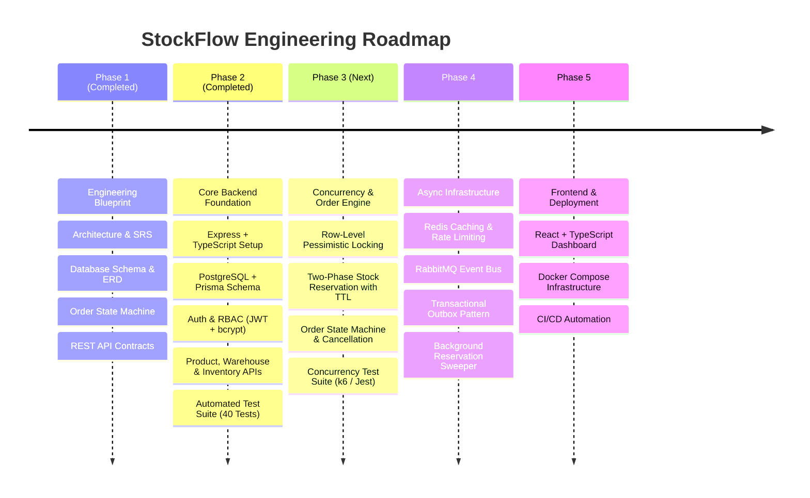

# StockFlow — Distributed Inventory & Order Management System

[](#)
[](#)
[](#)
[](#)
[](#)

---

## 1. Project Overview

**StockFlow** is an enterprise-grade, distributed inventory and order management platform engineered to solve core e-commerce fulfillment challenges:
- **Zero Overselling:** Mathematically prevents overselling under extreme flash-sale concurrency using row-level database locking and strict ACID transaction boundaries.
- **Multi-Warehouse Topology:** Manages independent stock allocations per warehouse, per SKU.
- **Two-Phase Inventory Allocation:** Holds stock temporarily during checkout via an expiring reservation engine (TTL-bound) and commits physical stock deduction only upon verified payment.
- **Strict Idempotency:** Eliminates duplicate orders, multi-billing, and orphan reservations caused by network drops or client retries.
- **Deterministic State Machine:** Governs the entire order lifecycle with automatic compensation workflows (automatic stock release on payment failure or timeout).
- **Immutable Audit Ledger:** Tracks every stock modification in an append-only inventory ledger for financial reconciliation.

---

## 2. Phase 1 Documentation Index

All engineering blueprints from Phase 1 are maintained in the [`docs/`](file:///Users/sankalp/Desktop/SDE_PRO_1/docs) directory:

| Document | Description |
| :--- | :--- |
| **[SRS.md](file:///Users/sankalp/Desktop/SDE_PRO_1/docs/SRS.md)** | **Software Requirements Specification:** Problem statement, target personas, functional & non-functional requirements, constraints, and business requirement analyses. |
| **[ARCHITECTURE.md](file:///Users/sankalp/Desktop/SDE_PRO_1/docs/ARCHITECTURE.md)** | **System Architecture & Technical Design:** Modular monolithic architecture, module boundaries, request-response lifecycle, Mermaid component diagrams, ADRs, and folder structure. |
| **[DATABASE_DESIGN.md](file:///Users/sankalp/Desktop/SDE_PRO_1/docs/DATABASE_DESIGN.md)** | **Database Design & Schema:** Normalized 3NF PostgreSQL schema, full table schemas, data types, constraints, partial indexes, and Mermaid ER diagram. |
| **[ORDER_LIFECYCLE.md](file:///Users/sankalp/Desktop/SDE_PRO_1/docs/ORDER_LIFECYCLE.md)** | **Order Lifecycle State Machine:** Finite-state machine definitions, valid transitions matrix, invalid transitions, inventory side effects, and compensation/rollback workflows. |
| **[API_SPECIFICATION.md](file:///Users/sankalp/Desktop/SDE_PRO_1/docs/API_SPECIFICATION.md)** | **REST API Contracts:** Standard API envelopes, endpoint contracts for Auth, Products, Warehouses, Inventory, Orders, and Payments. |

---

## 3. Technology Stack & Evolution Roadmap



---

## 4. Phase 2 Implemented Features & Endpoints

### 4.1 Implemented Modules
- **Authentication & User Management:** User registration, password hashing (`bcrypt`), JWT token generation, role-based access control (`CUSTOMER`, `WAREHOUSE_STAFF`, `ADMIN`), and current user profile inspection.
- **Product Management:** Product catalog creation, listing with pagination & search, individual SKU detail lookup, and product updates with duplicate SKU prevention.
- **Warehouse Management:** Distribution facility creation, unique warehouse code enforcement, active status tracking, and warehouse listing & detail retrieval.
- **Inventory Management:** Atomic stock replenishment using PostgreSQL transactions, double-entry tracking (`quantityOnHand`, `quantityReserved`, dynamic `quantityAvailable`), duplicate record prevention via composite unique keys, and immutable `inventory_movements` audit logging.

### 4.2 API Endpoints Matrix

| Module | Method | Endpoint | Access Control | Purpose |
| :--- | :--- | :--- | :--- | :--- |
| **Health** | `GET` | `/health` & `/api/v1/health` | Public | Service health & uptime probe |
| **Auth** | `POST` | `/api/v1/auth/register` | Public | Register new user account |
| **Auth** | `POST` | `/api/v1/auth/login` | Public | Authenticate user & issue JWT |
| **Auth** | `GET` | `/api/v1/auth/me` | Authenticated | Retrieve current user profile |
| **Products**| `POST` | `/api/v1/products` | Admin | Create product SKU |
| **Products**| `GET` | `/api/v1/products` | Public | List products (paginated) |
| **Products**| `GET` | `/api/v1/products/:id` | Public | Get product details by ID |
| **Products**| `PUT / PATCH` | `/api/v1/products/:id` | Admin | Update product details |
| **Warehouses**| `POST` | `/api/v1/warehouses` | Admin | Register physical warehouse |
| **Warehouses**| `GET` | `/api/v1/warehouses` | Public | List all active warehouses |
| **Warehouses**| `GET` | `/api/v1/warehouses/:id`| Public | Get warehouse details by ID |
| **Inventory**| `POST` | `/api/v1/inventory/restock` & `/stock` | Staff / Admin | Atomically add stock & log movement |
| **Inventory**| `GET` | `/api/v1/inventory` | Public | Global inventory / product breakdown |
| **Inventory**| `GET` | `/api/v1/inventory/warehouse/:id` & `/:id` | Public | List stock at specific warehouse |

---

## 5. Development & Testing Setup

### Prerequisites
- Node.js (>= v20.x, tested on v26.4.0)
- PostgreSQL (>= 15.x)
- npm (>= 10.x)

### Environment Configuration
Copy `.env.example` to `.env` and configure your database credentials:
```bash
cp .env.example .env
```

### Database Migration
```bash
npm run prisma:generate
npx prisma migrate dev
```

### Running Tests
Execute the comprehensive automated test suite (Unit & Supertest Integration):
```bash
npm test
```

### Running the Application
```bash
# Development (with hot reloading)
npm run dev

# Production Build
npm run build
npm start
```

---

## 6. Next Steps for Phase 3

Phase 2 establishes the core operational baseline with 100% test pass rate across 40 test cases.

**Phase 3** will implement the **Concurrency & Order Processing Engine**:
1. Implement `Order` and `OrderItem` domain entities.
2. Build the Two-Phase Inventory Reservation Engine (`quantityReserved` management).
3. Implement PostgreSQL Row-Level Pessimistic Locking (`SELECT ... FOR UPDATE`) sorted by `product_id ASC` to eliminate deadlocks and race conditions.
4. Enforce idempotency key handling across order creation.
5. Implement order cancellation and automatic inventory rollback compensation workflows.
6. Write concurrency stress tests simulating simultaneous checkout requests competing for the same SKU.
