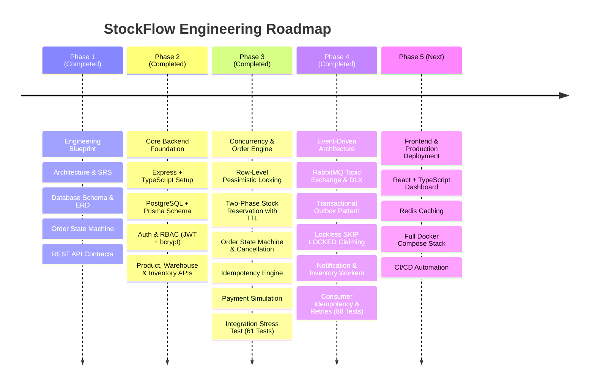

# StockFlow — Distributed Inventory & Order Management System

[](#)
[](#)
[](#)
[](#)
[](#)

---

## 1. Project Overview

**StockFlow** is an enterprise-grade, distributed inventory and order management platform engineered to solve core e-commerce fulfillment challenges:
- **Zero Overselling:** Mathematically prevents overselling under extreme flash-sale concurrency using row-level database locking and strict ACID transaction boundaries.
- **Multi-Warehouse Topology:** Manages independent stock allocations per warehouse, per SKU.
- **Two-Phase Inventory Allocation:** Holds stock temporarily during checkout via an expiring reservation engine (TTL-bound) and commits physical stock deduction only upon verified payment.
- **Strict Idempotency:** Eliminates duplicate orders, multi-billing, and orphan reservations caused by network drops or client retries.
- **Deterministic State Machine:** Governs the entire order lifecycle with automatic compensation workflows (automatic stock release on payment failure or timeout).
- **Immutable Audit Ledger:** Tracks every stock modification in an append-only inventory ledger for financial reconciliation.

---

## 2. Documentation Index

All engineering blueprints and architecture documentation are maintained in the [`docs/`](file:///Users/sankalp/Desktop/SDE_PRO_1/docs) directory:

| Document | Description |
| :--- | :--- |
| **[SRS.md](file:///Users/sankalp/Desktop/SDE_PRO_1/docs/SRS.md)** | **Software Requirements Specification:** Problem statement, target personas, functional & non-functional requirements, constraints, and business requirement analyses. |
| **[ARCHITECTURE.md](file:///Users/sankalp/Desktop/SDE_PRO_1/docs/ARCHITECTURE.md)** | **System Architecture & Technical Design:** Modular monolithic architecture, module boundaries, request-response lifecycle, Mermaid component diagrams, ADRs, and detailed Phase 3 concurrency implementation guide. |
| **[DATABASE_DESIGN.md](file:///Users/sankalp/Desktop/SDE_PRO_1/docs/DATABASE_DESIGN.md)** | **Database Design & Schema:** Normalized 3NF PostgreSQL schema, full table schemas, data types, constraints, partial indexes, and Mermaid ER diagram. |
| **[ORDER_LIFECYCLE.md](file:///Users/sankalp/Desktop/SDE_PRO_1/docs/ORDER_LIFECYCLE.md)** | **Order Lifecycle State Machine:** Finite-state machine definitions, valid transitions matrix, invalid transitions, inventory side effects, and compensation/rollback workflows. |
| **[API_SPECIFICATION.md](file:///Users/sankalp/Desktop/SDE_PRO_1/docs/API_SPECIFICATION.md)** | **REST API Contracts:** Standard API envelopes, endpoint contracts for Auth, Products, Warehouses, Inventory, Orders, and Payments. |
| **[EVENT_DRIVEN_ARCHITECTURE.md](file:///Users/sankalp/Desktop/SDE_PRO_1/docs/EVENT_DRIVEN_ARCHITECTURE.md)** | **Event-Driven Architecture:** Domain event specifications, message envelope schema, asynchronous decoupled workflows, consumer idempotency, and failure recovery. |
| **[OUTBOX_PATTERN.md](file:///Users/sankalp/Desktop/SDE_PRO_1/docs/OUTBOX_PATTERN.md)** | **Transactional Outbox Engine:** Dual-write problem analysis, atomic PostgreSQL transactions, lockless claiming via `FOR UPDATE SKIP LOCKED`, and publisher confirms. |
| **[RABBITMQ_CONFIGURATION.md](file:///Users/sankalp/Desktop/SDE_PRO_1/docs/RABBITMQ_CONFIGURATION.md)** | **RabbitMQ Topology & Infrastructure:** Durable topic exchanges, dead-letter routing (DLX/DLQ), bounded retries, and Docker Compose orchestration. |

---

## 3. Technology Stack & Evolution Roadmap



---

## 4. Implemented API Endpoints Matrix

| Module | Method | Endpoint | Access Control | Purpose |
| :--- | :--- | :--- | :--- | :--- |
| **Health** | `GET` | `/health` & `/api/v1/health` | Public | Service health & uptime probe |
| **Auth** | `POST` | `/api/v1/auth/register` | Public | Register new user account |
| **Auth** | `POST` | `/api/v1/auth/login` | Public | Authenticate user & issue JWT |
| **Auth** | `GET` | `/api/v1/auth/me` | Authenticated | Retrieve current user profile |
| **Products**| `POST` | `/api/v1/products` | Admin | Create product SKU |
| **Products**| `GET` | `/api/v1/products` | Public | List products (paginated) |
| **Products**| `GET` | `/api/v1/products/:id` | Public | Get product details by ID |
| **Products**| `PUT / PATCH` | `/api/v1/products/:id` | Admin | Update product details |
| **Warehouses**| `POST` | `/api/v1/warehouses` | Admin | Register physical warehouse |
| **Warehouses**| `GET` | `/api/v1/warehouses` | Public | List all active warehouses |
| **Warehouses**| `GET` | `/api/v1/warehouses/:id`| Public | Get warehouse details by ID |
| **Inventory**| `POST` | `/api/v1/inventory/restock` & `/stock` | Staff / Admin | Atomically add stock & log movement |
| **Inventory**| `GET` | `/api/v1/inventory` | Public | Global inventory / product breakdown |
| **Inventory**| `GET` | `/api/v1/inventory/warehouse/:id` & `/:id` | Public | List stock at specific warehouse |
| **Inventory**| `POST` | `/api/v1/inventory/expire-reservations` | Staff / Admin | Trigger sweeper for expired stock holds |
| **Orders** | `POST` | `/api/v1/orders` | Customer / Admin | Place order with row lock & stock reservation |
| **Orders** | `GET` | `/api/v1/orders` | Authenticated | List customer orders (or all for Admin) |
| **Orders** | `GET` | `/api/v1/orders/my-orders` | Customer | List authenticated customer's orders |
| **Orders** | `GET` | `/api/v1/orders/:id` | Authenticated | Get full order details & reservations |
| **Orders** | `POST` | `/api/v1/orders/:id/cancel` | Authenticated | Cancel order & release held/committed stock |
| **Payments**| `POST` | `/api/v1/payments/process` | Authenticated | Simulate payment outcome (commit/release stock) |

---

## 5. Development & Testing Setup

### Prerequisites
- Node.js (>= v20.x, tested on v26.4.0)
- PostgreSQL (>= 15.x, Neon supported via pooled & direct connections)
- npm (>= 10.x)

### Running Tests
Execute the comprehensive automated test suite (Unit, Integration & Concurrency Stress Test):
```bash
npm test
```

### Running the Application
```bash
# Development (with hot reloading)
npm run dev

# Production Build
npm run build
npm start
```

---

## 6. Next Steps for Phase 4

Phase 3 establishes the concurrency control baseline with 100% test pass rate across 61 test cases, proving zero overselling under extreme simultaneous load.

**Phase 4** will implement **Asynchronous Infrastructure & Background Processing**:
1. Integrate **Redis** for distributed caching of product catalog and inventory availability reads.
2. Implement Redis token-bucket rate limiting to protect order checkout endpoints from bot traffic.
3. Integrate **RabbitMQ** event broker with the **Transactional Outbox Pattern** for decoupled domain event dispatching.
4. Convert the reservation expiration sweeper into an autonomous recurring background worker.
