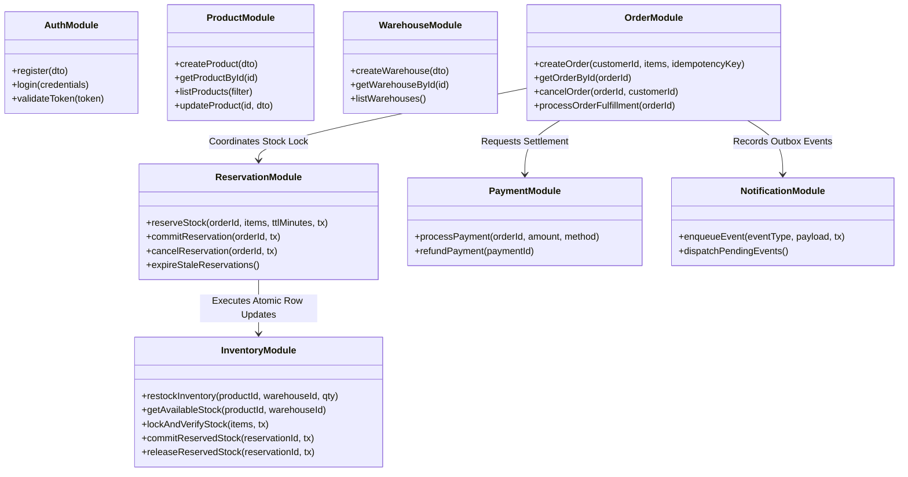
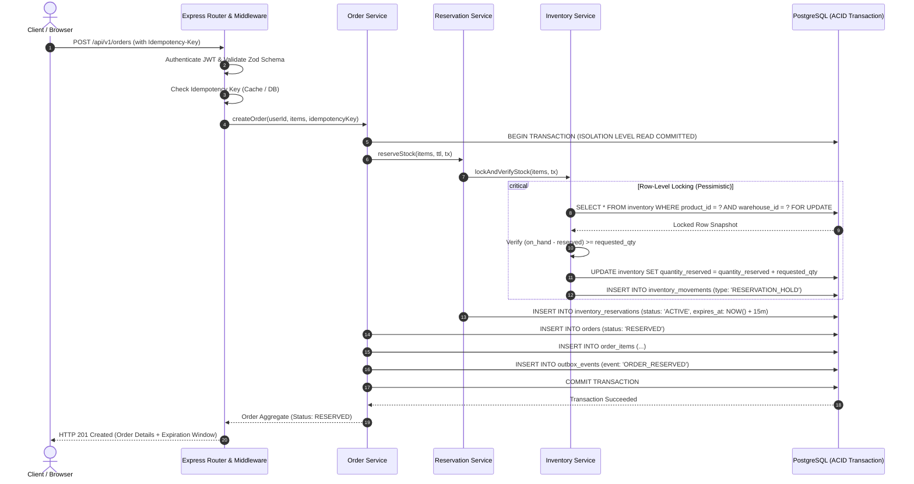
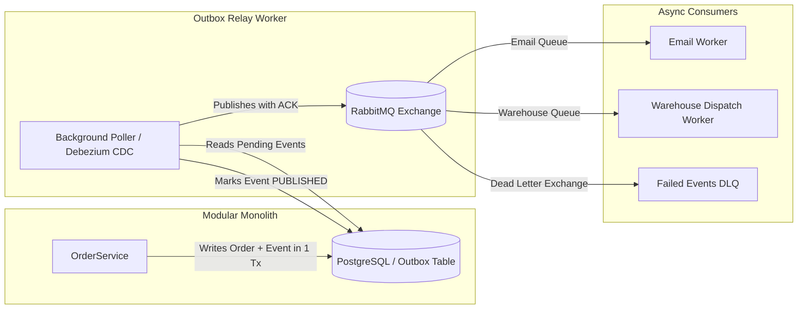

# System Architecture & Technical Design Document
## StockFlow — Distributed Inventory & Order Management System

---

## 1. Architectural Philosophy: The Modular Monolith

StockFlow is intentionally designed as a **Modular Monolith**. 

Modern engineering often defaults prematurely to microservices, introducing network latency, distributed transactions (two-phase commits / Sagas), eventual consistency edge cases, and high operational overhead. For StockFlow, the core engineering challenge is **absolute data consistency**—preventing overselling and race conditions when multiple orders claim the same stock. 

A modular monolith deployed as a single unified service backed by a single PostgreSQL database provides:
- **ACID Transactions:** Atomically updating orders, reservations, and inventory within a single database transaction boundary without distributed consensus protocols.
- **Strict In-Memory Module Boundaries:** High cohesion and loose coupling between domains through well-defined service interfaces and domain contracts.
- **Simplified Operational Footprint:** Streamlined local development, zero inter-service network latency, and unified observability.
- **Clean Migration Path:** Clear module boundaries ensure that if specific domains (such as Order Processing or Inventory Reservation) ever require independent horizontal scaling, they can be extracted into microservices with minimal refactoring.

---

## 2. System Architecture Diagram

```mermaid
flowchart TB
    subgraph ClientLayer [Client Applications]
        ClientWeb["Web Client / Admin Dashboard (React + TypeScript)"]
        ClientAPI["External B2B Clients / API Consumers"]
    end

    subgraph APIGatewayLayer [API & Middleware Layer]
        ExpressServer["Express.js HTTP Server"]
        AuthMiddleware["JWT Auth & RBAC Guard"]
        IdempotencyMW["Idempotency Middleware"]
        ValidationMW["Schema Validation (Zod)"]
        ErrorMW["Centralized Error Handler"]
    end

    subgraph CoreModules [Modular Monolith Business Logic]
        AuthModule["1. Auth & User Management"]
        ProductModule["2. Product Catalog"]
        WarehouseModule["3. Warehouse Management"]
        InventoryModule["4. Inventory Management"]
        ReservationModule["6. Inventory Reservation Engine"]
        OrderModule["5. Order Management"]
        PaymentModule["7. Payment Simulation"]
        NotificationModule["8. Notification & Outbox Dispatcher"]
    end

    subgraph DataLayer [Persistence & State Management]
        PostgresDB[(PostgreSQL Primary Database)]
        RedisCache[(Redis - Future Cache & Distributed Locks)]
        RabbitMQ[(RabbitMQ - Future Event Bus / Workers)]
    end

    subgraph BackgroundWorkers [Background Execution Engine]
        ReservationSweeper["Reservation Expiry Sweeper (Cron / Worker)"]
        OutboxWorker["Transactional Outbox Relay Worker"]
    end

    %% Client Traffic
    ClientWeb -->|HTTPS / REST| ExpressServer
    ClientAPI -->|HTTPS / REST| ExpressServer

    %% Middleware flow
    ExpressServer --> AuthMiddleware
    AuthMiddleware --> IdempotencyMW
    IdempotencyMW --> ValidationMW
    ValidationMW --> CoreModules
    CoreModules --> ErrorMW

    %% Inter-module coordination
    OrderModule -->|1. Request Allocation| ReservationModule
    ReservationModule -->|2. Lock & Check Stock| InventoryModule
    OrderModule -->|3. Trigger Payment| PaymentModule
    PaymentModule -->|4. Confirm / Fail| OrderModule
    OrderModule -->|5. Commit / Release| ReservationModule
    OrderModule -->|6. Publish Event| NotificationModule

    %% Persistence
    CoreModules -->|Prisma Client / ACID Transactions| PostgresDB
    CoreModules -.->|Read Cache / Fast Lookup (Phase 3)| RedisCache
    NotificationModule -.->|Publish Domain Events (Phase 4)| RabbitMQ

    %% Background tasks
    ReservationSweeper -->|Scan Expired Reservations| PostgresDB
    ReservationSweeper -->|Release Expired Stock| InventoryModule
    RabbitMQ -.->|Consume Async Jobs| BackgroundWorkers
    OutboxWorker -->|Read Outbox Table| PostgresDB
    OutboxWorker -->|Publish Messages| RabbitMQ
```

---

## 3. Module Responsibilities and Boundaries

Each module operates with an isolated domain boundary. Modules expose public service interfaces to peer modules while keeping internal repository logic, entity transformations, and private helpers strictly encapsulated.



### 3.1 Authentication and User Management
- **Primary Responsibility:** User identity, credential hashing, JWT token generation, role verification (`CUSTOMER`, `WAREHOUSE_STAFF`, `ADMIN`).
- **Dependencies:** None. Independent leaf module.
- **Database Scope:** Owns the `users` table.

### 3.2 Product Management
- **Primary Responsibility:** Product catalog definitions, SKU registration, catalog updates, price rules, and product activation status.
- **Dependencies:** None.
- **Database Scope:** Owns the `products` table.

### 3.3 Warehouse Management
- **Primary Responsibility:** Warehouse registry, location details, operational statuses, and capacity definitions.
- **Dependencies:** None.
- **Database Scope:** Owns the `warehouses` table.

### 3.4 Inventory Management
- **Primary Responsibility:** Core stock ledger tracking. Tracks physical `quantity_on_hand` and committed `quantity_reserved`. Calculates real-time `available_quantity`. Records all physical changes in an append-only `inventory_movements` ledger.
- **Dependencies:** `ProductModule`, `WarehouseModule`.
- **Database Scope:** Owns `inventory` and `inventory_movements` tables.

### 3.5 Inventory Reservation Engine
- **Primary Responsibility:** Manages the temporary holding of stock during the order checkout window. Issues reservations with expiration timestamps (TTL), commits held stock upon payment confirmation, and releases reservations upon order cancellation or timeout.
- **Dependencies:** `InventoryModule`.
- **Database Scope:** Owns the `inventory_reservations` table.

### 3.6 Order Management
- **Primary Responsibility:** Orchestrates the order lifecycle from creation through fulfillment. Manages order line items, validates totals, coordinates reservation with `ReservationModule`, handles customer cancellations, and enforces order state machine transitions.
- **Dependencies:** `AuthModule`, `ProductModule`, `ReservationModule`, `PaymentModule`, `NotificationModule`.
- **Database Scope:** Owns `orders` and `order_items` tables.

### 3.7 Payment Simulation
- **Primary Responsibility:** Simulates transaction authorizations, captures, and rejections. Records payment transactions and correlates them to order IDs. Emits payment success or failure signals to the order coordinator.
- **Dependencies:** `OrderModule`.
- **Database Scope:** Owns the `payments` table.

### 3.8 Notification & Background Processing
- **Primary Responsibility:** Manages asynchronous side effects (order receipt emails, warehouse dispatch alerts, analytics) using the Transactional Outbox Pattern to guarantee at-least-once delivery without distributed two-phase commits.
- **Dependencies:** `OrderModule`.
- **Database Scope:** Owns the `outbox_events` table.

---

## 4. Request-Response Lifecycle & Client-Server Architecture



### Steps in the Request-Response Flow:
1. **Network Ingress:** HTTP Request arrives at Express.js server over TLS.
2. **Authentication Middleware:** Validates JWT bearer token, extracts user ID and role, and attaches them to `req.user`.
3. **Idempotency Guard:** Checks the `Idempotency-Key` header against database records. If a completed result exists, returns cached response immediately.
4. **Input Validation:** Zod middleware validates request payload shape, types, and constraints (e.g., positive quantities, valid UUIDs).
5. **Transaction Initialization:** Order service starts a PostgreSQL transaction.
6. **Pessimistic Row Lock:** Inventory records for requested SKUs are queried with `SELECT ... FOR UPDATE` ordered deterministically by ID to prevent deadlocks.
7. **Availability Verification:** If available quantity ($\text{on\_hand} - \text{reserved}$) is sufficient, `quantity_reserved` is incremented.
8. **Record Creation:** Order, OrderItems, Reservation, and Outbox records are created atomically in the same transaction.
9. **Commit & Return:** Transaction commits, lock releases, and HTTP 201 Created is returned to the client.

---

## 5. Architectural Decisions (ADRs)

### Decision 1: Modular Monolith vs Microservices
- **Selected:** Modular Monolith with strictly separated domain boundaries.
- **Why Selected:** Eliminates network latency between business modules and permits atomic ACID transactions across Orders and Inventory. Overselling prevention requires sub-millisecond atomic checks that are complex and brittle across distributed network boundaries.
- **Alternative Approaches:** Microservices architecture with independent databases per service (e.g., Order Service, Inventory Service) communicating via Sagas / event choreography.
- **Why Selected Approach is Appropriate:** Microservices introduce eventual consistency, network partition risks, and distributed transaction complexity (two-phase commit or compensation sagas). At this stage, a modular monolith guarantees 100% data consistency, rapid developer velocity, and low operational overhead while maintaining a clear code structure that can be split into microservices if scaling demands dictate.

### Decision 2: Concurrency Control — Pessimistic Row Locking vs Optimistic Locking
- **Selected:** Pessimistic Row-Level Locking (`SELECT ... FOR UPDATE`) in PostgreSQL.
- **Why Selected:** In flash-sale scenarios with high concurrency on limited inventory items, optimistic concurrency control (OCC via `version` column) results in massive transaction abort rates. Under OCC, if 500 requests compete for 10 units, 490 transactions fail immediately due to version conflicts, requiring expensive client-side retry storms. Pessimistic row locking serializes conflicting updates gracefully: requests queue up at the database row, verify real-time available stock, and cleanly succeed or report genuine out-of-stock.
- **Alternative Approaches:** 
  1. Optimistic Concurrency Control (Version checking / retry loops).
  2. Redis Distributed Locks (Redlock).
  3. Single-threaded in-memory queue.
- **Why Selected Approach is Appropriate:** PostgreSQL's native row lock is highly optimized, battle-tested, releases automatically if a transaction fails or crashes, and operates inside the exact same ACID transaction that writes the order and reservation records.

### Decision 3: Inventory Reservation Model (Two-Phase Hold & Commit)
- **Selected:** Two-Phase Stock Allocation: Stock is reserved (`quantity_reserved += N`) during checkout and committed (`quantity_on_hand -= N, quantity_reserved -= N`) only after payment confirmation.
- **Why Selected:** Immediate physical deduction requires issuing a compensating "restock" transaction if payment fails, polluting inventory movement history and risking negative inventory if physical inventory audits occur mid-flight. The two-phase reservation model guarantees that unconfirmed checkouts never distort physical on-hand counts.
- **Alternative Approaches:** Immediate stock deduction with compensating restock on payment failure.
- **Why Selected Approach is Appropriate:** Accurately reflects real-world warehouse logistics: an item in an online shopping cart is "held" (reserved), but it physically remains on the warehouse shelf (on-hand) until pick-and-pack fulfillment begins.

### Decision 4: Idempotency Handling
- **Selected:** Database-backed Idempotency Key validation enforced via a unique constraint in the Orders table and transactional idempotency ledger.
- **Why Selected:** Guarantees absolute deduplication even across multi-instance server deployments without relying on volatile in-memory state.
- **Alternative Approaches:** In-memory Redis set with key expiry; client-side debouncing only.
- **Why Selected Approach is Appropriate:** Guarantees strong consistency: if an order insertion commits, the idempotency key is permanently recorded within the same transaction. Even if the network drops before the client receives the response, subsequent retries hit the database record and receive the exact same response without re-processing.

### Decision 5: Prisma ORM with Explicit Raw SQL Locking
- **Selected:** Prisma ORM for standard relational modeling, type-safe queries, and migrations, supplemented with `$queryRaw` / `$executeRaw` for `SELECT ... FOR UPDATE` operations.
- **Why Selected:** Prisma provides strong TypeScript type generation and migration tooling, but abstract ORMs often lack direct native semantics for pessimistic locking (`FOR UPDATE`). Using raw SQL escape hatches inside `$transaction` allows us to combine type safety for standard queries with precise relational lock semantics for critical stock allocations.
- **Alternative Approaches:** Pure TypeORM, MikroORM, or raw SQL driver (`pg` / Knex).
- **Why Selected Approach is Appropriate:** Gives the team compile-time type safety across 95% of domain operations while giving full database-level control where concurrency correctness is critical.

---

## 6. Engineering Challenges & Mitigations Matrix

| # | Challenge | Root Cause | Selected Solution & Architectural Technique |
| :--- | :--- | :--- | :--- |
| **1** | **Race conditions during stock reservations** | Concurrent read-modify-write requests reading identical available stock simultaneously. | **Pessimistic Row-Level Locking:** Use `SELECT ... FOR UPDATE` on inventory rows ordered by `product_id ASC` inside an isolated transaction. |
| **2** | **Overselling** | Selling beyond physical stock due to uncoordinated stock updates. | **Constraint-enforced Two-Phase Allocation:** `CHECK (quantity_reserved <= quantity_on_hand)` at DB level and atomic reservation decrements. |
| **3** | **Duplicate order creation** | Network timeouts causing client retries; double clicks. | **Idempotency Keys:** Mandatory `Idempotency-Key` HTTP header. Unique DB constraint returns identical result on retry. |
| **4** | **Payment failure after reservation** | User cancels payment, card declined, or payment gateway times out. | **Automated Compensation:** Order transitions to `PAYMENT_FAILED` or `CANCELLED`; reservation releases `quantity_reserved` back to available. |
| **5** | **Message delivery failures** | Network drops between monolith and downstream notification/messaging services. | **Transactional Outbox Pattern:** Outbox events written to DB in same ACID transaction as order; background worker relays to queue with retry logic. |
| **6** | **Inventory synchronization** | Divergence between warehouse physical stock, reserved stock, and order logs. | **Immutable Inventory Movements Ledger:** Append-only ledger records every delta (`RESTOCK`, `HOLD`, `RELEASE`, `FULFILL`). Reconciliation scripts verify: $\sum \Delta = \text{Current On Hand}$. |
| **7** | **Stuck / abandoned reservations** | User starts checkout and closes browser without completing payment. | **Time-To-Live (TTL) & Background Sweeper:** Reservations include `expires_at`. Sweeper worker periodically expires stale records and decrements reserved quantity. |
| **8** | **Database transaction failures** | Deadlocks, connection drops, or serialization errors during peak spikes. | **Deadlock Avoidance & Retry Policy:** Canonical resource ordering (sort IDs before lock) + exponential backoff retry wrapper for transient PostgreSQL error codes (e.g., `40P01`, `40001`). |

---

## 7. Future Infrastructure Integration Blueprint

### 7.1 Redis Integration (Phase 3)
```mermaid
flowchart LR
    Client -->|1. GET /inventory| Express
    Express -->|2. Check Cache| Redis[(Redis Cache)]
    Redis -->>|Hit: Return in <5ms| Express
    Redis -.->|Miss| Postgres[(PostgreSQL)]
    Postgres -.->|Populate Cache with TTL| Redis
```
- **Read-Through Caching:** Cache frequently accessed product metadata and approximate stock availability with a short TTL (e.g., 5 seconds) to offload 90% of read traffic from PostgreSQL.
- **Distributed Rate Limiting:** Enforce per-user and per-IP rate limits using Redis Token Bucket algorithms to protect order placement endpoints from bot attacks.
- **Ephemeral Session / Idempotency Cache:** Fast sub-millisecond check for in-flight idempotency keys to short-circuit duplicate concurrent submissions before hitting PostgreSQL.

### 7.2 RabbitMQ Integration (Phase 4)

- **Guaranteed At-Least-Once Delivery:** Decouples slow side effects (email notifications, third-party logistics webhooks, analytics data feeds) from the synchronous HTTP request-response cycle.
- **Transactional Outbox Pattern:** Guarantees that messages are published if and only if the corresponding database transaction commits successfully.
- **Dead Letter Queues (DLQ):** Messages that fail after $N$ retry attempts are routed to a DLQ for manual inspection and alerting.

---

## 8. Backend Project Directory Structure

```
stockflow-backend/
├── src/
│   ├── app.ts                       # Express application setup & middleware registration
│   ├── server.ts                    # HTTP server entry point & graceful shutdown handling
│   │
│   ├── config/                      # Application configuration & validated env variables
│   │   ├── env.ts                   # Zod-validated environment config
│   │   └── constants.ts             # System-wide constants (TTL defaults, error codes)
│   │
│   ├── common/                      # Cross-cutting concerns & shared utilities
│   │   ├── errors/                  # Custom error classes (AppError, NotFoundError, ConflictError)
│   │   ├── middlewares/             # Express middlewares (auth, idempotency, validation, error handler)
│   │   ├── types/                   # Global TypeScript types & Express request augmentations
│   │   └── utils/                   # Shared utility functions (logger, response formatters)
│   │
│   ├── database/                    # Database connection & ORM infrastructure
│   │   ├── prisma.ts                # PrismaClient singleton instance
│   │   └── transaction.ts           # ACID transaction wrapper with retry capability
│   │
│   ├── modules/                     # Domain modules (Modular Monolith)
│   │   ├── auth/                    # 1. Authentication & User Management
│   │   │   ├── auth.controller.ts
│   │   │   ├── auth.routes.ts
│   │   │   ├── auth.service.ts
│   │   │   └── auth.schemas.ts
│   │   │
│   │   ├── products/                # 2. Product Catalog Management
│   │   │   ├── product.controller.ts
│   │   │   ├── product.routes.ts
│   │   │   ├── product.service.ts
│   │   │   └── product.schemas.ts
│   │   │
│   │   ├── warehouses/              # 3. Warehouse Management
│   │   │   ├── warehouse.controller.ts
│   │   │   ├── warehouse.routes.ts
│   │   │   ├── warehouse.service.ts
│   │   │   └── warehouse.schemas.ts
│   │   │
│   │   ├── inventory/               # 4. Inventory Management & Stock Ledger
│   │   │   ├── inventory.controller.ts
│   │   │   ├── inventory.routes.ts
│   │   │   ├── inventory.service.ts
│   │   │   ├── inventory.repository.ts # Low-level queries & SELECT FOR UPDATE locks
│   │   │   └── inventory.schemas.ts
│   │   │
│   │   ├── reservations/            # 6. Inventory Reservation Engine
│   │   │   ├── reservation.service.ts  # TTL management, reserve, commit, release
│   │   │   └── reservation.worker.ts   # Sweeper for expired reservations
│   │   │
│   │   ├── orders/                  # 5. Order Management
│   │   │   ├── order.controller.ts
│   │   │   ├── order.routes.ts
│   │   │   ├── order.service.ts        # Order lifecycle orchestrator
│   │   │   └── order.schemas.ts
│   │   │
│   │   ├── payments/                # 7. Payment Simulation
│   │   │   ├── payment.controller.ts
│   │   │   ├── payment.routes.ts
│   │   │   ├── payment.service.ts
│   │   │   └── payment.schemas.ts
│   │   │
│   │   └── notifications/           # 8. Outbox & Notification Dispatch
│   │       ├── outbox.service.ts
│   │       └── outbox.worker.ts
│   │
│   └── routes.ts                    # Root API router assembling all module routes (/api/v1)
│
├── prisma/
│   ├── schema.prisma                # Prisma ORM schema definition
│   └── migrations/                  # Generated SQL migration files
│
├── tests/                           # Automated test suites
│   ├── unit/                        # Isolated unit tests for domain services
│   ├── integration/                 # API endpoint integration tests using Supertest
│   └── concurrency/                 # Race condition & oversell tests (simulated concurrent checkout)
│
├── .env.example                     # Sample environment variable configuration
├── tsconfig.json                    # TypeScript compiler configuration (strict mode)
└── package.json                     # Project manifest and scripts
```

### Folder Responsibilities:
- `src/config/`: Centralizes typed configuration. Uses schema validation (Zod) on startup so the app fails fast if required environment variables are absent.
- `src/common/`: House cross-cutting middleware (Authentication, Idempotency, Centralized Error Handling, Zod Validation) that all modules rely on.
- `src/database/`: Exposes the Prisma client singleton and database transaction helper functions ensuring database connection pooling is managed safely.
- `src/modules/<domain>/`: Each directory represents an autonomous business module. Routes wire endpoints to Controllers. Controllers parse HTTP inputs and delegate to Services. Services execute business logic, call other module services, and interact with the database via Prisma/Repositories.
- `src/modules/inventory/inventory.repository.ts`: Encapsulates raw SQL pessimistic locking queries (`SELECT ... FOR UPDATE`) away from high-level business logic.
- `src/modules/reservations/reservation.worker.ts`: Self-contained background sweeper task for expiring stale reservations.
- `tests/concurrency/`: Dedicated test harness for simulating hundreds of simultaneous checkouts on a single inventory item to verify zero-oversell guarantees.


---

## 9. Core System Design & Concurrency Concepts Implemented (Phase 3)

### 9.1 ACID Transactions
Every mutating workflow in StockFlow operates inside a strict database transaction (`prisma.$transaction`):
- **Atomicity:** In order placement, creating the `Order`, creating `OrderItem` records, incrementing `quantity_reserved` in `inventory`, creating the `InventoryReservation` record, and logging the `inventory_movements` ledger happen as a single indivisible unit. If any check fails (e.g., insufficient stock on the second SKU), every modification is rolled back.
- **Consistency:** Database invariants (`quantity_reserved <= quantity_on_hand`, `quantity_on_hand >= 0`) are checked by PostgreSQL engine constraints at commit time.
- **Isolation:** Using PostgreSQL's default `Read Committed` isolation level augmented with explicit pessimistic row locks (`FOR UPDATE`), read-modify-write anomalies are completely eliminated.
- **Durability:** Committed transactions are flushed to the Write-Ahead Log (WAL) on PostgreSQL before returning HTTP 201 to the client.

### 9.2 Database Row-Level Locking (`SELECT ... FOR UPDATE`)
To serialize concurrent order placements on hot inventory SKUs, StockFlow utilizes PostgreSQL pessimistic row locking:
```sql
SELECT id, product_id, warehouse_id, quantity_on_hand, quantity_reserved
FROM inventory
WHERE id = ANY($1::uuid[])
ORDER BY id ASC
FOR UPDATE
```
When Request A locks the inventory row, Request B waits at the row level until Request A commits. When Request B acquires the lock, it reads the updated `quantity_reserved`, computes `available = on_hand - reserved`, and cleanly fails with `HTTP 409 Conflict` if stock is exhausted.

### 9.3 Race Condition Elimination (Zero Overselling Guarantee)
In high-concurrency flash sales (e.g., 100 simultaneous requests competing for 10 units), naive read-then-write code experiences the classic "check-then-act" race condition:
1. Client 1 reads Available = 1
2. Client 2 reads Available = 1
3. Client 1 decrements $\to$ 0
4. Client 2 decrements $\to$ -1 (Oversell!)

With StockFlow's row-level locking, Client 2 cannot read or modify the row until Client 1 finishes. The integration stress test (`tests/concurrency.test.ts`) verified that across 100 simultaneous requests for 10 units, exactly 10 succeed, 90 fail with HTTP 409, and available stock never drops below 0.

### 9.4 Isolation & Consistency Guarantees
StockFlow enforces strong consistency:
- Available stock is never stored as an independent column; it is always derived dynamically ($\text{on\_hand} - \text{reserved}$) to prevent drift.
- Inventory movements are append-only. Summing movements reconciles exact physical inventory.

### 9.5 Idempotency Implementation
StockFlow enforces idempotency using client-supplied `Idempotency-Key` headers:
1. **Hash Verification:** Request bodies are hashed via SHA-256 (`requestPayloadHash`). If the same key is reused with a different payload, the server rejects it with `HTTP 409 Conflict (IDEMPOTENCY_PAYLOAD_MISMATCH)`.
2. **Replay Cache:** Completed order responses are cached in `idempotency_records`. Repeated requests return the identical cached order with an `Idempotent-Replay: true` header without reserving additional inventory.
3. **Concurrent Key Race Handling:** If 5 concurrent requests fire with the exact same key at the same millisecond, the database unique constraint permits exactly 1 to insert. The other 4 catch the `P2002` constraint, await transaction completion, and safely return the winning response.

### 9.6 Two-Phase Reservation Lifecycle
```
PENDING ──(Stock Locked)──> RESERVED ──(Pay Succeeded)──> CONFIRMED (Committed)
                               │
                               ├──(Pay Failed)──> PAYMENT_FAILED (Released)
                               ├──(User Cancel)──> CANCELLED (Released)
                               └──(TTL Expired)──> RESERVATION_EXPIRED (Released)
```
- Stock is held temporarily with a 15-minute TTL. Physical `quantity_on_hand` is only deducted upon successful payment capture.

### 9.7 Rollback and Failure Handling
- **Payment Failure:** When simulated payment returns `FAIL`, the transaction updates payment to `FAILED`, sets order to `PAYMENT_FAILED`, marks reservations `RELEASED`, decrements `quantity_reserved`, and logs a `RESERVATION_RELEASE` audit record.
- **Reservation Expiry Sweeper:** Background sweeper queries active reservations where `expires_at < NOW()`, decrements `quantity_reserved`, marks reservations `EXPIRED`, and updates orders to `RESERVATION_EXPIRED`.

### 9.8 Deadlock Prevention via Canonical Resource Ordering
A classic deadlock occurs if Order 1 locks SKU A then SKU B, while Order 2 locks SKU B then SKU A.
StockFlow eliminates this by sorting all target inventory IDs deterministically:
```ts
const uniqueInventoryIds = Array.from(new Set(resolvedItems.map((r) => r.inventoryId))).sort();
```
By acquiring row locks in ascending UUID order across all transactions, cyclic wait graphs are mathematically impossible.

---

## 10. Phase 4 Technical Implementation — Event-Driven Architecture & Transactional Outbox

### 10.1 Motivation & The Dual-Write Problem
To decouple the primary checkout funnel from downstream asynchronous operations (notifications, audit reconciliation, external logistics), StockFlow implements an **Event-Driven Architecture (EDA)** powered by RabbitMQ. 

To eliminate the dual-write vulnerability—where an order is written to PostgreSQL but fails to emit to RabbitMQ if the node crashes—StockFlow implements the **Transactional Outbox Pattern**:
- Every business event is inserted into the `outbox_events` table inside the *same atomic PostgreSQL transaction* as the entity update.
- No network calls to RabbitMQ are made within the HTTP request lifecycle. The database remains the single source of truth.

### 10.2 Outbox Publisher Engine & Lockless Batch Claiming
An asynchronous background worker (`OutboxPublisherWorker`) scans for unpublished events:
- **Lockless Claiming (`FOR UPDATE SKIP LOCKED`):** Multiple publisher worker instances claim batches without lock contention or deadlocks.
- **Strict Per-Aggregate FIFO Ordering:** A correlated `NOT EXISTS` subquery guarantees that events belonging to the same aggregate (e.g. `order.created` then `order.confirmed`) are published strictly in order of creation. An event cannot be claimed if an earlier event for the same aggregate remains unpublished. Cross-aggregate events remain fully concurrent.
- **Publisher Confirms & Exponential Backoff:** Events are published to RabbitMQ topic exchange `stockflow.events` with `persistent: true`. Only after receiving broker confirmation is the database status updated to `PUBLISHED`. Failed publishes transition to `FAILED` with bounded exponential backoff delay ($\min(2^n, 60)\text{ s}$) before becoming re-eligible.
- **Lease Timeout for Fault Tolerance:** If an instance crashes while holding claimed rows, other instances automatically reclaim them after `OUTBOX_LOCK_TTL_SECONDS = 60s`.

### 10.3 RabbitMQ Topology & Dead-Lettering
- **Primary Topic Exchange:** `stockflow.events` routes events by routing key (e.g. `order.created`, `order.confirmed`, `order.cancelled`).
- **Dead-Letter Exchange (DLX):** `stockflow.dlx` direct exchange.
- **Primary Queues:** `order-notifications.queue` and `inventory-events.queue` configured with `deadLetterExchange: 'stockflow.dlx'`.
- **Dead-Letter Queues:** `order-notifications.dlq` and `inventory-events.dlq` store poisoned messages that fail repeatedly.

### 10.4 Consumer Idempotency & Crash Recovery
RabbitMQ provides at-least-once message delivery. To prevent duplicate executions and recover from worker crashes mid-handler:
- **Two-Phase Idempotency Lifecycle:** Events transition through `IN_PROGRESS` $\to$ `COMPLETED`.
- **Claim Token Fencing:** Each lease acquisition generates a unique UUID fencing token. When a consumer completes handling, it updates status to `COMPLETED` filtered by matching `claim_token`. If a worker's lease expired and was reclaimed by another worker, the stale worker's commit is safely ignored.
- **Stale Lease Recovery:** If a consumer crashes mid-handler, its lease expires after `leaseTtlMs` (30s), allowing redelivered messages to be claimed and processed rather than skipped.
- **Immediate Failure Release:** If an unhandled exception occurs, the worker immediately deletes its `IN_PROGRESS` reservation, allowing RabbitMQ retries to proceed without waiting for TTL expiration.
- **Bounded Retries & DLQ:** Transient failures retry up to `MAX_CONSUMER_RETRIES = 3` with incremented `x-retry-count` headers. Messages exceeding bounded retries are rejected without requeue directly to the Dead-Letter Queue.

