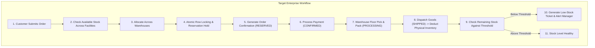
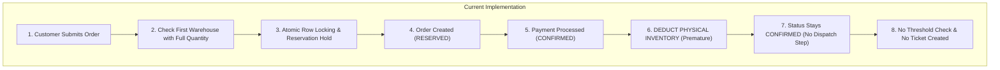
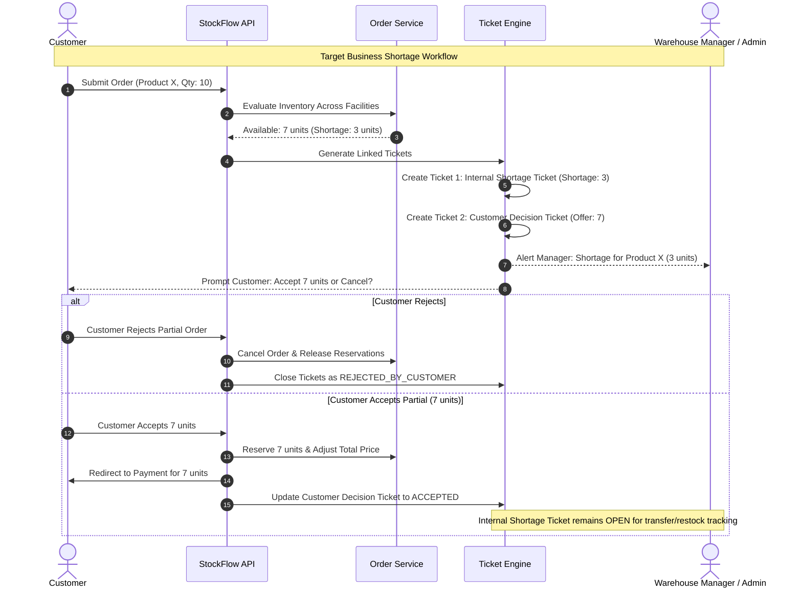
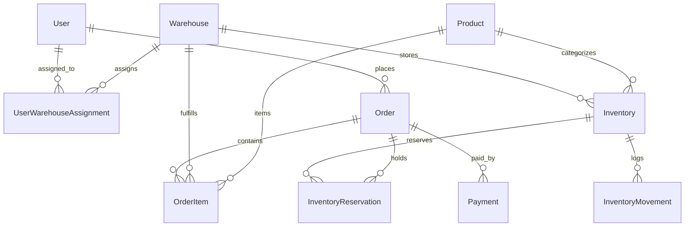
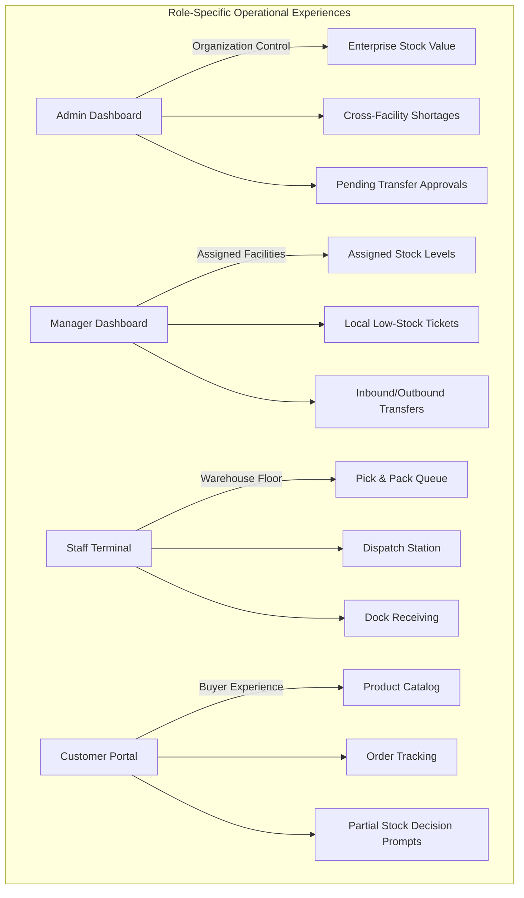
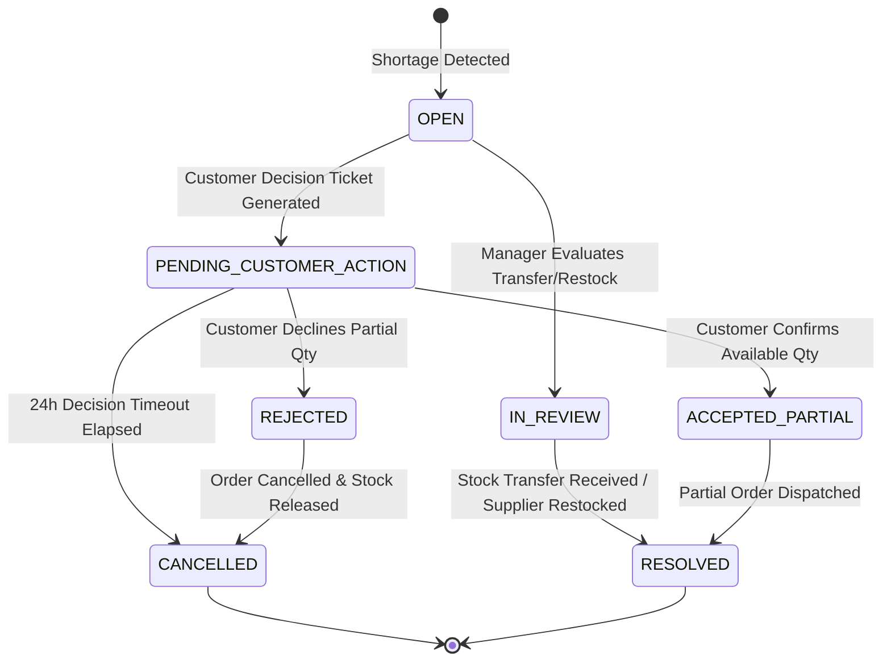
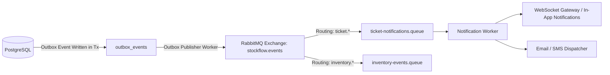
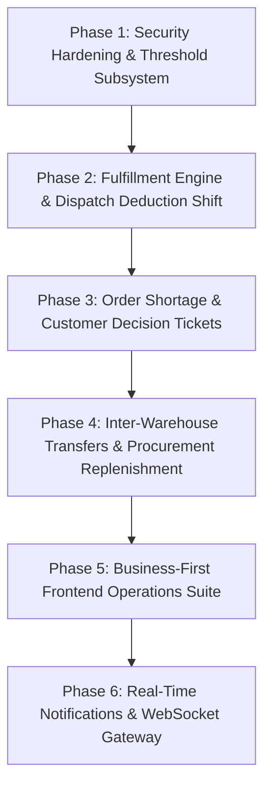

# StockFlow — Phase 1: Business-First Architecture & Workflow Audit

**Document Status:** Comprehensive System Audit  
**Classification:** Read-Only Technical Evaluation  
**Auditor:** DeepMind Advanced Agentic Systems  
**Date:** November 2026  
**Target Repository:** `StockFlow (Distributed Inventory & Order Fulfilment Platform)`

---

## Executive Summary

StockFlow is transitioning from a customer-facing e-commerce model into an enterprise **Business Inventory, Multi-Warehouse Management, and Order Fulfilment Platform**. The system's primary operational focus is multi-facility governance, inventory allocation, warehouse floor execution, shortage resolution, and automated replenishment.

This document presents a **strictly read-only audit** of the existing backend, frontend, database schema, event bus, caching layers, and automated test suites. Every finding in this audit has been verified directly against the production source code and test files in the repository.

### Key Audit Conclusions

1. **Robust Core Mechanics:** The platform possesses exceptional concurrency controls (canonical row-level locking via `SELECT ... FOR UPDATE`), zero overselling under race conditions, a fully functional Transactional Outbox pattern with strict per-aggregate FIFO ordering, and a dynamic multi-facility dashboard with no hardcoded limits.
2. **Critical Timing Discrepancy (Stock Deduction):** In the current implementation (`src/modules/payments/payment.service.ts:92-95`), physical inventory (`quantityOnHand`) is decremented immediately upon **payment confirmation**. In an enterprise business platform, physical stock remains on warehouse shelves until goods are physically **dispatched** (`SHIPPED`). Premature deduction compromises inventory audit trails and warehouse floor cycle counts.
3. **Absence of Ticket & Threshold Subsystems:** Neither the database schema (`prisma/schema.prisma`) nor backend services implement `Ticket` models, `MinimumStockThreshold` models, or inter-warehouse `StockTransfer` workflows. Low-stock detection is currently an arbitrary hardcoded frontend filter (`available <= 20` in `frontend/src/features/dashboard/LowStockList.tsx`).
4. **All-or-Nothing Order Rejection:** When requested stock exceeds warehouse availability, `order.service.ts:153` immediately aborts with a `409 ConflictError` (`INSUFFICIENT_STOCK`). There is currently no partial allocation mechanism, no internal shortage ticket generation, and no customer decision workflow.
5. **Security Gaps on Unauthenticated Inspection:** In `src/modules/inventory/inventory.routes.ts` and `src/modules/warehouses/warehouse.routes.ts`, inventory and warehouse GET routes utilize `authenticateOptional`. When requests lack an `Authorization` header, the user context is `undefined`, completely bypassing role checks and exposing enterprise inventory and facility metadata to unauthenticated callers.

---

## Section A: Existing Architecture and Feature Inventory

### A.1 Backend Architecture & Module Hierarchy

The backend is built with **Node.js, TypeScript, Express 4.19**, and **Prisma ORM (5.18)** running against PostgreSQL.

```
src/
├── app.ts                          # Express application factory & middleware chain
├── server.ts                       # HTTP server entrypoint
├── worker.ts                       # Dedicated background worker process entrypoint
├── routes.ts                       # Root API router mounting /api/v1 subrouters
├── config/
│   ├── env.ts                      # Zod-validated environment schema
│   └── constants.ts                # Application constants, event types, queue names
├── database/
│   └── prisma.ts                   # Singleton PrismaClient with retry & health checks
├── infra/
│   ├── rabbitmq/rabbitmq.client.ts # Amqplib client, topology assertion, DLQ bindings
│   └── redis/redis.client.ts       # Ioredis client with pattern invalidation & reconnect
├── common/
│   ├── errors/app-error.ts         # Domain error hierarchy (BadRequest, NotFound, etc.)
│   ├── middlewares/                # Auth, validation, rate-limiter, error-handler, logger
│   └── utils/                      # Password hashing, HMAC token generation, payload hash
├── modules/
│   ├── auth/                       # Register, login, /me, token issuance
│   ├── users/                      # User management & warehouse facility assignment
│   ├── products/                   # Product catalog CRUD with Redis caching
│   ├── warehouses/                 # Facility management & access control service
│   ├── inventory/                  # Stock ledger, restock mutations, warehouse breakdown
│   ├── orders/                     # Order creation, locking, cancellation, query
│   ├── payments/                   # Payment simulation & reservation commitment
│   ├── reservations/               # Stale reservation sweeper service
│   ├── outbox/                     # Transactional outbox service & background publisher
│   └── events/                     # Event envelopes & payload type definitions
└── workers/
    ├── consumer-idempotency.service.ts # Lease-based event deduplication
    ├── inventory.worker.ts         # RabbitMQ consumer for inventory audit logs
    ├── notification.worker.ts      # RabbitMQ consumer for order notification logs
    └── worker-helper.ts            # Message acknowledgment & error handling wrapper
```

### A.2 Frontend Architecture, Pages, and Layouts

The frontend is built with **React 18, Vite, TypeScript, TailwindCSS, @tanstack/react-query**, and **React Router DOM v6**.

- **Routing & Shell (`frontend/src/routes/AppRoutes.tsx`):**
  - Uses `ProtectedRoute` to enforce authentication.
  - Dynamically switches `/orders` between `MyOrdersPage` (for `CUSTOMER`) and `OrdersPage` (for internal roles).
- **Active Operational Pages:**
  - `DashboardPage.tsx`: Dynamic facility switcher (`WarehouseSelector.tsx`), multi-warehouse aggregate breakdown (`MultiWarehouseOverview.tsx`), single-warehouse view (`SelectedWarehouseOverview.tsx`), restock modal (`RestockModal.tsx`), low-stock card (`LowStockList.tsx`), recent orders list (`RecentOrdersList.tsx`).
  - `ProductsPage.tsx`: Full catalog table, search/filter, CRUD modals (`ProductFormModal.tsx`, `ProductDetailModal.tsx`, `ProductDeleteModal.tsx`), and Customer Storefront view (`CustomerCatalogView.tsx`).
  - `WarehousesPage.tsx`: Facilities listing, creation modal (`WarehouseFormModal.tsx`), and detail modal (`WarehouseDetailModal.tsx`). Customer role is explicitly blocked with a security shield screen.
  - `CartPage.tsx` & `CheckoutPage.tsx`: Customer shopping cart and checkout form submitting to `POST /api/v1/orders` and `POST /api/v1/payments/process`.
  - `MyOrdersPage.tsx` & `OrderTrackingPage.tsx`: Customer order listing and milestone progress tracker.
- **Placeholder Pages (`frontend/src/pages/PlaceholderPages.tsx`):**
  - `InventoryPage`, `OrdersPage`, and `SettingsPage` are currently static placeholder mockups labeled "Phase 2 Scope".

### A.3 Prisma Schema & Data Models

The relational schema is defined in `prisma/schema.prisma` (293 lines) containing 12 models:
- **Core Entities:** `User`, `Warehouse`, `Product`, `UserWarehouseAssignment`.
- **Inventory Subsystem:** `Inventory` (`quantityOnHand`, `quantityReserved`), `InventoryMovement` (audit ledger), `InventoryReservation` (`ACTIVE`, `COMMITTED`, `RELEASED`, `EXPIRED`).
- **Order & Payment Subsystem:** `Order`, `OrderItem`, `Payment`.
- **Reliability Infrastructure:** `IdempotencyRecord` (API deduplication), `OutboxEvent` (transactional outbox), `ProcessedEvent` (consumer idempotency).

### A.4 Comprehensive Feature Verification Matrix

| Subsystem / Feature | Implementation File | Verification Status | Observed Limitations / Risks |
|---|---|---|---|
| **User Authentication** | `src/modules/auth/auth.service.ts` | **VERIFIED** | Argon2/bcrypt password hashing, JWT issuance, rate-limited `/login` and `/register`. |
| **Role-Based Authorization** | `src/common/middlewares/auth.ts` | **VERIFIED** | Role checking for `ADMIN`, `WAREHOUSE_MANAGER`, `WAREHOUSE_STAFF`, `CUSTOMER`. |
| **Warehouse Assignment** | `src/modules/warehouses/warehouse-access.service.ts` | **VERIFIED** | Many-to-many facility mapping via `UserWarehouseAssignment`. |
| **Multi-Facility Inventory View** | `src/modules/inventory/inventory.service.ts:146` | **VERIFIED** | Admins view all facilities; Managers/Staff see strictly assigned facilities. |
| **Product Catalog & Redis Cache** | `src/modules/products/product.service.ts` | **VERIFIED** | Cached reads with automatic invalidation on product mutations. |
| **Deterministic Row Locking** | `src/modules/orders/order.service.ts:183` | **VERIFIED** | `SELECT ... FOR UPDATE` ordered by inventory ID prevents deadlocks. |
| **Zero Overselling Concurrency** | `tests/concurrency.test.ts` | **VERIFIED** | 100 concurrent order requests tested against fixed stock with 0 overselling. |
| **Two-Phase Reservation** | `src/modules/orders/order.service.ts:249` | **VERIFIED** | Pre-allocates `quantityReserved` with a 15-minute TTL without touching `quantityOnHand`. |
| **Physical Stock Deduction** | `src/modules/payments/payment.service.ts:92` | **PARTIAL / MISALIGNED** | Deducts `quantityOnHand` at **payment confirmation**, not at warehouse dispatch. |
| **Order Dispatch Workflow** | *None* | **NOT IMPLEMENTED** | No endpoint or service exists to mark orders `SHIPPED` or trigger warehouse dispatch. |
| **Reservation Expiry Sweeper** | `src/modules/reservations/reservation.service.ts` | **VERIFIED** | Background interval (60s) releases expired reservations and restores available stock. |
| **Payment Simulation** | `src/modules/payments/payment.service.ts` | **VERIFIED** | Supports `SUCCESS` (confirms order) and `FAILED` (releases reservations). |
| **Transactional Outbox Publisher** | `src/modules/outbox/outbox-publisher.worker.ts` | **VERIFIED** | Polling worker with `FOR UPDATE SKIP LOCKED` and strict per-aggregate FIFO ordering. |
| **RabbitMQ Consumers** | `src/workers/notification.worker.ts`, `inventory.worker.ts` | **PARTIAL** | Consumers acknowledge messages and verify idempotency, but only log to `console.log`. |
| **Minimum Stock Thresholds** | *None* | **NOT IMPLEMENTED** | No database model or API exists. UI relies on hardcoded `available <= 20`. |
| **Shortage Handling (Scenario B)** | `src/modules/orders/order.service.ts:153` | **NOT IMPLEMENTED** | System throws `409 ConflictError` immediately; no partial allocation or splitting. |
| **Ticket Subsystem** | *None* | **NOT IMPLEMENTED** | No tickets (shortage, customer decision, or low-stock) exist in database or API. |
| **Inter-Warehouse Stock Transfers** | *None* | **NOT IMPLEMENTED** | No transfer requests, transit tracking, or multi-facility rebalancing exist. |
| **Procurement & Supplier Receiving**| *None* | **NOT IMPLEMENTED** | Restock is only manual via `POST /api/v1/inventory/restock`; no supplier POs exist. |

---

## Section B: Current vs. Target Workflow Comparison

### B.1 Scenario A: Sufficient Stock

When sufficient inventory is present across warehouses:





#### Detailed Gap Analysis for Scenario A
1. **Warehouse Allocation Policy:** Current logic (`order.service.ts:137-156`) iterates through warehouses and picks the first single facility with `available >= requested`. It cannot split an order item across two warehouses when no single facility has the complete quantity.
2. **Timing of Physical Stock Deduction:** In `payment.service.ts:92-95`, `quantityOnHand` is decremented as soon as payment is confirmed. In reality, the goods are still physically inside the warehouse bin. If an order is cancelled or modified after payment but before dispatch, physical stock must be artificially "restocked". Physical deduction must be deferred to the dispatch event (`SHIPPED`).
3. **Threshold Check & Alerting:** Following deduction, no evaluation against a reorder point occurs.

---

### B.2 Scenario B: Insufficient Stock (e.g., Requested 10 Units, Available 7)



#### Current Code Behavior Under Shortage
In `src/modules/orders/order.service.ts:152-156` & lines 207-212:
```typescript
if (available < totalDemanded) {
  const prod = productMap.get(locked.product_id);
  throw new ConflictError(
    `Insufficient stock available for '${prod?.name || locked.product_id}'. Required: ${totalDemanded}, Available: ${available}`
  );
}
```
**Outcome:** The entire transaction rolls back immediately. The customer receives an HTTP 409 error message, no order record is preserved, no tickets are logged, and facility managers receive no notification of unmet demand.

---

## Section C: Existing Database Models and Proposed Schema Additions

### C.1 Existing Schema Breakdown

The existing schema contains no ticket, replenishment, threshold, or transfer models.



### C.2 Proposed Schema Additions (Prisma DSL)

To support the business platform repositioning, the following models must be added to `prisma/schema.prisma`:

```prisma
// ----------------------------------------------------
// 1. MINIMUM STOCK & REORDER THRESHOLDS
// ----------------------------------------------------
model MinimumStockThreshold {
  id              String     @id @default(uuid()) @db.Uuid
  productId       String     @map("product_id") @db.Uuid
  warehouseId     String?    @map("warehouse_id") @db.Uuid // null = Global Organisation Default
  minQuantity     Int        @default(10) @map("min_quantity") // Reorder Point
  safetyStock     Int        @default(5) @map("safety_stock")
  reorderQuantity Int        @default(50) @map("reorder_quantity") // Suggested PO quantity
  isActive        Boolean    @default(true) @map("is_active")
  createdAt       DateTime   @default(now()) @map("created_at") @db.Timestamptz
  updatedAt       DateTime   @updatedAt @map("updated_at") @db.Timestamptz

  product         Product    @relation(fields: [productId], references: [id], onDelete: Restrict)
  warehouse       Warehouse? @relation(fields: [warehouseId], references: [id], onDelete: Cascade)

  @@unique([productId, warehouseId], map: "uq_product_warehouse_threshold")
  @@index([warehouseId], map: "idx_threshold_warehouse")
  @@map("minimum_stock_thresholds")
}

// ----------------------------------------------------
// 2. TICKET & SHORTAGE MANAGEMENT
// ----------------------------------------------------
enum TicketType {
  INTERNAL_SHORTAGE
  CUSTOMER_DECISION
  LOW_STOCK_ALERT
  QUALITY_INSPECTION
}

enum TicketStatus {
  OPEN
  PENDING_CUSTOMER_ACTION
  IN_REVIEW
  RESOLVED
  CANCELLED
}

enum TicketPriority {
  LOW
  MEDIUM
  HIGH
  CRITICAL
}

enum CustomerDecision {
  PENDING
  ACCEPTED_PARTIAL
  REJECTED
  EXPIRED
}

model Ticket {
  id                 String           @id @default(uuid()) @db.Uuid
  ticketNumber       String           @unique(map: "idx_tickets_number") @map("ticket_number") @db.VarChar(50)
  type               TicketType
  status             TicketStatus     @default(OPEN)
  priority           TicketPriority   @default(MEDIUM)
  orderId            String?          @map("order_id") @db.Uuid
  productId          String?          @map("product_id") @db.Uuid
  warehouseId        String?          @map("warehouse_id") @db.Uuid
  requestedQuantity  Int?             @map("requested_quantity")
  availableQuantity  Int?             @map("available_quantity")
  shortageQuantity   Int?             @map("shortage_quantity")
  customerDecision   CustomerDecision? @map("customer_decision")
  decisionDeadline   DateTime?        @map("decision_deadline") @db.Timestamptz
  assignedToUserId   String?          @map("assigned_to_user_id") @db.Uuid
  parentTicketId     String?          @map("parent_ticket_id") @db.Uuid // Links Customer Decision <-> Shortage
  resolutionNotes    String?          @map("resolution_notes") @db.Text
  createdAt          DateTime         @default(now()) @map("created_at") @db.Timestamptz
  updatedAt          DateTime         @updatedAt @map("updated_at") @db.Timestamptz
  resolvedAt         DateTime?        @map("resolved_at") @db.Timestamptz

  order              Order?           @relation(fields: [orderId], references: [id], onDelete: SetNull)
  product            Product?         @relation(fields: [productId], references: [id], onDelete: SetNull)
  warehouse          Warehouse?       @relation(fields: [warehouseId], references: [id], onDelete: SetNull)
  assignedToUser     User?            @relation("AssignedTickets", fields: [assignedToUserId], references: [id], onDelete: SetNull)
  parentTicket       Ticket?          @relation("LinkedTickets", fields: [parentTicketId], references: [id], onDelete: SetNull)
  childTickets       Ticket[]         @relation("LinkedTickets")
  messages           TicketMessage[]
  stockTransfers     StockTransfer[]

  @@index([type, status], map: "idx_tickets_type_status")
  @@index([orderId], map: "idx_tickets_order_id")
  @@index([productId, warehouseId], map: "idx_tickets_product_warehouse")
  @@map("tickets")
}

model TicketMessage {
  id         String   @id @default(uuid()) @db.Uuid
  ticketId   String   @map("ticket_id") @db.Uuid
  senderId   String   @map("sender_id") @db.Uuid
  message    String   @db.Text
  isInternal Boolean  @default(false) @map("is_internal") // true = Staff/Manager note only
  createdAt  DateTime @default(now()) @map("created_at") @db.Timestamptz

  ticket     Ticket   @relation(fields: [ticketId], references: [id], onDelete: Cascade)
  sender     User     @relation(fields: [senderId], references: [id], onDelete: Restrict)

  @@index([ticketId], map: "idx_ticket_messages_ticket")
  @@map("ticket_messages")
}

// ----------------------------------------------------
// 3. INTER-WAREHOUSE STOCK TRANSFERS
// ----------------------------------------------------
enum TransferStatus {
  DRAFT
  REQUESTED
  APPROVED
  IN_TRANSIT
  RECEIVED
  CANCELLED
}

model StockTransfer {
  id                     String              @id @default(uuid()) @db.Uuid
  transferNumber         String              @unique(map: "idx_transfers_number") @map("transfer_number") @db.VarChar(50)
  sourceWarehouseId      String              @map("source_warehouse_id") @db.Uuid
  destinationWarehouseId String              @map("destination_warehouse_id") @db.Uuid
  status                 TransferStatus      @default(REQUESTED)
  ticketId               String?             @map("ticket_id") @db.Uuid
  requestedByUserId      String              @map("requested_by_user_id") @db.Uuid
  approvedByUserId       String?             @map("approved_by_user_id") @db.Uuid
  shippedAt              DateTime?           @map("shipped_at") @db.Timestamptz
  receivedAt             DateTime?           @map("received_at") @db.Timestamptz
  createdAt              DateTime            @default(now()) @map("created_at") @db.Timestamptz
  updatedAt              DateTime            @updatedAt @map("updated_at") @db.Timestamptz

  sourceWarehouse        Warehouse           @relation("TransfersOut", fields: [sourceWarehouseId], references: [id], onDelete: Restrict)
  destinationWarehouse   Warehouse           @relation("TransfersIn", fields: [destinationWarehouseId], references: [id], onDelete: Restrict)
  ticket                 Ticket?             @relation(fields: [ticketId], references: [id], onDelete: SetNull)
  requestedByUser        User                @relation("TransferRequests", fields: [requestedByUserId], references: [id], onDelete: Restrict)
  approvedByUser         User?               @relation("TransferApprovals", fields: [approvedByUserId], references: [id], onDelete: SetNull)
  items                  StockTransferItem[]

  @@index([sourceWarehouseId], map: "idx_transfers_source")
  @@index([destinationWarehouseId], map: "idx_transfers_dest")
  @@map("stock_transfers")
}

model StockTransferItem {
  id               String        @id @default(uuid()) @db.Uuid
  transferId       String        @map("transfer_id") @db.Uuid
  productId        String        @map("product_id") @db.Uuid
  quantityExpected Int           @map("quantity_expected")
  quantityShipped  Int?          @map("quantity_shipped")
  quantityReceived Int?          @map("quantity_received")

  transfer         StockTransfer @relation(fields: [transferId], references: [id], onDelete: Cascade)
  product          Product       @relation(fields: [productId], references: [id], onDelete: Restrict)

  @@index([transferId], map: "idx_transfer_items_transfer")
  @@map("stock_transfer_items")
}

// ----------------------------------------------------
// 4. PROCUREMENT & SUPPLIER REPLENISHMENT
// ----------------------------------------------------
enum POStatus {
  DRAFT
  ORDERED
  PARTIALLY_RECEIVED
  RECEIVED
  CANCELLED
}

model PurchaseOrder {
  id                   String              @id @default(uuid()) @db.Uuid
  poNumber             String              @unique(map: "idx_po_number") @map("po_number") @db.VarChar(50)
  warehouseId          String              @map("warehouse_id") @db.Uuid
  supplierName         String              @map("supplier_name") @db.VarChar(150)
  status               POStatus            @default(ORDERED)
  expectedDeliveryDate DateTime?           @map("expected_delivery_date") @db.Timestamptz
  createdAt            DateTime            @default(now()) @map("created_at") @db.Timestamptz
  updatedAt            DateTime            @updatedAt @map("updated_at") @db.Timestamptz

  warehouse            Warehouse           @relation(fields: [warehouseId], references: [id], onDelete: Restrict)
  items                PurchaseOrderItem[]

  @@map("purchase_orders")
}

model PurchaseOrderItem {
  id               String        @id @default(uuid()) @db.Uuid
  purchaseOrderId  String        @map("purchase_order_id") @db.Uuid
  productId        String        @map("product_id") @db.Uuid
  quantityOrdered  Int           @map("quantity_ordered")
  quantityReceived Int           @default(0) @map("quantity_received")
  unitCostCents    Int           @map("unit_cost_cents")

  purchaseOrder    PurchaseOrder @relation(fields: [purchaseOrderId], references: [id], onDelete: Cascade)
  product          Product       @relation(fields: [productId], references: [id], onDelete: Restrict)

  @@map("purchase_order_items")
}
```

---

## Section D: API Specification — Existing vs. Proposed Endpoints

### D.1 Verified Existing Endpoints Inventory

```
AUTH & USERS
POST   /api/v1/auth/register                   Public (Rate-Limited)
POST   /api/v1/auth/login                      Public (Rate-Limited)
GET    /api/v1/auth/me                         Authenticated (All Roles)
GET    /api/v1/users                           Admin Only
GET    /api/v1/users/:id                       Admin Only
PATCH  /api/v1/users/:id/role                  Admin Only
POST   /api/v1/users/:id/warehouses            Admin Only
DELETE /api/v1/users/:id/warehouses/:whId      Admin Only
GET    /api/v1/users/:id/warehouses            Admin or Self

PRODUCTS
GET    /api/v1/products                        Optional Auth (Cached in Redis)
GET    /api/v1/products/:id                    Optional Auth (Cached in Redis)
POST   /api/v1/products                        Admin Only (Invalidates Cache)
PUT    /api/v1/products/:id                    Admin Only (Invalidates Cache)
PATCH  /api/v1/products/:id                    Admin Only (Invalidates Cache)
DELETE /api/v1/products/:id                    Admin Only (Invalidates Cache)

WAREHOUSES
GET    /api/v1/warehouses                      Optional Auth (Security Risk: Leaks on undefined)
GET    /api/v1/warehouses/:id                  Optional Auth (Security Risk: Leaks on undefined)
POST   /api/v1/warehouses                      Admin Only

INVENTORY
POST   /api/v1/inventory/restock               Admin, Warehouse Manager, Staff
POST   /api/v1/inventory/stock                 Admin, Warehouse Manager, Staff
POST   /api/v1/inventory/expire-reservations   Admin Only
GET    /api/v1/inventory                       Optional Auth (Security Risk: Leaks on undefined)
GET    /api/v1/inventory/:warehouseId          Optional Auth (Security Risk: Leaks on undefined)
GET    /api/v1/inventory/warehouse/:whId       Optional Auth (Security Risk: Leaks on undefined)

ORDERS & PAYMENTS
POST   /api/v1/orders                          Authenticated (Customer, Admin)
GET    /api/v1/orders                          Authenticated (Admin, Manager, Staff, Customer)
GET    /api/v1/orders/my-orders                Authenticated (Customer)
GET    /api/v1/orders/:id                      Authenticated (Ownership or Warehouse Overlap)
POST   /api/v1/orders/:id/cancel               Authenticated (Ownership or Admin)
POST   /api/v1/payments/process                Authenticated (Order Owner or Admin)

SYSTEM
GET    /health                                 Public
GET    /api/v1/health                          Public
```

### D.2 Proposed Missing Endpoints for Business-First Platform

```
1. MINIMUM STOCK THRESHOLDS
GET    /api/v1/inventory/thresholds             Admin, Manager (Lists thresholds for assigned facilities)
POST   /api/v1/inventory/thresholds             Admin, Manager (Create warehouse-specific or global threshold)
PUT    /api/v1/inventory/thresholds/:id         Admin, Manager (Update threshold quantities)
DELETE /api/v1/inventory/thresholds/:id         Admin Only

2. TICKET & SHORTAGE LIFECYCLE
GET    /api/v1/tickets                          Admin, Manager, Staff (Assigned facilities), Customer (Own)
GET    /api/v1/tickets/:id                      Admin, Manager, Staff, Customer (Owner)
POST   /api/v1/tickets/:id/decision             Customer (Accept partial allocation or cancel order)
POST   /api/v1/tickets/:id/messages             Authenticated (Post internal note or customer message)
POST   /api/v1/tickets/:id/resolve              Admin, Manager (Resolve ticket with audit notes)

3. ORDER FULFILLMENT & PHYSICAL DISPATCH
POST   /api/v1/orders/:id/process               Manager, Staff (Mark order PROCESSING / Start Picking)
POST   /api/v1/orders/:id/dispatch              Manager, Staff (Mark SHIPPED & Deduct Physical Inventory)
POST   /api/v1/orders/:id/deliver               Manager, Staff, Admin (Mark DELIVERED)

4. INTER-WAREHOUSE STOCK TRANSFERS
GET    /api/v1/transfers                        Admin, Manager, Staff (Assigned source/dest)
POST   /api/v1/transfers                        Admin, Manager (Create transfer request)
GET    /api/v1/transfers/:id                    Admin, Manager, Staff
POST   /api/v1/transfers/:id/approve            Admin, Source Manager (Approve transfer)
POST   /api/v1/transfers/:id/ship               Source Staff/Manager (Ship transfer & deduct source onHand)
POST   /api/v1/transfers/:id/receive            Dest Staff/Manager (Receive goods, increment dest onHand, auto-resolve tickets)

5. PROCUREMENT & SUPPLIER RECEIVING
GET    /api/v1/procurement/orders               Admin, Manager
POST   /api/v1/procurement/orders               Admin, Manager (Create supplier PO)
POST   /api/v1/procurement/orders/:id/receive   Manager, Staff (Receive supplier shipment, restock onHand, auto-resolve tickets)
```

---

## Section E: Frontend Architecture & Proposed Navigation Structure

### E.1 Current UI Architecture & Limitations

1. **Coupled Navigation (`frontend/src/components/layout/Sidebar.tsx`):** The sidebar attempts to serve both business operators and e-commerce shoppers by switching labels based on `user.role === 'CUSTOMER'`.
2. **Placeholder Pages:** Key operational screens (`/inventory`, `/orders`, `/settings`) render `PlaceholderPage` components without live data tables.
3. **Hardcoded Thresholds:** The dashboard displays "Low Stock Alerts" (`LowStockList.tsx:17`) filtered statically on `quantityAvailable <= 20` rather than warehouse-specific database thresholds.

### E.2 Proposed Business Navigation Shell (11 Modules)

The enterprise business navigation should be structured into clear operational domains:

```
BUSINESS OPERATIONS SHELL (Admin, Warehouse Manager, Warehouse Staff)
├── 1. Business Dashboard             # Executive KPI control tower & operational health
├── 2. Inventory Management           # Multi-facility stock ledgers, movements & threshold rules
├── 3. Warehouse Management           # Facility profiles, zones, capacities & staff mapping
├── 4. Order Management               # Enterprise order master & multi-warehouse fulfillment
├── 5. Order Feasibility & Approvals  # Shortage resolution, partial acceptance review & split routing
├── 6. Warehouse Fulfilment           # Station terminal: Pick, pack & dispatch execution
├── 7. Low-Stock Tickets              # Critical inventory ticket inbox & replenishment triggers
├── 8. Stock Transfers                # Inter-warehouse transfer manifests, transit & receiving
├── 9. Procurement & Receiving        # Supplier POs, ASNs, dock receiving & inspection
├── 10. Analytics & Reports           # Stock velocity, holding costs & fulfillment cycle time
└── 11. User & Access Management      # Personnel directory, RBAC roles & facility permissions
```

*Note: The Customer Experience (Storefront, Cart, Checkout, My Orders, Decision Modals) should be isolated into a dedicated customer portal layout (`/store`, `/store/orders`, `/store/decisions`).*

### E.3 Proposed Role-Specific Dashboard Views



1. **Admin Dashboard:** Organization-wide metrics (total on-hand valuation, aggregate reserved units, open enterprise shortage tickets, active transfers, facility utilization heatmap).
2. **Warehouse Manager Dashboard:** Scoped specifically to assigned facilities (local available vs. reserved stock, local low-stock tickets, incoming stock transfers, staff task queue).
3. **Warehouse Staff Terminal:** Fast, touch-friendly barcode/list interface (Pick list generation, Packing verification, One-click dispatch with tracking label, Dock intake receiving).
4. **Customer Portal:** Clean catalog, order timeline, and interactive **Customer Decision Modal** (prompts: *"Only 7 units of Product X are available today. Would you like us to ship the 7 available units now or cancel your order?"*).

---

## Section F: Ticket Lifecycle and Notification Architecture

### F.1 Domain Ticket Types & State Machines



1. **Internal Shortage Ticket:**
   - **Trigger:** Generated when an order demands more stock than available across eligible warehouses.
   - **Attributes:** `orderId`, `productId`, `requestedQuantity`, `availableQuantity`, `shortageQuantity`, `targetWarehouseId`.
   - **Resolution Paths:** Inter-warehouse stock transfer receipt, emergency supplier PO receiving, or partial order fulfillment.
2. **Customer Decision Ticket:**
   - **Trigger:** Generated synchronously with the internal shortage ticket.
   - **Action:** Prompts customer to accept partial quantity or cancel with 100% refund.
   - **Idempotency:** Customer can only submit a decision once; decision locks the ticket.
3. **Low-Stock Alert Ticket:**
   - **Trigger:** Generated when available stock (`onHand - reserved`) drops below `MinimumStockThreshold.minQuantity`.
   - **De-duplication:** Automatically suppressed if an existing `OPEN` or `IN_REVIEW` ticket exists for the same `(productId, warehouseId)`.
   - **Resolution:** Automatically transitions to `RESOLVED` when an incoming `StockTransfer` or `PurchaseOrder` restocks the warehouse above the threshold.

### F.2 Asynchronous Event & Notification Topology

To prevent synchronous HTTP requests from blocking, ticket generation and notification dispatch must follow the Transactional Outbox pattern:



---

## Section G: Stock Accounting, Concurrency, and Idempotency Assessment

### G.1 Three-Tier Stock Accounting Model

The platform enforces three distinct stock quantities:
- **Physical Stock (`quantityOnHand`):** The actual inventory sitting on the warehouse racks.
- **Reserved Stock (`quantityReserved`):** Stock allocated to pending, paid, or processing orders.
- **Available Stock (`quantityAvailable`):** Computed dynamically:
  $$\text{quantityAvailable} = \text{quantityOnHand} - \text{quantityReserved}$$

### G.2 Concurrency & Overselling Prevention

- **Verified Lock Mechanism:** In `src/modules/orders/order.service.ts:183`, row-level locks are acquired using:
  ```sql
  SELECT id, product_id, warehouse_id, quantity_on_hand, quantity_reserved
  FROM inventory
  WHERE id = ANY($1::uuid[])
  ORDER BY id ASC
  FOR UPDATE;
  ```
- **Deadlock Guarantee:** Sorting `uniqueInventoryIds.sort()` before acquiring locks ensures consistent locking order across all concurrent transactions, mathematically preventing deadlocks.
- **Verification:** Verified by `tests/concurrency.test.ts`, where 100 concurrent checkout attempts competed for 10 units, resulting in exactly 10 successes and 90 conflict rejections with zero overselling.

### G.3 Critical Timing Discrepancy: Payment vs. Dispatch Deduction

In the current code (`src/modules/payments/payment.service.ts:92-95`):
```typescript
await tx.inventory.update({
  where: { id: res.inventoryId },
  data: {
    quantityOnHand: { decrement: res.quantity },
    quantityReserved: { decrement: res.quantity },
  },
});
```
**Why this is an architectural flaw in an enterprise platform:**
1. Decrementing `quantityOnHand` at payment implies the product has vanished into thin air before the warehouse even prints a pick slip.
2. If warehouse staff perform a cycle count between payment and shipping, physical items on shelves will not match the database `quantityOnHand`.
3. If an order is cancelled while in packing, the system must trigger an artificial `RESTOCK` movement to restore physical inventory.

**Correct Enterprise Accounting:**
- **Order Placement:** Increment `quantityReserved`. (Available stock drops; physical stock untouched).
- **Payment Confirmation:** Status moves to `CONFIRMED`. (`quantityOnHand` and `quantityReserved` remain unchanged).
- **Dispatch (`SHIPPED`):** Decrement `quantityOnHand` and decrement `quantityReserved`. Record `MovementType.FULFILLMENT_DEDUCTION`.

### G.4 Stale Reservation Sweeping & Idempotency

- **Reservation Sweeper:** Handled in `src/modules/reservations/reservation.service.ts` and `src/worker.ts`. Stale reservations (>15 mins TTL) are automatically released every 60 seconds, restoring available stock.
- **API Idempotency:** Guarded by `IdempotencyRecord` table and SHA-256 payload hashing (`order.service.ts:51`). Replaying the same key returns the cached response without creating duplicate orders or stock movements.
- **Consumer Idempotency:** Guarded by `ProcessedEvent` table using claim tokens and expiring leases (`consumer-idempotency.service.ts:27`). Prevents duplicate event processing across worker restarts.

---

## Section H: Security and Role-Based Access Assessment

### H.1 RBAC Enforcement Matrix

| Capability / API Route | ADMIN | WAREHOUSE_MANAGER | WAREHOUSE_STAFF | CUSTOMER |
|---|:---:|:---:|:---:|:---:|
| Create / Edit Products | **YES** | NO | NO | NO |
| Create Warehouses | **YES** | NO | NO | NO |
| Assign Users to Warehouses | **YES** | NO | NO | NO |
| View All Warehouses | **YES** | Assigned Only | Assigned Only | NO |
| Inspect Internal Stock Ledgers | **YES** | Assigned Only | Assigned Only | NO |
| Restock Inventory | **YES** | Assigned Only | Assigned Only | NO |
| Expire Stale Reservations (Manual) | **YES** | NO | NO | NO |
| Place Orders | **YES** | NO | NO | **YES** |
| View Orders | All Orders | Overlapping Assigned Wh | Overlapping Assigned Wh | Own Orders Only |
| Dispatch Orders (Fulfillment) | **YES** | Assigned Only | Assigned Only | NO |
| Process Payment | **YES** | NO | NO | Own Orders Only |

### H.2 Security Vulnerabilities & Edge Case Gaps Identified

1. **Unauthenticated Information Leakage on Inventory & Warehouses:**
   - **File:** `src/modules/inventory/inventory.routes.ts:41` & `src/modules/warehouses/warehouse.routes.ts:15`
   - **Vulnerability:** Routes utilize `authenticateOptional`. In `inventory.service.ts:151` and `warehouse.service.ts:41`, role checks are wrapped in `if (user) { ... }`.
   - **Exploit:** If a request is sent **without** an `Authorization` header, `user` is `undefined`. The `if (user)` check evaluates to `false`, and the service proceeds to return **all organisation warehouses and full inventory ledgers**. Authenticated customers receive `403 Forbidden`, while unauthenticated attackers receive full access.
   - **Fix Required:** Change route middleware from `authenticateOptional` to `authenticate`, and reject customers explicitly.

---

## Section I: Missing Features and Technical Risks

### I.1 Comprehensive Missing Features Register

1. **Database Schema:** Missing `MinimumStockThreshold`, `Ticket`, `TicketMessage`, `StockTransfer`, `StockTransferItem`, `PurchaseOrder`, and `PurchaseOrderItem` models.
2. **Partial Order Fulfillment:** No order splitting or partial quantity reservations.
3. **Dispatch Fulfillment Engine:** No endpoint to mark orders as `PROCESSING`, `SHIPPED`, or `DELIVERED`, and no dispatch-time physical stock deduction.
4. **Ticket & Shortage Engine:** No ticket generation, assignment, messaging, or resolution logic.
5. **Interactive Business UI:** `InventoryPage`, `OrdersPage`, and `SettingsPage` are non-functional placeholders.
6. **In-App Notification Center:** RabbitMQ consumer logs to `console.log`; no database persistence or WebSocket pushes.

### I.2 Technical & Operational Risks

1. **Premature Stock Deduction:** Decrementing `quantityOnHand` at payment breaks physical stock auditing.
2. **Alert Storm / Ticket Flooding:** Without strict composite unique constraints on `[productId, warehouseId, type, status]`, rapid checkout attempts could spam thousands of duplicate low-stock alerts.
3. **Lock Contention in Multi-Facility Evaluation:** Evaluating multiple warehouses across multiple items during checkout could cause database latency spikes without efficient index coverage.

---

## Section J: Recommended Implementation Roadmap



### J.1 Phased Implementation Blueprint

#### Phase 1: Security Hardening & Minimum Stock Thresholds
- Fix `authenticateOptional` vulnerabilities on `/inventory` and `/warehouses`.
- Add `MinimumStockThreshold` model to Prisma schema with migration.
- Implement CRUD endpoints for warehouse-specific and global stock thresholds.
- Add post-movement threshold evaluation engine.

#### Phase 2: Fulfillment Engine & Dispatch Deduction Shift
- Add order status transitions: `PROCESSING`, `SHIPPED`, `DELIVERED`.
- Shift physical inventory deduction (`quantityOnHand`) from payment confirmation to dispatch endpoint (`POST /api/v1/orders/:id/dispatch`).
- Preserve reserved stock commitment until goods physically leave the facility.

#### Phase 3: Order Shortage & Customer Decision Tickets
- Add `Ticket` and `TicketMessage` models to Prisma schema.
- Update `order.service.ts` to detect partial availability instead of throwing 409.
- Generate linked **Internal Shortage Ticket** and **Customer Decision Ticket**.
- Expose customer decision API (`POST /api/v1/tickets/:id/decision`) to accept partial quantity or cancel.

#### Phase 4: Inter-Warehouse Transfers & Procurement Replenishment
- Add `StockTransfer` and `PurchaseOrder` models.
- Implement transfer workflow: Request -> Approve -> Ship (deduct source) -> Receive (increment destination).
- Auto-resolve open low-stock and shortage tickets upon stock receipt.

#### Phase 5: Business-First Frontend Operations Suite
- Convert placeholder pages (`InventoryPage`, `OrdersPage`, `SettingsPage`) into fully interactive data tables.
- Build dedicated **Warehouse Staff Terminal** (pick/pack/dispatch).
- Build dedicated **Low-Stock & Shortage Ticket Inbox**.
- Implement Customer Decision Modal in customer account view.

#### Phase 6: Real-Time Notifications & WebSocket Gateway
- Implement persistent `Notification` table.
- Connect Socket.io / WebSocket server to RabbitMQ `ticket-notifications.queue`.
- Provide live audio/visual alerts to warehouse managers on critical shortages.

---

## Section K: Verification & Testing Strategy

### K.1 Concurrency & Race Condition Verification
- **Test:** Simulate 50 concurrent customer checkouts demanding 2 units each when only 5 units are available.
- **Assertion:** Exactly 2 checkouts receive partial allocation / decision prompts, remaining checkouts receive shortage tickets. Under no circumstance may total allocations exceed physical stock.

### K.2 Idempotency & Replay Verification
- **Test:** Submit the same customer decision (`ACCEPTED_PARTIAL`) 5 times simultaneously with identical idempotency keys.
- **Assertion:** Exactly one transaction executes; subsequent requests return cached 200 OK without re-decrementing inventory or duplicating outbox events.

### K.3 Dispatch Deduction Verification
- **Test:** Verify `quantityOnHand` and `quantityReserved` across order creation, payment confirmation, and dispatch.
- **Assertion:**
  - Order Created: `quantityOnHand` unchanged, `quantityReserved` incremented.
  - Payment Confirmed: `quantityOnHand` unchanged, `quantityReserved` unchanged.
  - Dispatch (`SHIPPED`): `quantityOnHand` decremented, `quantityReserved` decremented.

---

## Synthesis Matrices & Strategic Recommendations

### Component Reuse Matrix

| Subsystem / Component | Verdict | Justification / Action Required |
|---|:---:|---|
| **Pessimistic Row Locking (`SELECT ... FOR UPDATE`)** | **REUSE AS-IS** | Canonical ID sorting prevents deadlocks and guarantees zero overselling. |
| **Transactional Outbox & Publisher Worker** | **REUSE AS-IS** | Solid `FOR UPDATE SKIP LOCKED` implementation with aggregate FIFO guarantees. |
| **RabbitMQ Client & DLQ Topology** | **REUSE AS-IS** | Reliable reconnects, exchange assertions, and dead-letter queues. |
| **Consumer Idempotency Service** | **REUSE AS-IS** | Lease-based claim tokens prevent duplicate message execution. |
| **Stale Reservation Expiry Sweeper** | **REUSE AS-IS** | Reliably sweeps expired reservations every 60 seconds. |
| **Dynamic Multi-Warehouse Frontend Dashboard** | **REUSE AS-IS** | Scalable warehouse selector and multi-facility overview. |
| **Inventory Deduction Timing** | **NEEDS MODIFICATION** | Shift `quantityOnHand` deduction from payment confirmation to dispatch. |
| **Inventory & Warehouse Route Security** | **NEEDS MODIFICATION** | Replace `authenticateOptional` with strict authentication and role guards. |
| **Order Creation Logic (`createOrder`)** | **NEEDS MODIFICATION** | Replace immediate 409 abort with partial allocation and ticket generation. |
| **Frontend Sidebar Navigation** | **NEEDS MODIFICATION** | Split into Business Operations Shell (11 modules) and Customer Storefront. |
| **Minimum Stock Threshold Subsystem** | **BUILD FROM SCRATCH**| Schema model, CRUD endpoints, and threshold evaluation logic. |
| **Ticket & Shortage Engine** | **BUILD FROM SCRATCH**| Schema models, state machine, linked ticket logic, and customer decision flow. |
| **Warehouse Fulfillment Terminal** | **BUILD FROM SCRATCH**| Staff pick/pack/dispatch API and UI. |
| **Inter-Warehouse Stock Transfers** | **BUILD FROM SCRATCH**| Multi-facility transfer requests, in-transit tracking, and intake receiving. |
| **Interactive Business Pages** | **BUILD FROM SCRATCH**| Replace static placeholders with full CRUD inventory and order fulfillment tables. |

---

### Recommended First Implementation Phase

**Recommendation:** Proceed immediately with **Phase 1: Security Hardening & Minimum Stock Thresholds**.

**Rationale:**
1. **Zero Breaking Changes to Existing Checkout:** Implementing minimum stock thresholds and fixing route security does not alter the core order placement flow, ensuring continuous stability.
2. **Prerequisite for Ticket Generation:** Low-stock tickets cannot be generated without an underlying database threshold model (`MinimumStockThreshold`).
3. **Immediate Security Risk Remediation:** Eliminates the vulnerability where unauthenticated callers can inspect internal warehouse inventory ledgers.

