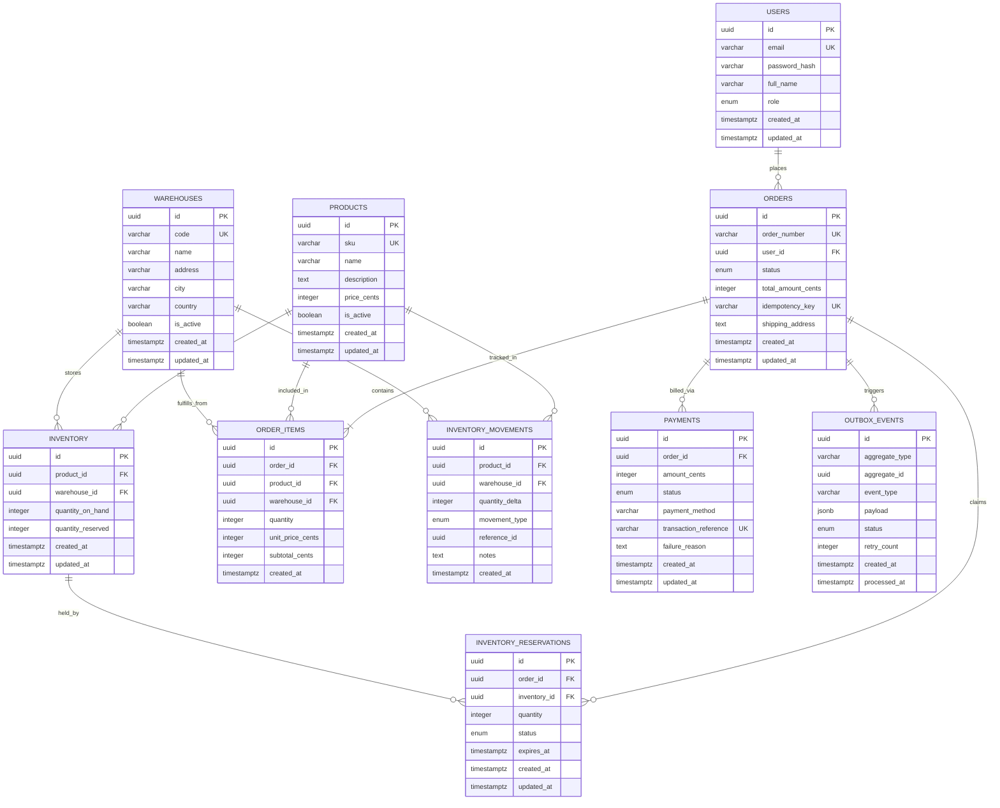

# Database Design & Schema Specification
## StockFlow — Distributed Inventory & Order Management System

---

## 1. Overview & Relational Design Philosophy

The StockFlow database is designed for **PostgreSQL** adhering strictly to **Third Normal Form (3NF)**. It ensures:
1. **Zero Data Redundancy:** Attributes depend solely on the primary key, avoiding anomalies during insertions, updates, or deletions.
2. **Strict Data Integrity:** Business invariants (such as non-negative inventory balances and reservation ceilings) are enforced directly at the database engine level using `CHECK` constraints and `FOREIGN KEY` referential actions.
3. **Double-Entry Stock Accounting:** Inventory levels are maintained via two stateful counters (`quantity_on_hand` and `quantity_reserved`), supplemented by an append-only `inventory_movements` audit ledger to guarantee full auditability and reconcilability.
4. **Optimized Concurrency & Indexing:** Dedicated B-Tree and compound indexes are defined to support high-throughput row-level locking (`SELECT ... FOR UPDATE`), idempotency lookups, and rapid reservation expiry sweeps.

---

## 2. Entity-Relationship (ER) Diagram

---

## 3. Detailed Table Specifications

### 3.1 `users`
**Purpose:** Stores user profiles, credentials, and access control roles.

| Column | Data Type | Constraints | Description |
| :--- | :--- | :--- | :--- |
| `id` | `UUID` | `PRIMARY KEY`, Default: `gen_random_uuid()` | Unique user identifier |
| `email` | `VARCHAR(255)` | `NOT NULL`, `UNIQUE` | User login email address |
| `password_hash` | `VARCHAR(255)` | `NOT NULL` | Cryptographic hash of user password |
| `full_name` | `VARCHAR(100)` | `NOT NULL` | Full name of the user |
| `role` | `VARCHAR(30)` | `NOT NULL`, Default: `'CUSTOMER'` | Role: `CUSTOMER`, `WAREHOUSE_STAFF`, `ADMIN` |
| `created_at` | `TIMESTAMPTZ` | `NOT NULL`, Default: `NOW()` | Creation timestamp |
| `updated_at` | `TIMESTAMPTZ` | `NOT NULL`, Default: `NOW()` | Last update timestamp |

**Indexes & Constraints:**
- `UNIQUE INDEX idx_users_email ON users(email);`

---

### 3.2 `warehouses`
**Purpose:** Stores metadata for distinct physical distribution centers.

| Column | Data Type | Constraints | Description |
| :--- | :--- | :--- | :--- |
| `id` | `UUID` | `PRIMARY KEY`, Default: `gen_random_uuid()` | Unique warehouse identifier |
| `code` | `VARCHAR(50)` | `NOT NULL`, `UNIQUE` | Human-readable unique code (e.g., `WH-EAST-01`) |
| `name` | `VARCHAR(150)` | `NOT NULL` | Warehouse facility name |
| `address` | `VARCHAR(255)` | `NOT NULL` | Physical street address |
| `city` | `VARCHAR(100)` | `NOT NULL` | City location |
| `country` | `VARCHAR(100)` | `NOT NULL` | Country location |
| `is_active` | `BOOLEAN` | `NOT NULL`, Default: `TRUE` | Whether warehouse is active for fulfillment |
| `created_at` | `TIMESTAMPTZ` | `NOT NULL`, Default: `NOW()` | Creation timestamp |
| `updated_at` | `TIMESTAMPTZ` | `NOT NULL`, Default: `NOW()` | Last update timestamp |

**Indexes & Constraints:**
- `UNIQUE INDEX idx_warehouses_code ON warehouses(code);`

---

### 3.3 `products`
**Purpose:** Catalogs items available for purchase across the system.

| Column | Data Type | Constraints | Description |
| :--- | :--- | :--- | :--- |
| `id` | `UUID` | `PRIMARY KEY`, Default: `gen_random_uuid()` | Unique product identifier |
| `sku` | `VARCHAR(100)` | `NOT NULL`, `UNIQUE` | Stock Keeping Unit (e.g., `PROD-MACBOOK-16`) |
| `name` | `VARCHAR(200)` | `NOT NULL` | Product display name |
| `description` | `TEXT` | `NULL` | Product description |
| `price_cents` | `INTEGER` | `NOT NULL`, `CHECK (price_cents >= 0)` | Price in smallest currency unit (cents) |
| `is_active` | `BOOLEAN` | `NOT NULL`, Default: `TRUE` | Whether product is active for sale |
| `created_at` | `TIMESTAMPTZ` | `NOT NULL`, Default: `NOW()` | Creation timestamp |
| `updated_at` | `TIMESTAMPTZ` | `NOT NULL`, Default: `NOW()` | Last update timestamp |

**Indexes & Constraints:**
- `UNIQUE INDEX idx_products_sku ON products(sku);`
- `INDEX idx_products_active ON products(is_active);`

---

### 3.4 `inventory`
**Purpose:** Tracks physical stock counts and committed reservations per product per warehouse.

| Column | Data Type | Constraints | Description |
| :--- | :--- | :--- | :--- |
| `id` | `UUID` | `PRIMARY KEY`, Default: `gen_random_uuid()` | Unique inventory record identifier |
| `product_id` | `UUID` | `NOT NULL`, `REFERENCES products(id) ON DELETE RESTRICT` | Associated product |
| `warehouse_id`| `UUID` | `NOT NULL`, `REFERENCES warehouses(id) ON DELETE RESTRICT` | Associated warehouse |
| `quantity_on_hand`| `INTEGER` | `NOT NULL`, Default: `0`, `CHECK (quantity_on_hand >= 0)` | Total physical stock currently on shelves |
| `quantity_reserved`| `INTEGER` | `NOT NULL`, Default: `0`, `CHECK (quantity_reserved >= 0)` | Stock currently held for unconfirmed orders |
| `created_at` | `TIMESTAMPTZ` | `NOT NULL`, Default: `NOW()` | Creation timestamp |
| `updated_at` | `TIMESTAMPTZ` | `NOT NULL`, Default: `NOW()` | Last update timestamp |

**Table-Level Invariants & Constraints:**
- `CONSTRAINT uq_inventory_product_warehouse UNIQUE (product_id, warehouse_id);`
- `CONSTRAINT chk_inventory_reserved_ceiling CHECK (quantity_reserved <= quantity_on_hand);`

**Indexes:**
- `UNIQUE INDEX idx_inventory_prod_wh ON inventory(product_id, warehouse_id);`
- `INDEX idx_inventory_warehouse ON inventory(warehouse_id);`

> **Note on Available Stock:**  
> Rather than storing a mutable `quantity_available` column that can drift out of sync, available stock is a derived calculation:  
> $$\text{quantity\_available} = \text{quantity\_on\_hand} - \text{quantity\_reserved}$$  
> This eliminates update anomalies and guarantees that available stock is always 100% mathematically consistent.

---

### 3.5 `inventory_movements` (Immutable Ledger)
**Purpose:** Append-only ledger recording every stock adjustment, reservation hold, release, and fulfillment deduction for complete auditability.

| Column | Data Type | Constraints | Description |
| :--- | :--- | :--- | :--- |
| `id` | `UUID` | `PRIMARY KEY`, Default: `gen_random_uuid()` | Unique movement ledger ID |
| `product_id` | `UUID` | `NOT NULL`, `REFERENCES products(id) ON DELETE RESTRICT` | Affected product |
| `warehouse_id`| `UUID` | `NOT NULL`, `REFERENCES warehouses(id) ON DELETE RESTRICT` | Affected warehouse |
| `quantity_delta`| `INTEGER` | `NOT NULL` | Stock delta (+ for addition/restock, - for fulfillment) |
| `movement_type`| `VARCHAR(30)` | `NOT NULL` | Type: `RESTOCK`, `RESERVATION_HOLD`, `RESERVATION_RELEASE`, `FULFILLMENT_DEDUCTION`, `AUDIT_ADJUSTMENT` |
| `reference_id`| `UUID` | `NULL` | Foreign reference (e.g. `order_id`, `reservation_id`) |
| `notes` | `TEXT` | `NULL` | Optional audit explanation or adjustment reason |
| `created_at` | `TIMESTAMPTZ` | `NOT NULL`, Default: `NOW()` | When movement occurred |

**Indexes:**
- `INDEX idx_inv_movements_prod_wh ON inventory_movements(product_id, warehouse_id);`
- `INDEX idx_inv_movements_ref ON inventory_movements(reference_id);`
- `INDEX idx_inv_movements_created ON inventory_movements(created_at);`

---

### 3.6 `orders`
**Purpose:** Records customer orders, financial totals, execution status, and idempotency guarantees.

| Column | Data Type | Constraints | Description |
| :--- | :--- | :--- | :--- |
| `id` | `UUID` | `PRIMARY KEY`, Default: `gen_random_uuid()` | Unique internal order identifier |
| `order_number` | `VARCHAR(50)` | `NOT NULL`, `UNIQUE` | Human-facing order reference (e.g. `ORD-20261031-8941`) |
| `user_id` | `UUID` | `NOT NULL`, `REFERENCES users(id) ON DELETE RESTRICT` | Placing customer |
| `status` | `VARCHAR(30)` | `NOT NULL`, Default: `'PENDING'` | State machine status (see Order Lifecycle) |
| `total_amount_cents`| `INTEGER` | `NOT NULL`, `CHECK (total_amount_cents >= 0)` | Total payable amount in cents |
| `idempotency_key` | `VARCHAR(255)` | `NOT NULL`, `UNIQUE` | Client-provided key preventing duplicate orders |
| `shipping_address`| `TEXT` | `NOT NULL` | Physical shipping destination |
| `created_at` | `TIMESTAMPTZ` | `NOT NULL`, Default: `NOW()` | Creation timestamp |
| `updated_at` | `TIMESTAMPTZ` | `NOT NULL`, Default: `NOW()` | Last state change timestamp |

**Indexes:**
- `UNIQUE INDEX idx_orders_order_number ON orders(order_number);`
- `UNIQUE INDEX idx_orders_idempotency_key ON orders(idempotency_key);`
- `INDEX idx_orders_user_id ON orders(user_id);`
- `INDEX idx_orders_status ON orders(status);`

---

### 3.7 `order_items`
**Purpose:** Line items associated with each order, recording quantity, warehouse allocation, and historical price at purchase time.

| Column | Data Type | Constraints | Description |
| :--- | :--- | :--- | :--- |
| `id` | `UUID` | `PRIMARY KEY`, Default: `gen_random_uuid()` | Unique line item identifier |
| `order_id` | `UUID` | `NOT NULL`, `REFERENCES orders(id) ON DELETE CASCADE` | Parent order reference |
| `product_id` | `UUID` | `NOT NULL`, `REFERENCES products(id) ON DELETE RESTRICT` | Purchased product |
| `warehouse_id`| `UUID` | `NOT NULL`, `REFERENCES warehouses(id) ON DELETE RESTRICT` | Warehouse fulfilling this line item |
| `quantity` | `INTEGER` | `NOT NULL`, `CHECK (quantity > 0)` | Quantity of item ordered |
| `unit_price_cents`| `INTEGER` | `NOT NULL`, `CHECK (unit_price_cents >= 0)` | Historical unit price at moment of purchase |
| `subtotal_cents` | `INTEGER` | `NOT NULL`, `CHECK (subtotal_cents >= 0)` | `quantity * unit_price_cents` |
| `created_at` | `TIMESTAMPTZ` | `NOT NULL`, Default: `NOW()` | Creation timestamp |

**Indexes:**
- `INDEX idx_order_items_order_id ON order_items(order_id);`
- `INDEX idx_order_items_product_id ON order_items(product_id);`

---

### 3.8 `inventory_reservations`
**Purpose:** Tracks temporary stock allocations tied to active checkout orders with expiry TTLs.

| Column | Data Type | Constraints | Description |
| :--- | :--- | :--- | :--- |
| `id` | `UUID` | `PRIMARY KEY`, Default: `gen_random_uuid()` | Unique reservation identifier |
| `order_id` | `UUID` | `NOT NULL`, `REFERENCES orders(id) ON DELETE RESTRICT` | Associated order |
| `inventory_id` | `UUID` | `NOT NULL`, `REFERENCES inventory(id) ON DELETE RESTRICT` | Specific warehouse-product inventory row |
| `quantity` | `INTEGER` | `NOT NULL`, `CHECK (quantity > 0)` | Number of units held |
| `status` | `VARCHAR(30)` | `NOT NULL`, Default: `'ACTIVE'` | Status: `ACTIVE`, `COMMITTED`, `RELEASED`, `EXPIRED` |
| `expires_at` | `TIMESTAMPTZ` | `NOT NULL` | Expiry deadline timestamp |
| `created_at` | `TIMESTAMPTZ` | `NOT NULL`, Default: `NOW()` | Creation timestamp |
| `updated_at` | `TIMESTAMPTZ` | `NOT NULL`, Default: `NOW()` | Status update timestamp |

**Indexes:**
- `INDEX idx_reservations_order_id ON inventory_reservations(order_id);`
- `INDEX idx_reservations_inventory_id ON inventory_reservations(inventory_id);`
- `INDEX idx_reservations_expiry ON inventory_reservations(status, expires_at) WHERE status = 'ACTIVE';`

> **Partial Index Justification:**  
> The index `idx_reservations_expiry` is a **partial index** indexing only active reservations (`WHERE status = 'ACTIVE'`). The background sweeper executes `SELECT ... WHERE status = 'ACTIVE' AND expires_at < NOW()`. A partial index keeps the index tree tiny and blazing fast by omitting historical `COMMITTED` or `RELEASED` records.

---

### 3.9 `payments`
**Purpose:** Records payment attempts, financial authorizations, and gateway reference IDs.

| Column | Data Type | Constraints | Description |
| :--- | :--- | :--- | :--- |
| `id` | `UUID` | `PRIMARY KEY`, Default: `gen_random_uuid()` | Unique payment identifier |
| `order_id` | `UUID` | `NOT NULL`, `REFERENCES orders(id) ON DELETE RESTRICT` | Associated order |
| `amount_cents` | `INTEGER` | `NOT NULL`, `CHECK (amount_cents > 0)` | Captured or authorized amount in cents |
| `status` | `VARCHAR(30)` | `NOT NULL`, Default: `'PENDING'` | Status: `PENDING`, `SUCCESS`, `FAILED`, `REFUNDED` |
| `payment_method` | `VARCHAR(50)` | `NOT NULL` | Method (e.g., `CREDIT_CARD`, `MOCK_GATEWAY`) |
| `transaction_reference` | `VARCHAR(100)` | `NOT NULL`, `UNIQUE` | External or generated transaction ID |
| `failure_reason` | `TEXT` | `NULL` | Error details if payment failed |
| `created_at` | `TIMESTAMPTZ` | `NOT NULL`, Default: `NOW()` | Payment attempt timestamp |
| `updated_at` | `TIMESTAMPTZ` | `NOT NULL`, Default: `NOW()` | Status update timestamp |

**Indexes:**
- `UNIQUE INDEX idx_payments_tx_ref ON payments(transaction_reference);`
- `INDEX idx_payments_order_id ON payments(order_id);`

---

### 3.10 `outbox_events` (Transactional Outbox)
**Purpose:** Enables reliable, at-least-once asynchronous domain event dispatching without distributed two-phase commits.

| Column | Data Type | Constraints | Description |
| :--- | :--- | :--- | :--- |
| `id` | `UUID` | `PRIMARY KEY`, Default: `gen_random_uuid()` | Unique event identifier |
| `aggregate_type` | `VARCHAR(50)` | `NOT NULL` | Entity type (e.g. `Order`, `Inventory`) |
| `aggregate_id` | `UUID` | `NOT NULL` | ID of the primary entity |
| `event_type` | `VARCHAR(100)` | `NOT NULL` | Event name (e.g. `OrderConfirmed`, `StockDepleted`) |
| `payload` | `JSONB` | `NOT NULL` | Structured event data |
| `status` | `VARCHAR(20)` | `NOT NULL`, Default: `'PENDING'` | Status: `PENDING`, `PUBLISHED`, `FAILED` |
| `retry_count` | `INTEGER` | `NOT NULL`, Default: `0` | Failed publishing attempts |
| `created_at` | `TIMESTAMPTZ` | `NOT NULL`, Default: `NOW()` | Event generation timestamp |
| `processed_at` | `TIMESTAMPTZ` | `NULL` | When event was published |

**Indexes:**
- `INDEX idx_outbox_pending ON outbox_events(status, created_at) WHERE status = 'PENDING';`

---

## 4. Key Database Design & Normalization Decisions

### 4.1 3NF Normalization Breakdown
1. **First Normal Form (1NF):** All attributes contain atomic values. Repeated line items are stored in separate rows (`order_items`), not arrays or serialized strings.
2. **Second Normal Form (2NF):** Every non-key attribute is fully dependent on the primary key. In `inventory`, the composite candidate key `(product_id, warehouse_id)` maps directly to stock counts, avoiding partial dependencies.
3. **Third Normal Form (3NF):** There are zero transitive dependencies. Product details (`name`, `description`, `price_cents`) reside exclusively in `products`. `order_items` stores only `product_id` and captures `unit_price_cents` as an immutable snapshot at order time to protect against future price changes.

### 4.2 Integer Precision for Currency
- Floating point data types (`FLOAT`, `DOUBLE`) introduce IEEE 754 binary rounding errors (e.g. `0.1 + 0.2 = 0.30000000000000004`).
- StockFlow strictly utilizes `INTEGER` representing cents (e.g., \$19.99 is stored as `1999`). This guarantees zero arithmetic inaccuracy in pricing, discounts, and payment settlement.

### 4.3 Composite Unique Constraints & Data Integrity
- The composite unique index on `inventory(product_id, warehouse_id)` prevents accidental duplicate inventory rows for the same SKU at a warehouse.
- Database-level check constraints (`quantity_reserved <= quantity_on_hand`) provide a hard safeguard against application bugs: even if an unhandled bug in application logic attempted to over-reserve, the database engine itself rejects the transaction.

