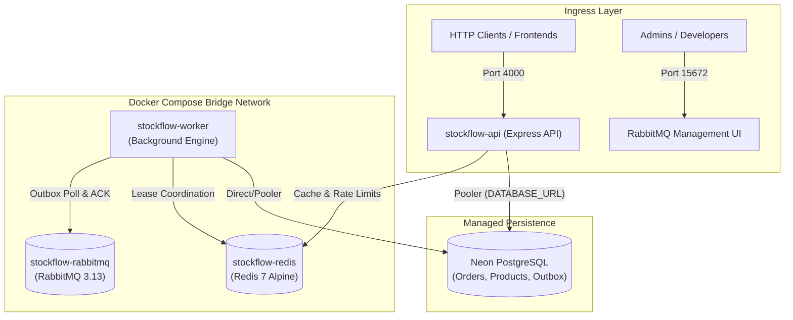

# StockFlow — Docker Architecture & Production Deployment Guide

## 1. Overview & Process Separation

In Phase 5, StockFlow separates its monolithic runtime into two specialized containerized processes:
1. **API Process (`stockflow-api`)**:
   - Executes the Express HTTP server on port 4000.
   - Connects to Neon PostgreSQL and Redis.
   - Does *not* poll the transactional outbox or bind message consumer queues.
2. **Worker Process (`stockflow-worker`)**:
   - Executes background workers: Outbox Publisher, Notification Consumer, Inventory Consumer, and Reservation Sweeper.
   - Connects to Neon PostgreSQL, RabbitMQ, and Redis.
   - Does *not* open or bind an HTTP network port.

Both services share the exact same compiled codebase and Docker image, using distinct entrypoint commands.

---

## 2. Docker Architecture Diagram



---

## 3. Multi-Stage Dockerfile Blueprint

The `Dockerfile` employs a multi-stage build pattern:
- **Stage 1 (`builder`)**: Uses `node:20-alpine`, installs build tools (`python3`, `make`, `g++`, `openssl`), installs all dependencies, generates Prisma client, compiles TypeScript to `/dist`, and prunes development dependencies.
- **Stage 2 (`runner`)**: Uses `node:20-alpine`, installs `tini` for PID 1 signal forwarding, copies only production `node_modules` and compiled `/dist`, switches to unprivileged non-root user `node`, and exposes port 4000. Final compressed image size is only **~144 MB**.

---

## 4. Docker Compose Services Reference

| Service | Image | Internal Port | Exposed Port | Purpose |
|---|---|---|---|---|
| `api` | `stockflow-backend:latest` | `4000` | `4000:4000` | Express REST API server |
| `worker` | `stockflow-backend:latest` | — | None | Outbox publisher & RabbitMQ consumers |
| `redis` | `redis:7-alpine` | `6379` | `6379:6379` | In-memory cache & rate limiter |
| `rabbitmq` | `rabbitmq:3.13-management-alpine` | `5672`, `15672` | `5672`, `15672` | Message broker & admin dashboard |

---

## 5. Operational Commands Guide

### Start All Services (Detached Mode)
```bash
docker compose up -d
```

### Start Only Infrastructure (Redis & RabbitMQ)
```bash
docker compose up -d redis rabbitmq
```

### Build or Rebuild Application Images
```bash
docker compose build
```

### Inspect Container Health & Status
```bash
docker compose ps
```

### Inspect Logs in Real Time
```bash
# All services
docker compose logs -f

# API process only
docker compose logs -f api

# Background worker only
docker compose logs -f worker
```

### Stop All Containers
```bash
docker compose down
```

### Stop Containers and Remove Persistent Volumes
```bash
docker compose down -v
```

---

## 6. Cloud Deployment & Rollback Safety Strategy

### Critical Warning: Application Rollback Does Not Revert Migrations
When deploying to cloud platforms such as Railway:
- Rolling back a deployment via the Railway Dashboard or Git reverts **only the application container image and running code**.
- **It does NOT roll back or undo PostgreSQL database migrations.**
- If a new release applied a destructive database migration (e.g., dropped a column, renamed a field, or added a `NOT NULL` constraint without a default), rolling back the application to the previous image will cause the old application to immediately crash when attempting to query the missing or altered columns.

### Backward-Compatible Migration Architecture (Expand-Contract Pattern)
To ensure that application rollbacks are always 100% safe and zero-downtime:

1. **Step 1 (Expand — Additive Changes Only)**:
   - All migrations must be backward-compatible with the currently running application code.
   - When adding fields, make them nullable (`?`) or specify a database-level `@default(...)`.
   - Never rename or drop existing columns in the same release as application code changes.
2. **Step 2 (Deploy Application)**:
   - Deploy the new version of the API and Worker containers.
   - The application begins reading and writing the new structure.
   - **Safe Rollback Window**: If the new application version has defects, rolling back to the previous container image is completely safe because all legacy columns, tables, and constraints remain intact in PostgreSQL.
3. **Step 3 (Contract — Deprecation Cleanup)**:
   - Only after the new release is verified and stable in production, execute a subsequent migration in a later release cycle to remove deprecated columns or convert nullable fields to `NOT NULL`.

### Database Connection Distinction
- **`DIRECT_URL` (Port 5432, Unpooled)**: Used strictly for executing `npx prisma migrate deploy` in the pre-deploy release step. Requires direct TCP access for PostgreSQL advisory locks and DDL execution.
- **`DATABASE_URL` (Port 6543, Pooled)**: Used exclusively by runtime API and Worker instances for pooled query execution. Connection poolers (such as PgBouncer or Neon connection poolers) must never be used to run DDL migrations.

---

## 7. Railway Deployment Verification & Environment Isolation

### Attached-Mode Deployment Verification
In `.github/workflows/deploy.yml`:
- Both `stockflow-api` and `stockflow-worker` are deployed using `railway up --service <name> --environment <target>` in **attached mode** (omitting both `--detach` and `--ci`).
- **Why Attached Mode?**
  - `--detach` exits immediately after queuing the build (fire-and-forget), reporting false success even if the build or container crashes.
  - `--ci` exits immediately after the Docker image build completes; it does *not* wait for container startup or health check probes.
  - **Attached mode** streams live build and deploy logs to GitHub Actions and blocks until the deployment reaches its terminal state:
    - `stockflow-api`: blocks until the container passes the HTTP `/health` probe configured in `railway.json`.
    - `stockflow-worker`: blocks until the container successfully initializes and enters an active running state.
  - If either container fails to boot or fails its health check within the timeout window, `railway up` exits with a non-zero exit code, failing the GitHub Actions job.

### Explicit Project Targeting via RAILWAY_PROJECT_ID
- Railway CLI commands in headless CI environments require an explicit project context. Because local `.railway/` link files are not committed to Git, both API and Worker deployments pass `--project "$RAILWAY_PROJECT_ID"`.
- `RAILWAY_PROJECT_ID` is stored as an environment variable in GitHub (`vars.RAILWAY_PROJECT_ID`) within the `production` environment, keeping the configuration dynamic without hardcoding IDs in workflow files.
- A pre-flight validation step in `deploy.yml` checks that `vars.RAILWAY_PROJECT_ID` and `secrets.RAILWAY_TOKEN` are both non-empty before initiating any deployment commands.

### Environment-Scoped Railway Tokens
- Railway **Project Tokens** are strictly scoped to a single environment (e.g., `production` or `staging`).
- A `production` Project Token cannot deploy to or access resources in `staging`, and vice versa.
- GitHub Actions dynamically resolves `RAILWAY_TOKEN`, `DATABASE_URL`, and `DIRECT_URL` from the GitHub Environment matching `deploy_target` (`environment: name: ${{ github.event.inputs.deploy_target }}`).
- When multiple environments are used, distinct Project Tokens must be generated in the Railway Dashboard under **Project Settings -> Tokens** for each environment.

### Production Database Protection & Re-enabling Staging
- Currently, StockFlow connects to a single production Neon PostgreSQL database branch.
- To prevent accidental schema mutations or data corruption on production data, **the `staging` target is disabled** in `deploy.yml`. The workflow is locked to `deploy_target: production`.
- **How to Re-enable Staging Safely in the Future**:
  1. In the Neon Console, create an isolated database branch (e.g., `staging`) branched from `main`.
  2. Obtain isolated staging connection strings: `DATABASE_URL` (pooled) and `DIRECT_URL` (direct).
  3. In Railway, provision a separate `staging` environment with an isolated Redis and RabbitMQ service.
  4. In Railway Project Settings, generate a new Project Token scoped to the `staging` environment.
  5. In GitHub Repository Settings -> Environments, create the `staging` environment and populate `RAILWAY_TOKEN`, `DATABASE_URL`, and `DIRECT_URL`.
  6. In `.github/workflows/deploy.yml`, add `staging` back to the `options` list under `deploy_target` and update the validation step.

