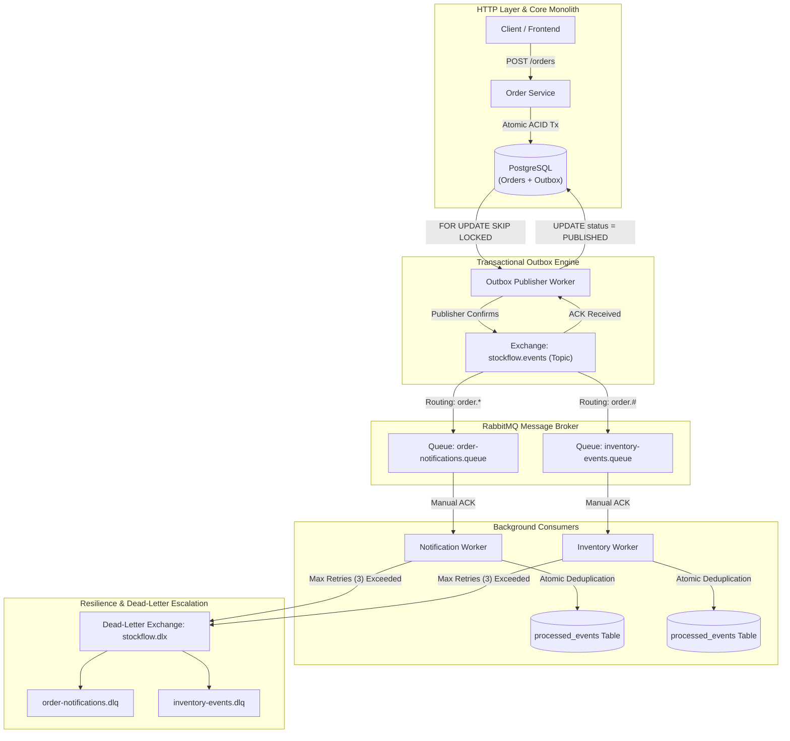

# StockFlow — Event-Driven Architecture Specification

## 1. Overview & Principles

In high-throughput e-commerce and distributed inventory management systems, synchronicity across business domains introduces cascading latencies, tight coupling, and operational fragility. If order placement directly made downstream calls to notification services, analytical warehouses, and third-party logistics, any downstream failure or latency spike would jeopardize the core customer checkout funnel.

To resolve this, StockFlow implements an **Asynchronous Event-Driven Architecture (EDA)** built upon:
1. **Decoupled Business Domains**: Producers emit business event facts; consumers react autonomously without the producer needing knowledge of consumers.
2. **Transactional Outbox Pattern**: Guaranteed event publication that eliminates the Dual-Write problem between PostgreSQL and RabbitMQ.
3. **Consumer-Side Idempotency**: Safe deduplication using unique event identifiers and atomic relational database constraints.
4. **Resilient Failure Handling**: Bounded retries with exponential backoff and automatic routing to Dead-Letter Queues (DLQ) for permanent failures.

---

## 2. End-to-End Event Architecture

The following diagram illustrates the complete architectural pipeline from HTTP request to dead-letter escalation:



---

## 3. Business Event Catalog

All events inherit a standardized, strongly-typed envelope structure:

```typescript
export interface EventEnvelope<T = any> {
  id: string;             // UUID matching outbox_events.id
  type: string;           // Dot-notated event name (e.g., 'order.created')
  aggregateType: string;  // Root entity ('Order')
  aggregateId: string;    // Aggregate Root UUID (orderId)
  payload: T;             // Domain-specific payload (sanitized)
  timestamp: string;      // ISO-8601 UTC timestamp
  version: number;        // Schema version (e.g., 1)
}
```

### Event Definitions

| Event Type | Trigger Point | Routing Key | Key Payload Attributes |
|---|---|---|---|
| `order.created` | Order placed, stock held in active reservation | `order.created` | `orderId`, `orderNumber`, `userId`, `totalAmountCents`, `shippingAddress`, `items` |
| `order.confirmed` | Payment simulation succeeds, stock committed | `order.confirmed` | `orderId`, `orderNumber`, `userId`, `paymentId`, `amountCents`, `confirmedAt` |
| `order.cancelled` | Order cancelled by customer or admin, stock released/restocked | `order.cancelled` | `orderId`, `orderNumber`, `userId`, `reason`, `stockReleased`, `cancelledAt` |
| `order.payment_failed` | Payment declined, held stock released | `order.payment_failed` | `orderId`, `orderNumber`, `userId`, `paymentId`, `failureReason`, `failedAt` |
| `order.reservation_expired` | Reservation TTL elapsed, sweeper releases held units | `order.reservation_expired` | `orderId`, `orderNumber`, `userId`, `expiredAt` |

---

## 4. Consumer Idempotency & Crash Recovery

In distributed message delivery, RabbitMQ guarantees **at-least-once delivery**. Duplicate deliveries can occur under network partitions, worker reconnections, or manual requeues. Furthermore, if a worker node crashes mid-execution of an event handler, subsequent redeliveries must not be skipped as false duplicates.

To guarantee crash resilience and safe deduplication:
1. Every message carries a persistent `id` (the Outbox UUID).
2. The consumer executes an atomic lease-claim query with an `IN_PROGRESS` status and a unique `claimToken` (UUID fencing token):
   ```sql
   INSERT INTO processed_events (id, event_id, consumer_name, event_type, status, claim_token, locked_at, created_at, updated_at)
   VALUES (gen_random_uuid(), $1, $2, $3, 'IN_PROGRESS'::"ProcessedEventStatus", $4, NOW(), NOW(), NOW())
   ON CONFLICT (event_id, consumer_name) DO UPDATE
     SET status = 'IN_PROGRESS'::"ProcessedEventStatus",
         claim_token = EXCLUDED.claim_token,
         locked_at = NOW(),
         updated_at = NOW()
     WHERE processed_events.status = 'IN_PROGRESS'::"ProcessedEventStatus"
       AND processed_events.locked_at < NOW() - ($5 * INTERVAL '1 millisecond')
   RETURNING id, claim_token;
   ```
3. **Claim Token Fencing**:
   - If an insert succeeds, the worker obtains the lease.
   - If a conflict occurs and the existing row has `status = 'COMPLETED'`, 0 rows return: the event was already successfully processed and is safely skipped/ACKed.
   - If an active unexpired worker is currently processing (`status = 'IN_PROGRESS'` and `locked_at` is fresh), 0 rows return: duplicate delivery is skipped.
   - If a previous worker crashed mid-handler, its lease expires after `leaseTtlMs` (default: 30s). A new worker reclaims the stale lease and receives a fresh `claimToken`.
4. **Completion & Release Fencing**:
   - When the business handler succeeds, `completeEvent(eventId, consumerName, claimToken)` transitions the row to `COMPLETED` *only if* the `claim_token` still matches. If the worker was slow and its lease was taken over by another worker, the stale worker's completion update affects 0 rows, preventing corrupt status overwrites.
   - If the business handler throws an error, `releaseClaim(eventId, consumerName, claimToken)` deletes the uncompleted claim row so that RabbitMQ redeliveries or retries can immediately reclaim the event without waiting for the lease TTL.
5. **At-Least-Once Delivery Limitation for Side Effects**:
   - For database operations, operations should be enclosed within transactions.
   - For external side effects (e.g., sending emails via 3rd-party SMTP or charging cards via payment gateways), external networks do not support distributed two-phase commit with PostgreSQL. If a crash occurs after the external API call returns but before PostgreSQL records `COMPLETED`, redelivery will invoke the external service again. Downstream external services must be provided with an idempotency key (e.g., the outbox `event_id`) to ensure external idempotency. Exactly-once delivery across external network boundaries is mathematically impossible; StockFlow guarantees at-least-once delivery with end-to-end idempotent handling.

---

## 5. Failure Classification & Recovery

| Failure Category | Examples | Resolution Strategy |
|---|---|---|
| **Transient Failures** | Temporary database connection drop, intermittent network timeout | Bounded retries (up to 3 attempts) with retry counter in message headers. |
| **Permanent Failures** | Malformed JSON payload, missing invariant, corrupt aggregate schema | Immediately rejected with `nack(msg, false, false)` without requeue; routed to DLQ. |
| **Worker Crashes** | Node crash or OOM during event processing | Stale `IN_PROGRESS` lease expires after 30s; RabbitMQ redelivery reclaims lease with fencing token. |
| **Broker Outages** | RabbitMQ broker offline or restarting | Dual-write protection: Outbox events remain safe in PostgreSQL with status `PENDING`. Outbox Publisher Worker automatically publishes upon broker reconnection. |

---

## 6. Strict Per-Aggregate Event Ordering

When multiple events are emitted for the same aggregate (e.g., `order.created` followed by `order.confirmed`), processing them out-of-order in downstream systems causes data inconsistency (e.g., trying to confirm an order that downstream systems have not recorded as created yet).

StockFlow guarantees **strict FIFO publication ordering per aggregate root** while allowing full concurrent publishing across different aggregates:
1. The outbox claim query enforces a `NOT EXISTS` condition: an event cannot be claimed for publication if any earlier event for the same `(aggregate_type, aggregate_id)` has not yet achieved `PUBLISHED` status.
2. If an earlier event fails, it enters `FAILED` status with exponential backoff delay. Subsequent events for the *same aggregate* are strictly held in PostgreSQL until the earlier event succeeds or is manually resolved.
3. Events belonging to *different* aggregates are completely unblocked and published concurrently by parallel publisher workers via `FOR UPDATE SKIP LOCKED`.

