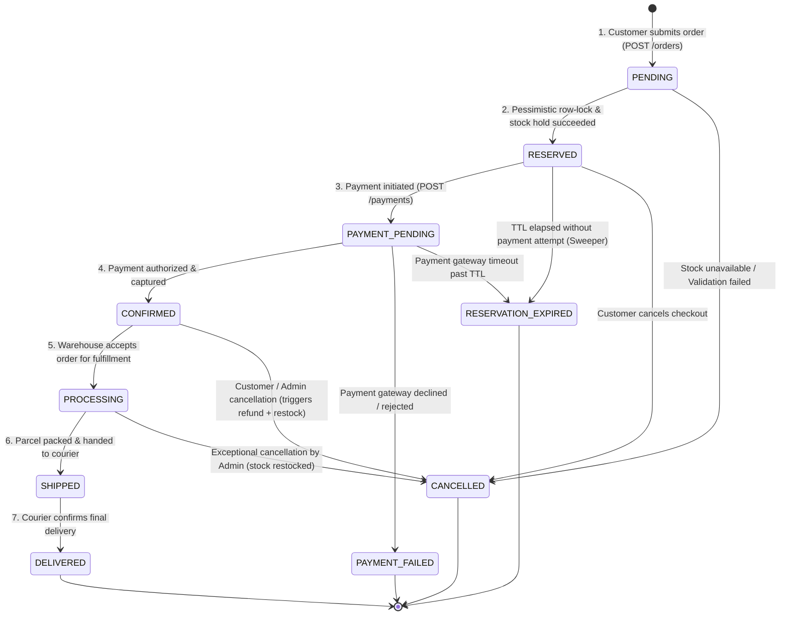
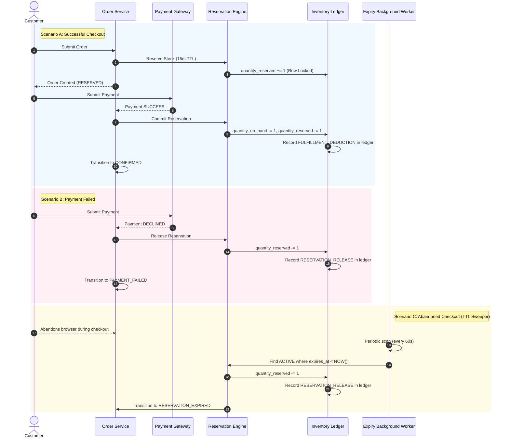

# Order Lifecycle & State Machine Specification
## StockFlow — Distributed Inventory & Order Management System

---

## 1. Overview

The Order Lifecycle is the central operational workflow of StockFlow. It governs how customer intent is converted into warehouse fulfillment while guaranteeing strict stock consistency.

To prevent overselling and stuck inventory, StockFlow models the order lifecycle as a **deterministic finite-state machine (FSM)**. Every transition is strictly validated, and all state changes execute side effects (such as holding, releasing, or committing stock) within atomic database transactions.

---

## 2. Order States Definition

| State | Classification | Description |
| :--- | :--- | :--- |
| **`PENDING`** | Intermediate | Initial state upon payload ingestion and schema validation. Inventory has not yet been reserved. |
| **`RESERVED`** | Active Hold | Multi-warehouse stock availability has been verified and locked. A reservation record with an active TTL (15 min) is created. |
| **`PAYMENT_PENDING`** | Active Hold | Payment attempt has been initiated with the payment gateway or simulation service. Stock remains held. |
| **`CONFIRMED`** | Committed | Payment succeeded. The reservation is committed: stock is deducted from physical `quantity_on_hand` and `quantity_reserved` is cleared. |
| **`PROCESSING`** | Operational | Order items are assigned to warehouse pickers; goods are being picked, verified, and packed. |
| **`SHIPPED`** | Operational | Packed parcel has been handed over to the logistics courier and tracking number is issued. |
| **`DELIVERED`** | Terminal (Success) | Parcel confirmed received by customer. Final successful state. |
| **`CANCELLED`** | Terminal (Abort) | Order cancelled by customer or admin prior to shipping. Any active reservation or payment is compensated. |
| **`PAYMENT_FAILED`** | Terminal (Failure) | Payment gateway declined or timed out. Any active reservation is immediately released back to available stock. |
| **`RESERVATION_EXPIRED`**| Terminal (Timeout) | Customer failed to complete payment before the reservation TTL elapsed. Background sweeper releases held stock. |

---

## 3. Order State Machine Diagram

---

## 4. Valid State Transitions Matrix

The following matrix defines all permissible transitions in the system. Any attempt to transition an order between states without an explicit rule is rejected with an HTTP 422 Unprocessable Entity error.

| From State | Allowed Target State | Triggering Event / Action | Inventory Side Effect |
| :--- | :--- | :--- | :--- |
| **`PENDING`** | `RESERVED` | Atomic stock lock and allocation succeeds. | `quantity_reserved += qty` (Reservation: `ACTIVE`) |
| **`PENDING`** | `CANCELLED` | Validation fails or insufficient stock available. | None |
| **`RESERVED`** | `PAYMENT_PENDING` | User begins checkout / initiates payment. | None (Hold maintained) |
| **`RESERVED`** | `RESERVATION_EXPIRED` | Expiration sweeper worker detects `expires_at < NOW()`. | `quantity_reserved -= qty` (Reservation: `EXPIRED`) |
| **`RESERVED`** | `CANCELLED` | User abandons checkout or clicks cancel. | `quantity_reserved -= qty` (Reservation: `RELEASED`) |
| **`PAYMENT_PENDING`**| `CONFIRMED` | Payment gateway returns successful settlement. | `quantity_on_hand -= qty`, `quantity_reserved -= qty` (Reservation: `COMMITTED`) |
| **`PAYMENT_PENDING`**| `PAYMENT_FAILED` | Gateway declines payment card or invalid funds. | `quantity_reserved -= qty` (Reservation: `RELEASED`) |
| **`PAYMENT_PENDING`**| `RESERVATION_EXPIRED`| Gateway transaction pending past reservation TTL. | `quantity_reserved -= qty` (Reservation: `EXPIRED`) |
| **`CONFIRMED`** | `PROCESSING` | Warehouse management system starts picking batch. | None (Physical stock already deducted) |
| **`CONFIRMED`** | `CANCELLED` | Order cancellation requested before warehouse pick. | `quantity_on_hand += qty` (Compensating Restock) |
| **`PROCESSING`** | `SHIPPED` | Courier tracking label generated and scanned. | None |
| **`PROCESSING`** | `CANCELLED` | Warehouse exception (damaged goods / unfulfillable). | `quantity_on_hand += qty` (Compensating Restock) |
| **`SHIPPED`** | `DELIVERED` | Delivery confirmed via carrier webhook or customer ACK.| None (Order complete) |

---

## 5. Invalid Transitions & Business Invariants

The system enforces strict negative assertions:
1. **No Post-Fulfillment Cancellations:** An order in `SHIPPED` or `DELIVERED` state can **never** transition to `CANCELLED`. Return/RMA workflows are distinct post-delivery domains outside Phase 1.
2. **Terminal States are Final:** `DELIVERED`, `CANCELLED`, `PAYMENT_FAILED`, and `RESERVATION_EXPIRED` are sink states. No further transitions are permitted.
3. **No Unchecked Stock Commitment:** `CONFIRMED` can only be entered if there was an active, non-expired reservation that matches the order amount.
4. **Idempotent Transitions:** If an order is already in `CONFIRMED` and receives a duplicate payment confirmation webhook, the system acknowledges the event without re-committing or double-deducting stock.

---

## 6. Inventory Side Effects & Compensation Workflows

### Detailed Rollback Steps:

#### 1. Payment Failure Rollback:
- Trigger: Payment gateway returns non-retryable error code or card decline.
- Action:
  1. Open database transaction.
  2. Update `payments` table with `status = 'FAILED'` and record `failure_reason`.
  3. Find active `inventory_reservations` for the order.
  4. Decrement `quantity_reserved` by the reserved amount on the target `inventory` row.
  5. Mark `inventory_reservations` as `RELEASED`.
  6. Insert `RESERVATION_RELEASE` record into `inventory_movements`.
  7. Update `orders` status to `PAYMENT_FAILED`.
  8. Commit transaction. Available stock is instantly restored.

#### 2. Reservation Expiration Sweeper:
- Trigger: Background worker evaluates active reservations whose TTL has elapsed.
- Action:
  1. Background worker queries batch: `SELECT * FROM inventory_reservations WHERE status = 'ACTIVE' AND expires_at < NOW() LIMIT 100 FOR UPDATE SKIP LOCKED`.
  2. For each reservation, decrements `quantity_reserved`.
  3. Updates reservation status to `EXPIRED`.
  4. Updates corresponding order status to `RESERVATION_EXPIRED`.
  5. Inserts audit movement `RESERVATION_RELEASE`.
  6. Releases lock. Stock is returned to general availability.

