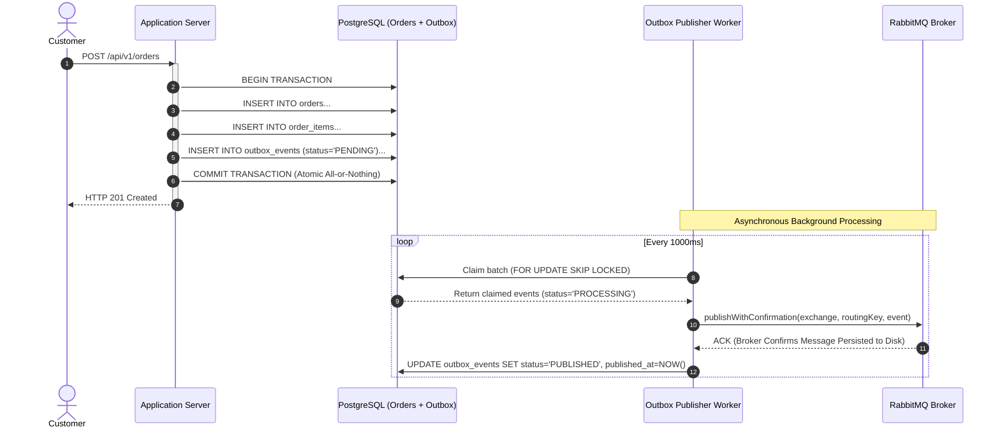

# StockFlow — Transactional Outbox Pattern

## 1. The Dual-Write Problem

In distributed applications, updating a relational database and publishing a message to a message broker within the same operation is susceptible to the **Dual-Write Problem**:

```mermaid
sequenceDiagram
    autonumber
    actor Customer
    participant App as Application Server
    participant DB as PostgreSQL Database
    participant Broker as RabbitMQ Broker

    Customer->>App: POST /api/v1/orders
    activate App
    App->>DB: BEGIN TRANSACTION; INSERT Order... COMMIT;
    Note over App,Broker: Crash occurs here (Power failure, OOM, Network severed)
    App--xBroker: publish('order.created') [LOST!]
    deactivate App
```

If the order is committed to PostgreSQL but the process crashes before transmitting to RabbitMQ, the business change exists permanently, but downstream services are never alerted. Conversely, publishing before committing risks emitting ghost events if the database transaction later aborts or rolls back.

---

## 2. The Solution: Transactional Outbox Pattern

StockFlow resolves this by storing events directly inside PostgreSQL as an append-only outbox table within the **very same ACID database transaction** that creates or updates business entities:



---

## 3. Database Schema

The `outbox_events` table is defined in Prisma:

```prisma
enum OutboxStatus {
  PENDING
  PROCESSING
  PUBLISHED
  FAILED
}

model OutboxEvent {
  id            String       @id @default(uuid()) @db.Uuid
  aggregateType String       @map("aggregate_type") @db.VarChar(50)
  aggregateId   String       @map("aggregate_id") @db.Uuid
  eventType     String       @map("event_type") @db.VarChar(100)
  payload       Json
  status        OutboxStatus @default(PENDING)
  retryCount    Int          @default(0) @map("retry_count")
  lastError     String?      @map("last_error") @db.Text
  retryAfter    DateTime?    @map("retry_after") @db.Timestamptz
  lockedAt      DateTime?    @map("locked_at") @db.Timestamptz
  publishedAt   DateTime?    @map("published_at") @db.Timestamptz
  createdAt     DateTime     @default(now()) @map("created_at") @db.Timestamptz
  updatedAt     DateTime     @updatedAt @map("updated_at") @db.Timestamptz

  @@index([status, createdAt], map: "idx_outbox_status_created")
  @@index([aggregateType, aggregateId], map: "idx_outbox_aggregate")
  @@map("outbox_events")
}
```

---

## 4. Lockless Batch Claiming (`FOR UPDATE SKIP LOCKED`)

To prevent multiple outbox worker instances from contending on or publishing identical events simultaneously, while strictly maintaining sequential event ordering per aggregate, StockFlow leverages PostgreSQL's `FOR UPDATE SKIP LOCKED` combined with an atomic subquery check:

```sql
UPDATE outbox_events
SET status = 'PROCESSING'::"OutboxStatus",
    locked_at = NOW(),
    updated_at = NOW()
WHERE id IN (
  SELECT e.id
  FROM outbox_events e
  WHERE (
    e.status = 'PENDING'::"OutboxStatus"
    OR (
      e.status = 'FAILED'::"OutboxStatus"
      AND e.retry_count < $1
      AND (e.retry_after IS NULL OR e.retry_after <= NOW())
    )
    OR (
      e.status = 'PROCESSING'::"OutboxStatus"
      AND e.locked_at < NOW() - ($2 * INTERVAL '1 second')
    )
  )
  -- Strict per-aggregate FIFO ordering:
  -- Only claim if no earlier event for the same aggregate is unpublished
  AND NOT EXISTS (
    SELECT 1
    FROM outbox_events prior
    WHERE prior.aggregate_type = e.aggregate_type
      AND prior.aggregate_id = e.aggregate_id
      AND prior.id != e.id
      AND prior.status != 'PUBLISHED'::"OutboxStatus"
      AND (
        prior.created_at < e.created_at
        OR (prior.created_at = e.created_at AND prior.id < e.id)
      )
  )
  ORDER BY e.created_at ASC
  LIMIT $3
  FOR UPDATE SKIP LOCKED
)
RETURNING id, aggregate_type, aggregate_id, event_type, payload, status, retry_count, last_error, retry_after, created_at;
```

### Key Engineering Decisions:
1. **Never Hold Database Locks Across Network I/O**: The claim query updates status to `PROCESSING` and commits immediately in milliseconds. Network calls to RabbitMQ are executed outside of any open database transaction.
2. **SKIP LOCKED Concurrency**: Parallel worker processes simply ignore rows already locked by other instances, achieving near-linear scaling without lock contention or deadlocks.
3. **Strict Per-Aggregate FIFO Preservation**: The `NOT EXISTS` clause guarantees that events belonging to the same order (e.g. `order.created` followed by `order.confirmed`) are published in strict creation sequence. A subsequent event is ineligible for claiming until all earlier events for that specific aggregate have reached `PUBLISHED` status.
4. **Cross-Aggregate Parallelism**: The ordering restriction applies only within the same `(aggregate_type, aggregate_id)`. Events for different orders or customers are processed concurrently across workers without head-of-line blocking.
5. **Lease Timeout for Crashed Workers**: If a worker node crashes mid-network transmission, its `lockedAt` timestamp will eventually exceed the lease threshold (`OUTBOX_LOCK_TTL_SECONDS = 60s`). Healthy worker nodes will automatically reclaim and publish the stranded events.

---

## 5. Publisher Confirms & Exponential Backoff Retries

To avoid marking events as published prematurely, StockFlow uses AMQP **Publisher Confirms** (`amqplib.ConfirmChannel`):
- Messages are published with `persistent: true` (DeliveryMode 2), instructing RabbitMQ to flush to disk.
- Only when RabbitMQ emits a confirmation callback does the publisher worker update the database record to `status = 'PUBLISHED'` and assign `published_at = NOW()`.
- If publishing fails (NACK or connection interruption):
  - Status is updated to `FAILED`.
  - `retryCount` is incremented.
  - `lastError` stores the diagnostic message.
  - **Exponential Backoff**: A `retry_after` timestamp is calculated as:
    $$\text{retry\_after} = \text{NOW}() + \min(2^{\text{retryCount}}, 60)\text{ seconds}$$
  - The worker ignores the event until `retry_after <= NOW()`, avoiding hot retry loops during transient broker instability.
- Once `retryCount >= OUTBOX_MAX_RETRIES` (default: 5), the event remains `FAILED` without automated retry until operator intervention.

