```mermaid
xychart-beta
    title "Product Detail Latency Comparison (ms) - Lower is Better"
    x-axis ["Avg Latency", "Median (p50)", "p95 Latency"]
    y-axis "Latency (ms)" 0 --> 120
    bar [89.51, 86.72, 106.34]
    bar [0.87, 0.64, 2.11]
```

```mermaid
xychart-beta
    title "Product Listing Latency Comparison (ms) - Lower is Better"
    x-axis ["Avg Latency", "Median (p50)", "p95 Latency"]
    y-axis "Latency (ms)" 0 --> 120
    bar [93.51, 84.87, 93.40]
    bar [1.83, 1.30, 3.52]
```

# StockFlow — Phase 5 Performance Benchmark Report

## 1. Executive Summary

This report documents the performance evaluation of StockFlow's read APIs before and after introducing **Redis 7 In-Memory Caching**. 

Benchmarks were executed locally against identical database records and query parameters across 100 sequential requests per scenario.

---

## 2. Test Environment Specification

| Component | Specification |
|---|---|
| **Runtime Environment** | Node.js v26.4.0 (TypeScript tsx engine) |
| **Operating System** | macOS Darwin (arm64 / Apple Silicon) |
| **Relational Database** | PostgreSQL (Prisma ORM, connection pool) |
| **Cache Store** | Redis 7-Alpine (Docker container on port 6379) |
| **Sample Size** | 100 requests per benchmark test |
| **Benchmark Script** | `scripts/benchmark.ts` (`npm run benchmark`) |

---

## 3. Product Detail API Benchmark (`GET /api/v1/products/:id`)

Queries a single product by UUID. Without caching, Prisma executes a database lookup on every request. With caching, only the first request touches PostgreSQL; subsequent requests are served from Redis RAM.

| Metric | Without Cache (PostgreSQL) | With Redis Caching | Improvement |
|---|---|---|---|
| **Average Latency** | **89.51 ms** | **0.87 ms** | **~102.9x faster (99.0% reduction)** |
| **Median (p50)** | **86.72 ms** | **0.64 ms** | **~135.5x faster** |
| **p95 Latency** | **106.34 ms** | **2.11 ms** | **~50.4x faster** |
| **Min Latency** | 78.00 ms | 0.40 ms | — |
| **Max Latency** | 190.00 ms | 15.00 ms | — |
| **Throughput** | **10.98 req/s** | **1137.81 req/s** | **~103.6x throughput increase** |
| **Cache Hit Rate** | 0.0% | 100.0% | +100% |

---

## 4. Product Listing API Benchmark (`GET /api/v1/products?page=1&limit=20`)

Queries paginated products with a total count aggregation (`prisma.$transaction([count, findMany])`).

| Metric | Without Cache (PostgreSQL) | With Redis Caching | Improvement |
|---|---|---|---|
| **Average Latency** | **93.51 ms** | **1.83 ms** | **~51.1x faster (98.0% reduction)** |
| **Median (p50)** | **84.87 ms** | **1.30 ms** | **~65.3x faster** |
| **p95 Latency** | **93.40 ms** | **3.52 ms** | **~26.5x faster** |
| **Min Latency** | 80.00 ms | 0.70 ms | — |
| **Max Latency** | 224.00 ms | 11.00 ms | — |
| **Throughput** | **10.40 req/s** | **546.01 req/s** | **~52.5x throughput increase** |
| **Cache Hit Rate** | 0.0% | 100.0% | +100% |

---

## 5. Architectural Analysis

1. **Sub-Millisecond Response Times**: Redis caching drops average product retrieval latencies from ~90ms down to sub-millisecond ranges (0.6ms – 1.8ms), completely bypassing disk I/O, SQL parsing, and connection pool queuing.
2. **Database Protection**: Under peak catalog browsing traffic (e.g. flash sale landing pages), Redis absorbs 99%+ of read requests, preserving database connection pool capacity strictly for transactional order placements and payment commitments.
3. **Deterministic Cache Invalidation**: As verified in `tests/redis-cache.test.ts`, mutating a product instantly invalidates the detail key and scans away listing cache keys, guaranteeing that the 100x speedup does not compromise data freshness.

