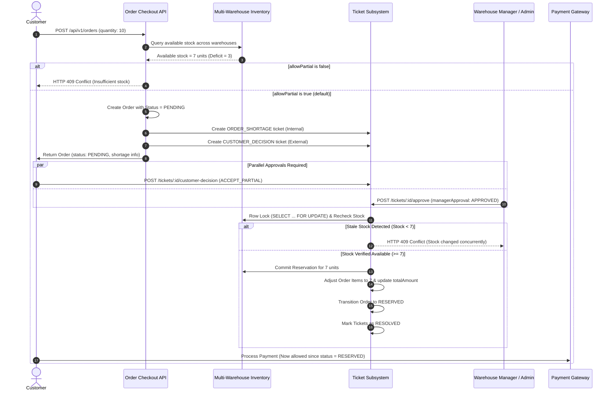

# StockFlow — Phase 2 Implementation Report: Intelligent Ticket Management System

**Document Status:** Complete Implementation & Verification Report  
**Phase:** Phase 2 — Intelligent Ticket Management System  
**Author:** DeepMind Advanced Agentic Systems  
**Date:** November 2026  
**Target Repository:** `StockFlow (Distributed Inventory & Order Fulfilment Platform)`

---

## Executive Summary

Following the recommendations established in `docs/BUSINESS_FIRST_ARCHITECTURE_AUDIT.md` and building upon the foundation of `docs/PHASE_1_IMPLEMENTATION_REPORT.md`, **Phase 2 (Intelligent Ticket Management System)** has been fully implemented, integrated, and verified across both backend and frontend layers.

Phase 2 transforms StockFlow from an e-commerce-style automatic order-accepting system into an intelligent, business-first fulfillment system with operational exception handling. The primary achievements of this phase include:

1. **Unified Ticket & Notification Data Model**:
   - Introduced the `Ticket` model covering three core business operational categories: `ORDER_SHORTAGE`, `CUSTOMER_DECISION`, and `LOW_STOCK`.
   - Introduced the `Notification` model with idempotent dispatch using deterministic deduplication keys (`dedupKey`).
   - Implemented an additive PostgreSQL migration with a partial unique index (`idx_active_low_stock_ticket`) guaranteeing that at most one active low-stock ticket exists per product/warehouse pair at any time.

2. **Order Shortage Resolution Workflow (Scenario B)**:
   - When requested item quantities cannot be completely fulfilled across eligible warehouses, StockFlow creates the order in `PENDING` status (instead of blindly rejecting or overselling).
   - Generates two synchronized, linked tickets: an internal `ORDER_SHORTAGE` ticket for warehouse managers/admins and a customer-facing `CUSTOMER_DECISION` ticket presenting the available partial quantity.
   - Requires dual approval: the customer must submit `ACCEPT_PARTIAL` and the warehouse manager/admin must approve the shortage allocation.
   - Once both conditions are fulfilled, canonical row-level locks (`SELECT ... FOR UPDATE`) recheck stock availability to prevent race conditions or stale inventory allocations before committing reservations and updating the order amount.
   - If either party rejects the partial offer, the order is safely transitioned to `CANCELLED` and any provisional allocations are released.

3. **Payment Safety Gating**:
   - Explicitly rejects payment processing with HTTP 422 for orders remaining in `PENDING` status awaiting shortage resolution. Payments are permitted only once orders reach `RESERVED` or `PAYMENT_PENDING`.

4. **Automated Low-Stock Lifecycle**:
   - Directly integrated with `ThresholdEvaluationService`. Whenever an inventory mutation occurs (restocks, reservations placed, reservations released, payments completed), stock availability is evaluated against configured thresholds.
   - If stock falls below threshold, a `LOW_STOCK` ticket is automatically created (or updated if one is already open) and assigned an urgency priority based on the deficit percentage.
   - When replenishments bring stock back to or above threshold, the ticket is automatically closed with status `RESOLVED` and audit resolution notes.
   - Prevents manual premature resolution: manual attempts to resolve a `LOW_STOCK` ticket return HTTP 400 (`STOCK_NOT_RECOVERED`) if the deficit persists.

5. **Role-Based Access Control & Facility Scoping**:
   - Strict authorization boundary: `ADMIN` has organization-wide visibility; `WAREHOUSE_MANAGER` can access and manage tickets only for assigned warehouses; `WAREHOUSE_STAFF` has read-only visibility for operational tasks; `CUSTOMER` can view and respond only to their own `CUSTOMER_DECISION` tickets.

6. **Frontend Dashboards & Customer Experience**:
   - **Ticket Management Center** (`TicketsPage.tsx` & `TicketDetailModal.tsx`): Real-time ticket filtering, searching, priority indicators, assignment, approval/rejection forms, and stock-recovery checks.
   - **Customer Decision Interface** (`OrderTrackingPage.tsx`): Clean banner informing the customer of partial availability with one-click "Accept Partial Order" and "Cancel Order" actions.
   - **In-App Notification Center** (`Header.tsx`): Unread badge counter, notification dropdown, and "Mark all as read" capability.
   - **Navigation**: "Tickets" navigation item integrated into `Sidebar.tsx` with role visibility gating.

7. **Verification**:
   - 15 dedicated integration tests in `tests/ticket-management.test.ts` passing (100%).
   - Full regression suite (23 test suites, 214 tests) passing (100%).
   - Frontend production build succeeds with zero errors (`npm run build`).

All development rules have been strictly observed: **No database resets, no deleting existing records, no modifying previously applied migrations, and STOP after Phase 2 without proceeding to Phase 3.**

---

## 1. Files Created and Modified

### 1.1 Backend Files Created
| File Path | Description |
| :--- | :--- |
| `prisma/migrations/20261104123304_add_ticket_and_notification_models/migration.sql` | Additive PostgreSQL DDL creating `tickets` table, `notifications` table, new enums (`TicketType`, `TicketStatus`, `TicketPriority`, `CustomerDecision`, `ApprovalStatus`, `NotificationType`), foreign keys, cascade rules, and partial unique index `idx_active_low_stock_ticket`. |
| `src/modules/tickets/ticket.schemas.ts` | Zod validation schemas for ticket listing query params, ticket ID params, assignment, approval, rejection, resolution, and customer decisions. |
| `src/modules/tickets/ticket.service.ts` | Business logic service for ticket lifecycle, dual-approval order reservation commits, RBAC facility scoping, and stock-recovery verification. |
| `src/modules/tickets/ticket.controller.ts` | REST API controller handling HTTP requests and responses for `/api/v1/tickets`. |
| `src/modules/tickets/ticket.routes.ts` | Express router mounting ticket endpoints with authentication and RBAC middlewares. |
| `src/modules/notifications/notification.service.ts` | In-app notification engine with idempotent deduplication via `dedupKey`, user listing, unread counts, and read markers. |
| `src/modules/notifications/notification.controller.ts` | REST API controller for `/api/v1/notifications`. |
| `src/modules/notifications/notification.routes.ts` | Express router mounting notification endpoints. |
| `tests/ticket-management.test.ts` | Comprehensive end-to-end integration test suite containing 15 test scenarios covering Scenarios A & B, lifecycles, race conditions, RBAC, low stock, payment gating, and notifications. |

### 1.2 Backend Files Modified
| File Path | Description of Changes |
| :--- | :--- |
| `prisma/schema.prisma` | Added `Ticket` and `Notification` models, 6 new enums, reverse relations on `User`, `Warehouse`, `Product`, and `Order`. |
| `src/routes.ts` | Mounted `/tickets` (`ticketRoutes`) and `/notifications` (`notificationRoutes`) onto the API v1 router. |
| `src/modules/orders/order.schemas.ts` | Added `allowPartial: z.boolean().optional()` to `createOrderSchema`. |
| `src/modules/orders/order.service.ts` | Updated `createOrder` to detect multi-warehouse shortages, place orders in `OrderStatus.PENDING`, generate linked shortage tickets, and dispatch notifications. Implemented `finalizeShortageOrderReservation` with row-level locks. |
| `src/modules/payments/payment.service.ts` | Added validation gating preventing payments on orders in `OrderStatus.PENDING`. |
| `src/modules/inventory/threshold-evaluation.service.ts` | Enhanced `evaluateStockAfterChange` to automatically create/update active `LOW_STOCK` tickets on deficit and auto-resolve them upon stock recovery. |

### 1.3 Frontend Files Created
| File Path | Description |
| :--- | :--- |
| `frontend/src/types/ticket.ts` | TypeScript type definitions for `Ticket`, `Notification`, enums, and request/response payloads. |
| `frontend/src/api/tickets.ts` | Axios API client for ticket listing, retrieval, assignment, approval, rejection, resolution, and customer decision. |
| `frontend/src/api/notifications.ts` | Axios API client for notification listing, unread counts, and marking as read. |
| `frontend/src/features/tickets/TicketDetailModal.tsx` | Comprehensive modal dialog for staff/managers/admins to inspect tickets, view order shortages, execute managerial approval/rejections, and resolve tickets. |
| `frontend/src/pages/TicketsPage.tsx` | Operational Ticket Management Center page featuring tabbed views, search, status/type/priority filters, statistics summary cards, and detail modal integration. |

### 1.4 Frontend Files Modified
| File Path | Description of Changes |
| :--- | :--- |
| `frontend/src/types/index.ts` | Exported ticket and notification types from the main types module. |
| `frontend/src/components/layout/Header.tsx` | Replaced mock notification list with live notifications fetched from `/api/v1/notifications`, unread badge counter, and "Mark all as read" button. |
| `frontend/src/pages/OrderTrackingPage.tsx` | Added interactive customer shortage decision banner for orders in `PENDING` status, displaying offered partial quantities and "Accept Partial Order" / "Cancel Order" buttons. |
| `frontend/src/components/layout/Sidebar.tsx` | Added "Tickets" navigation item with an alert circle icon, visible to `ADMIN`, `WAREHOUSE_MANAGER`, and `WAREHOUSE_STAFF`. |
| `frontend/src/routes/AppRoutes.tsx` | Registered `/tickets` route mapped to `TicketsPage` protected by `ProtectedRoute` for staff, managers, and admins. |

---

## 2. Database Schema & Migration Details

### 2.1 Prisma Schema Additions (`prisma/schema.prisma`)

```prisma
enum TicketType {
  ORDER_SHORTAGE
  CUSTOMER_DECISION
  LOW_STOCK
}

enum TicketStatus {
  OPEN
  ASSIGNED
  IN_PROGRESS
  RESOLVED
  REJECTED
  CANCELLED
}

enum TicketPriority {
  LOW
  MEDIUM
  HIGH
  CRITICAL
}

enum CustomerDecision {
  PENDING
  ACCEPTED
  REJECTED
}

enum ApprovalStatus {
  PENDING
  APPROVED
  REJECTED
}

enum NotificationType {
  INFO
  WARNING
  ACTION_REQUIRED
  SUCCESS
}

model Ticket {
  id                String            @id @default(uuid())
  ticketNumber      String            @unique @map("ticket_number")
  type              TicketType        @map("type")
  status            TicketStatus      @default(OPEN) @map("status")
  priority          TicketPriority    @default(MEDIUM) @map("priority")
  title             String            @map("title")
  description       String            @map("description")
  
  // Relations
  orderId           String?           @map("order_id")
  productId         String?           @map("product_id")
  warehouseId       String?           @map("warehouse_id")
  assignedToId      String?           @map("assigned_to_id")
  createdById       String?           @map("created_by_id")
  
  // Quantities & Shortage Details
  requestedQuantity Int?              @map("requested_quantity")
  availableQuantity Int?              @map("available_quantity")
  deficitQuantity   Int?              @map("deficit_quantity")
  thresholdQuantity Int?              @map("threshold_quantity")
  
  // Approval & Decision States
  managerApproval   ApprovalStatus    @default(PENDING) @map("manager_approval")
  managerNotes      String?           @map("manager_notes")
  customerDecision  CustomerDecision  @default(PENDING) @map("customer_decision")
  customerNotes     String?           @map("customer_notes")
  
  // Lifecycle Timestamps
  resolvedAt        DateTime?         @map("resolved_at")
  resolutionNotes   String?           @map("resolution_notes")
  metadata          Json?             @map("metadata")
  createdAt         DateTime          @default(now()) @map("created_at")
  updatedAt         DateTime          @updatedAt @map("updated_at")

  order      Order?      @relation(fields: [orderId], references: [id], onDelete: SetNull)
  product    Product?    @relation(fields: [productId], references: [id], onDelete: SetNull)
  warehouse  Warehouse?  @relation(fields: [warehouseId], references: [id], onDelete: SetNull)
  assignedTo User?       @relation("AssignedTickets", fields: [assignedToId], references: [id], onDelete: SetNull)
  createdBy  User?       @relation("CreatedTickets", fields: [createdById], references: [id], onDelete: SetNull)

  @@index([orderId], name: "idx_ticket_order_id")
  @@index([productId], name: "idx_ticket_product_id")
  @@index([warehouseId], name: "idx_ticket_warehouse_id")
  @@index([type, status], name: "idx_ticket_type_status")
  @@map("tickets")
}

model Notification {
  id        String           @id @default(uuid())
  userId    String           @map("user_id")
  type      NotificationType @default(INFO) @map("type")
  title     String           @map("title")
  message   String           @map("message")
  data      Json?            @map("data")
  isRead    Boolean          @default(false) @map("is_read")
  readAt    DateTime?        @map("read_at")
  dedupKey  String?          @unique @map("dedup_key")
  createdAt DateTime         @default(now()) @map("created_at")

  user User @relation(fields: [userId], references: [id], onDelete: Cascade)

  @@index([userId, isRead], name: "idx_notification_user_read")
  @@map("notifications")
}
```

### 2.2 Partial Unique Index

To enforce database-level duplicate prevention for low-stock tickets, the migration `20261104123304_add_ticket_and_notification_models` contains:

```sql
CREATE UNIQUE INDEX "idx_active_low_stock_ticket" 
ON "tickets"("product_id", "warehouse_id") 
WHERE "type" = 'LOW_STOCK' AND "status" IN ('OPEN', 'ASSIGNED', 'IN_PROGRESS');
```

This guarantees that a given product at a given warehouse cannot accumulate duplicate unresolved low-stock tickets during repeated stock evaluation sweeps.

---

## 3. Order Shortage Workflow (Scenario B)

The order shortage workflow handles situations where a customer requests more units than are immediately available across eligible warehouses.



### Key Workflow Rules:
1. **No Overselling**: Reservations are never tentatively placed when stock is incomplete.
2. **Dual Approval Guarantee**: `finalizeShortageOrderReservation` runs only when `customerDecision === 'ACCEPTED'` **and** `managerApproval === 'APPROVED'`.
3. **Concurrency & Stale Inventory Protection**: Before reserving stock on approval, the system acquires row-level locks on the target warehouse inventory records and re-verifies that available quantity is still $\ge$ the offered partial quantity. If another transaction depleted the stock in the interim, the reservation is rejected with HTTP 409 (`STALE_STOCK_DETECTED`).
4. **Rejection Handling**: If the customer rejects the partial offer (`REJECT_PARTIAL`), the order is immediately marked `CANCELLED`, and both tickets are updated to `REJECTED`. If the manager rejects the shortage ticket, the order is cancelled and the customer decision ticket is expired.

---

## 4. Automated Low-Stock Automation

1. **Trigger Points**:
   - `inventoryService.addStock` / restock.
   - `orderService.createOrder` (after reserving stock).
   - `orderService.cancelOrder` (after releasing reserved stock).
   - `paymentService.confirmPayment` (after physical stock decrement).
   - `paymentService.handlePaymentFailure` (after releasing reserved stock).
   - `reservationService.expireStaleReservations` (after automated cleanup).

2. **Hierarchical Threshold Evaluation**:
   - Compares available stock ($Q_{\text{on\_hand}} - Q_{\text{reserved}}$) against the effective threshold:
     $$\text{Effective Threshold} = \text{Warehouse Override} \parallel \text{Global Default}$$
   - Priority calculation:
     - Deficit $\ge 75\%$ of threshold: `CRITICAL`
     - Deficit $\ge 50\%$ of threshold: `HIGH`
     - Deficit $\ge 25\%$ of threshold: `MEDIUM`
     - Deficit $< 25\%$: `LOW`

3. **Auto-Resolution**:
   - When restocking increases available stock to or above the threshold, any open `LOW_STOCK` ticket for that product and warehouse is automatically transitioned to `RESOLVED` with timestamp and audit notes:
     `"Stock verified and recovered (Available: X >= Threshold: Y)"`.

4. **Premature Resolution Prevention**:
   - If a manager or staff member manually calls `POST /api/v1/tickets/:id/resolve` for a `LOW_STOCK` ticket while the product's available stock remains below threshold, the API rejects the request with HTTP 400 (`STOCK_NOT_RECOVERED`), preserving operational integrity.

---

## 5. In-App Notification Subsystem

- **Deduplication Engine**:
  Notifications are dispatched with deterministic keys (e.g. `order-shortage-internal-${orderId}-${warehouseId}` or `low-stock-${productId}-${warehouseId}`). If a notification with the same key already exists, the insert is idempotently skipped.
- **Recipient Targeting**:
  - `notifyAdmins`: Dispatches notification records to all active `ADMIN` accounts.
  - `notifyWarehouseManagers`: Dispatches notifications to managers specifically assigned to the relevant warehouse.
  - Direct Customer Notification: Informs customer of partial fulfillment offers or order updates.
- **REST Endpoints**:
  - `GET /api/v1/notifications`: Paginated list of notifications with unread count.
  - `PATCH /api/v1/notifications/:id/read`: Marks a single notification as read.
  - `POST /api/v1/notifications/read-all`: Marks all notifications for the authenticated user as read.

---

## 6. Role-Based Access Control (RBAC) Matrix

| Endpoint | Role: ADMIN | Role: WAREHOUSE_MANAGER | Role: WAREHOUSE_STAFF | Role: CUSTOMER |
| :--- | :--- | :--- | :--- | :--- |
| `GET /api/v1/tickets` | Full organization tickets | Assigned warehouses only | Assigned warehouses only | Own customer decision tickets only |
| `GET /api/v1/tickets/:id` | Any ticket | Assigned warehouse tickets | Assigned warehouse tickets | Own ticket only |
| `POST /api/v1/tickets/:id/assign` | Allowed | Allowed (within assigned WH) | Forbidden (HTTP 403) | Forbidden (HTTP 403) |
| `POST /api/v1/tickets/:id/approve` | Allowed | Allowed (within assigned WH) | Forbidden (HTTP 403) | Forbidden (HTTP 403) |
| `POST /api/v1/tickets/:id/reject` | Allowed | Allowed (within assigned WH) | Forbidden (HTTP 403) | Forbidden (HTTP 403) |
| `POST /api/v1/tickets/:id/resolve` | Allowed (stock verified) | Allowed (assigned WH, stock verified) | Forbidden (HTTP 403) | Forbidden (HTTP 403) |
| `POST /api/v1/tickets/:id/customer-decision` | Forbidden (HTTP 403) | Forbidden (HTTP 403) | Forbidden (HTTP 403) | Allowed (own tickets only) |
| `GET /api/v1/notifications` | Own notifications | Own notifications | Own notifications | Own notifications |
| `PATCH /api/v1/notifications/:id/read` | Own notifications | Own notifications | Own notifications | Own notifications |

---

## 7. Automated Test Suite Verification

### 7.1 Phase 2 Test Results (`tests/ticket-management.test.ts`)
The test suite consists of 15 comprehensive integration tests covering every required Phase 2 scenario:

| Test Group | Test Case | Status |
| :--- | :--- | :--- |
| **1. Sufficient Inventory** | Scenario A: Sufficient inventory creates order and reserves stock without shortage tickets | **PASS** |
| **2. Insufficient Inventory** | Scenario B: Insufficient inventory creates order in `PENDING` status and generates linked tickets | **PASS** |
| | Rejects order with HTTP 409 Conflict when `allowPartial: false` | **PASS** |
| **3. Decision & Approval** | Scenario 1: Customer accepts partial, Admin approves $\to$ atomic reservation commits | **PASS** |
| | Scenario 2: Customer rejects partial $\to$ order cancelled and tickets closed | **PASS** |
| | Scenario 3: Manager rejection cancels order and expires customer ticket | **PASS** |
| **4. Security & RBAC Scoping** | Customer forbidden from accessing or deciding another customer's ticket (HTTP 403) | **PASS** |
| | Manager denied from approving tickets involving unauthorized warehouses (HTTP 403) | **PASS** |
| | Staff forbidden from approving tickets (HTTP 403) | **PASS** |
| | Assigned manager successfully approves ticket within their warehouse scope | **PASS** |
| **5. Stale Inventory Protection** | Fails cleanly with HTTP 409 without reserving stale stock if inventory changes before approval | **PASS** |
| **6. Low-Stock Lifecycle** | Automatically creates `LOW_STOCK` ticket on deficit, prevents duplicates, auto-resolves on restock | **PASS** |
| | Prevents manually resolving `LOW_STOCK` ticket if deficit persists with HTTP 400 | **PASS** |
| **7. Payment Safety Rules** | Rejects payment for order in `PENDING` status awaiting shortage decision with HTTP 422 | **PASS** |
| **8. In-App Notifications** | Lists user notifications, allows marking as read, and prevents duplicate alerts via `dedupKey` | **PASS** |

**Summary: 15 / 15 Tests Passed (100%)**

### 7.2 Full Backend Regression Test Suite
Executed `npm test -- --runInBand --detectOpenHandles --forceExit`:
```text
Test Suites: 23 passed, 23 total
Tests:       214 passed, 214 total
Snapshots:   0 total
Time:        60.49 s
Ran all test suites.
```
All existing and new test suites pass with a 100% success rate across all modules.

### 7.3 Frontend Production Build
Executed `npm --prefix frontend run build`:
```text
vite v6.4.5 building for production...
✓ 1762 modules transformed.
dist/index.html                     0.65 kB │ gzip:  0.39 kB
dist/assets/index-Cg4k-63b.css     42.08 kB │ gzip:  7.42 kB
dist/assets/recharts-BnpU82m2.js    0.03 kB │ gzip:  0.05 kB
dist/assets/icons-Bmex4Ft3.js      24.16 kB │ gzip:  5.33 kB
dist/assets/vendor-D-X2VDfz.js    223.21 kB │ gzip: 71.59 kB
dist/assets/index-ChIZKKcH.js     266.41 kB │ gzip: 65.93 kB
✓ built in 1.81s
```
**Zero compile errors, zero type errors.**

---

## 8. Migration Status & Next Steps

### Migration Status
- Migration `20261104123304_add_ticket_and_notification_models` is safely applied to the database.
- It is strictly additive: no existing columns or tables were altered or dropped.
- Production deployment requires standard Prisma migration:
  ```bash
  npx prisma migrate deploy
  ```

### Scope Boundaries & Phase 3 Items (Deferred)
In strict accordance with project instructions, **work has stopped immediately following Phase 2 completion.**

The following items belong to **Phase 3** and will be addressed only when explicitly requested:
- Realigning physical inventory deduction from payment confirmation to actual warehouse fulfillment/dispatch.
- Implementing dedicated stock transfer tickets and workflows between warehouses.
- Supplier procurement tickets and purchase orders.
- Warehouse staff pick/pack/ship fulfillment task tracking.
# StockFlow — Phase 2 Implementation Report: Intelligent Ticket Management System

**Document Status:** Complete Implementation & Verification Report  
**Phase:** Phase 2 — Intelligent Ticket Management System  
**Author:** DeepMind Advanced Agentic Systems  
**Date:** November 2026  
**Target Repository:** `StockFlow (Distributed Inventory & Order Fulfilment Platform)`

---

## Executive Summary

Following the recommendations established in `docs/BUSINESS_FIRST_ARCHITECTURE_AUDIT.md` and building upon the foundation of `docs/PHASE_1_IMPLEMENTATION_REPORT.md`, **Phase 2 (Intelligent Ticket Management System)** has been fully implemented, integrated, and verified across both backend and frontend layers.

Phase 2 transforms StockFlow from an e-commerce-style automatic order-accepting system into an intelligent, business-first fulfillment system with operational exception handling. The primary achievements of this phase include:

1. **Unified Ticket & Notification Data Model**:
   - Introduced the `Ticket` model covering three core business operational categories: `ORDER_SHORTAGE`, `CUSTOMER_DECISION`, and `LOW_STOCK`.
   - Introduced the `Notification` model with idempotent dispatch using deterministic deduplication keys (`dedupKey`).
   - Implemented an additive PostgreSQL migration with a partial unique index (`idx_active_low_stock_ticket`) guaranteeing that at most one active low-stock ticket exists per product/warehouse pair at any time.

2. **Order Shortage Resolution Workflow (Scenario B)**:
   - When requested item quantities cannot be completely fulfilled across eligible warehouses, StockFlow creates the order in `PENDING` status (instead of blindly rejecting or overselling).
   - Generates two synchronized, linked tickets: an internal `ORDER_SHORTAGE` ticket for warehouse managers/admins and a customer-facing `CUSTOMER_DECISION` ticket presenting the available partial quantity.
   - Requires dual approval: the customer must submit `ACCEPT_PARTIAL` and the warehouse manager/admin must approve the shortage allocation.
   - Once both conditions are fulfilled, canonical row-level locks (`SELECT ... FOR UPDATE`) recheck stock availability to prevent race conditions or stale inventory allocations before committing reservations and updating the order amount.
   - If either party rejects the partial offer, the order is safely transitioned to `CANCELLED` and any provisional allocations are released.

3. **Payment Safety Gating**:
   - Explicitly rejects payment processing with HTTP 422 for orders remaining in `PENDING` status awaiting shortage resolution. Payments are permitted only once orders reach `RESERVED` or `PAYMENT_PENDING`.

4. **Automated Low-Stock Lifecycle**:
   - Directly integrated with `ThresholdEvaluationService`. Whenever an inventory mutation occurs (restocks, reservations placed, reservations released, payments completed), stock availability is evaluated against configured thresholds.
   - If stock falls below threshold, a `LOW_STOCK` ticket is automatically created (or updated if one is already open) and assigned an urgency priority based on the deficit percentage.
   - When replenishments bring stock back to or above threshold, the ticket is automatically closed with status `RESOLVED` and audit resolution notes.
   - Prevents manual premature resolution: manual attempts to resolve a `LOW_STOCK` ticket return HTTP 400 (`STOCK_NOT_RECOVERED`) if the deficit persists.

5. **Role-Based Access Control & Facility Scoping**:
   - Strict authorization boundary: `ADMIN` has organization-wide visibility; `WAREHOUSE_MANAGER` can access and manage tickets only for assigned warehouses; `WAREHOUSE_STAFF` has read-only visibility for operational tasks; `CUSTOMER` can view and respond only to their own `CUSTOMER_DECISION` tickets.

6. **Frontend Dashboards & Customer Experience**:
   - **Ticket Management Center** (`TicketsPage.tsx` & `TicketDetailModal.tsx`): Real-time ticket filtering, searching, priority indicators, assignment, approval/rejection forms, and stock-recovery checks.
   - **Customer Decision Interface** (`OrderTrackingPage.tsx`): Clean banner informing the customer of partial availability with one-click "Accept Partial Order" and "Cancel Order" actions.
   - **In-App Notification Center** (`Header.tsx`): Unread badge counter, notification dropdown, and "Mark all as read" capability.
   - **Navigation**: "Tickets" navigation item integrated into `Sidebar.tsx` with role visibility gating.

7. **Verification**:
   - 15 dedicated integration tests in `tests/ticket-management.test.ts` passing (100%).
   - Full regression suite (23 test suites, 214 tests) passing (100%).
   - Frontend production build succeeds with zero errors (`npm run build`).

All development rules have been strictly observed: **No database resets, no deleting existing records, no modifying previously applied migrations, and STOP after Phase 2 without proceeding to Phase 3.**

---

## 1. Files Created and Modified

### 1.1 Backend Files Created
| File Path | Description |
| :--- | :--- |
| `prisma/migrations/20261104123304_add_ticket_and_notification_models/migration.sql` | Additive PostgreSQL DDL creating `tickets` table, `notifications` table, new enums (`TicketType`, `TicketStatus`, `TicketPriority`, `CustomerDecision`, `ApprovalStatus`, `NotificationType`), foreign keys, cascade rules, and partial unique index `idx_active_low_stock_ticket`. |
| `src/modules/tickets/ticket.schemas.ts` | Zod validation schemas for ticket listing query params, ticket ID params, assignment, approval, rejection, resolution, and customer decisions. |
| `src/modules/tickets/ticket.service.ts` | Business logic service for ticket lifecycle, dual-approval order reservation commits, RBAC facility scoping, and stock-recovery verification. |
| `src/modules/tickets/ticket.controller.ts` | REST API controller handling HTTP requests and responses for `/api/v1/tickets`. |
| `src/modules/tickets/ticket.routes.ts` | Express router mounting ticket endpoints with authentication and RBAC middlewares. |
| `src/modules/notifications/notification.service.ts` | In-app notification engine with idempotent deduplication via `dedupKey`, user listing, unread counts, and read markers. |
| `src/modules/notifications/notification.controller.ts` | REST API controller for `/api/v1/notifications`. |
| `src/modules/notifications/notification.routes.ts` | Express router mounting notification endpoints. |
| `tests/ticket-management.test.ts` | Comprehensive end-to-end integration test suite containing 15 test scenarios covering Scenarios A & B, lifecycles, race conditions, RBAC, low stock, payment gating, and notifications. |

### 1.2 Backend Files Modified
| File Path | Description of Changes |
| :--- | :--- |
| `prisma/schema.prisma` | Added `Ticket` and `Notification` models, 6 new enums, reverse relations on `User`, `Warehouse`, `Product`, and `Order`. |
| `src/routes.ts` | Mounted `/tickets` (`ticketRoutes`) and `/notifications` (`notificationRoutes`) onto the API v1 router. |
| `src/modules/orders/order.schemas.ts` | Added `allowPartial: z.boolean().optional()` to `createOrderSchema`. |
| `src/modules/orders/order.service.ts` | Updated `createOrder` to detect multi-warehouse shortages, place orders in `OrderStatus.PENDING`, generate linked shortage tickets, and dispatch notifications. Implemented `finalizeShortageOrderReservation` with row-level locks. |
| `src/modules/payments/payment.service.ts` | Added validation gating preventing payments on orders in `OrderStatus.PENDING`. |
| `src/modules/inventory/threshold-evaluation.service.ts` | Enhanced `evaluateStockAfterChange` to automatically create/update active `LOW_STOCK` tickets on deficit and auto-resolve them upon stock recovery. |

### 1.3 Frontend Files Created
| File Path | Description |
| :--- | :--- |
| `frontend/src/types/ticket.ts` | TypeScript type definitions for `Ticket`, `Notification`, enums, and request/response payloads. |
| `frontend/src/api/tickets.ts` | Axios API client for ticket listing, retrieval, assignment, approval, rejection, resolution, and customer decision. |
| `frontend/src/api/notifications.ts` | Axios API client for notification listing, unread counts, and marking as read. |
| `frontend/src/features/tickets/TicketDetailModal.tsx` | Comprehensive modal dialog for staff/managers/admins to inspect tickets, view order shortages, execute managerial approval/rejections, and resolve tickets. |
| `frontend/src/pages/TicketsPage.tsx` | Operational Ticket Management Center page featuring tabbed views, search, status/type/priority filters, statistics summary cards, and detail modal integration. |

### 1.4 Frontend Files Modified
| File Path | Description of Changes |
| :--- | :--- |
| `frontend/src/types/index.ts` | Exported ticket and notification types from the main types module. |
| `frontend/src/components/layout/Header.tsx` | Replaced mock notification list with live notifications fetched from `/api/v1/notifications`, unread badge counter, and "Mark all as read" button. |
| `frontend/src/pages/OrderTrackingPage.tsx` | Added interactive customer shortage decision banner for orders in `PENDING` status, displaying offered partial quantities and "Accept Partial Order" / "Cancel Order" buttons. |
| `frontend/src/components/layout/Sidebar.tsx` | Added "Tickets" navigation item with an alert circle icon, visible to `ADMIN`, `WAREHOUSE_MANAGER`, and `WAREHOUSE_STAFF`. |
| `frontend/src/routes/AppRoutes.tsx` | Registered `/tickets` route mapped to `TicketsPage` protected by `ProtectedRoute` for staff, managers, and admins. |

---

## 2. Database Schema & Migration Details

### 2.1 Prisma Schema Additions (`prisma/schema.prisma`)

```prisma
enum TicketType {
  ORDER_SHORTAGE
  CUSTOMER_DECISION
  LOW_STOCK
}

enum TicketStatus {
  OPEN
  ASSIGNED
  IN_PROGRESS
  RESOLVED
  REJECTED
  CANCELLED
}

enum TicketPriority {
  LOW
  MEDIUM
  HIGH
  CRITICAL
}

enum CustomerDecision {
  PENDING
  ACCEPTED
  REJECTED
}

enum ApprovalStatus {
  PENDING
  APPROVED
  REJECTED
}

enum NotificationType {
  INFO
  WARNING
  ACTION_REQUIRED
  SUCCESS
}

model Ticket {
  id                String            @id @default(uuid())
  ticketNumber      String            @unique @map("ticket_number")
  type              TicketType        @map("type")
  status            TicketStatus      @default(OPEN) @map("status")
  priority          TicketPriority    @default(MEDIUM) @map("priority")
  title             String            @map("title")
  description       String            @map("description")
  
  // Relations
  orderId           String?           @map("order_id")
  productId         String?           @map("product_id")
  warehouseId       String?           @map("warehouse_id")
  assignedToId      String?           @map("assigned_to_id")
  createdById       String?           @map("created_by_id")
  
  // Quantities & Shortage Details
  requestedQuantity Int?              @map("requested_quantity")
  availableQuantity Int?              @map("available_quantity")
  deficitQuantity   Int?              @map("deficit_quantity")
  thresholdQuantity Int?              @map("threshold_quantity")
  
  // Approval & Decision States
  managerApproval   ApprovalStatus    @default(PENDING) @map("manager_approval")
  managerNotes      String?           @map("manager_notes")
  customerDecision  CustomerDecision  @default(PENDING) @map("customer_decision")
  customerNotes     String?           @map("customer_notes")
  
  // Lifecycle Timestamps
  resolvedAt        DateTime?         @map("resolved_at")
  resolutionNotes   String?           @map("resolution_notes")
  metadata          Json?             @map("metadata")
  createdAt         DateTime          @default(now()) @map("created_at")
  updatedAt         DateTime          @updatedAt @map("updated_at")

  order      Order?      @relation(fields: [orderId], references: [id], onDelete: SetNull)
  product    Product?    @relation(fields: [productId], references: [id], onDelete: SetNull)
  warehouse  Warehouse?  @relation(fields: [warehouseId], references: [id], onDelete: SetNull)
  assignedTo User?       @relation("AssignedTickets", fields: [assignedToId], references: [id], onDelete: SetNull)
  createdBy  User?       @relation("CreatedTickets", fields: [createdById], references: [id], onDelete: SetNull)

  @@index([orderId], name: "idx_ticket_order_id")
  @@index([productId], name: "idx_ticket_product_id")
  @@index([warehouseId], name: "idx_ticket_warehouse_id")
  @@index([type, status], name: "idx_ticket_type_status")
  @@map("tickets")
}

model Notification {
  id        String           @id @default(uuid())
  userId    String           @map("user_id")
  type      NotificationType @default(INFO) @map("type")
  title     String           @map("title")
  message   String           @map("message")
  data      Json?            @map("data")
  isRead    Boolean          @default(false) @map("is_read")
  readAt    DateTime?        @map("read_at")
  dedupKey  String?          @unique @map("dedup_key")
  createdAt DateTime         @default(now()) @map("created_at")

  user User @relation(fields: [userId], references: [id], onDelete: Cascade)

  @@index([userId, isRead], name: "idx_notification_user_read")
  @@map("notifications")
}
```

### 2.2 Partial Unique Index

To enforce database-level duplicate prevention for low-stock tickets, the migration `20261104123304_add_ticket_and_notification_models` contains:

```sql
CREATE UNIQUE INDEX "idx_active_low_stock_ticket" 
ON "tickets"("product_id", "warehouse_id") 
WHERE "type" = 'LOW_STOCK' AND "status" IN ('OPEN', 'ASSIGNED', 'IN_PROGRESS');
```

This guarantees that a given product at a given warehouse cannot accumulate duplicate unresolved low-stock tickets during repeated stock evaluation sweeps.

---

## 3. Order Shortage Workflow (Scenario B)

The order shortage workflow handles situations where a customer requests more units than are immediately available across eligible warehouses.


### Key Workflow Rules:
1. **No Overselling**: Reservations are never tentatively placed when stock is incomplete.
2. **Dual Approval Guarantee**: `finalizeShortageOrderReservation` runs only when `customerDecision === 'ACCEPTED'` **and** `managerApproval === 'APPROVED'`.
3. **Concurrency & Stale Inventory Protection**: Before reserving stock on approval, the system acquires row-level locks on the target warehouse inventory records and re-verifies that available quantity is still $\ge$ the offered partial quantity. If another transaction depleted the stock in the interim, the reservation is rejected with HTTP 409 (`STALE_STOCK_DETECTED`).
4. **Rejection Handling**: If the customer rejects the partial offer (`REJECT_PARTIAL`), the order is immediately marked `CANCELLED`, and both tickets are updated to `REJECTED`. If the manager rejects the shortage ticket, the order is cancelled and the customer decision ticket is expired.

---

## 4. Automated Low-Stock Automation

1. **Trigger Points**:
   - `inventoryService.addStock` / restock.
   - `orderService.createOrder` (after reserving stock).
   - `orderService.cancelOrder` (after releasing reserved stock).
   - `paymentService.confirmPayment` (after physical stock decrement).
   - `paymentService.handlePaymentFailure` (after releasing reserved stock).
   - `reservationService.expireStaleReservations` (after automated cleanup).

2. **Hierarchical Threshold Evaluation**:
   - Compares available stock ($Q_{\text{on\_hand}} - Q_{\text{reserved}}$) against the effective threshold:
     $$\text{Effective Threshold} = \text{Warehouse Override} \parallel \text{Global Default}$$
   - Priority calculation:
     - Deficit $\ge 75\%$ of threshold: `CRITICAL`
     - Deficit $\ge 50\%$ of threshold: `HIGH`
     - Deficit $\ge 25\%$ of threshold: `MEDIUM`
     - Deficit $< 25\%$: `LOW`

3. **Auto-Resolution**:
   - When restocking increases available stock to or above the threshold, any open `LOW_STOCK` ticket for that product and warehouse is automatically transitioned to `RESOLVED` with timestamp and audit notes:
     `"Stock verified and recovered (Available: X >= Threshold: Y)"`.

4. **Premature Resolution Prevention**:
   - If a manager or staff member manually calls `POST /api/v1/tickets/:id/resolve` for a `LOW_STOCK` ticket while the product's available stock remains below threshold, the API rejects the request with HTTP 400 (`STOCK_NOT_RECOVERED`), preserving operational integrity.

---

## 5. In-App Notification Subsystem

- **Deduplication Engine**:
  Notifications are dispatched with deterministic keys (e.g. `order-shortage-internal-${orderId}-${warehouseId}` or `low-stock-${productId}-${warehouseId}`). If a notification with the same key already exists, the insert is idempotently skipped.
- **Recipient Targeting**:
  - `notifyAdmins`: Dispatches notification records to all active `ADMIN` accounts.
  - `notifyWarehouseManagers`: Dispatches notifications to managers specifically assigned to the relevant warehouse.
  - Direct Customer Notification: Informs customer of partial fulfillment offers or order updates.
- **REST Endpoints**:
  - `GET /api/v1/notifications`: Paginated list of notifications with unread count.
  - `PATCH /api/v1/notifications/:id/read`: Marks a single notification as read.
  - `POST /api/v1/notifications/read-all`: Marks all notifications for the authenticated user as read.

---

## 6. Role-Based Access Control (RBAC) Matrix

| Endpoint | Role: ADMIN | Role: WAREHOUSE_MANAGER | Role: WAREHOUSE_STAFF | Role: CUSTOMER |
| :--- | :--- | :--- | :--- | :--- |
| `GET /api/v1/tickets` | Full organization tickets | Assigned warehouses only | Assigned warehouses only | Own customer decision tickets only |
| `GET /api/v1/tickets/:id` | Any ticket | Assigned warehouse tickets | Assigned warehouse tickets | Own ticket only |
| `POST /api/v1/tickets/:id/assign` | Allowed | Allowed (within assigned WH) | Forbidden (HTTP 403) | Forbidden (HTTP 403) |
| `POST /api/v1/tickets/:id/approve` | Allowed | Allowed (within assigned WH) | Forbidden (HTTP 403) | Forbidden (HTTP 403) |
| `POST /api/v1/tickets/:id/reject` | Allowed | Allowed (within assigned WH) | Forbidden (HTTP 403) | Forbidden (HTTP 403) |
| `POST /api/v1/tickets/:id/resolve` | Allowed (stock verified) | Allowed (assigned WH, stock verified) | Forbidden (HTTP 403) | Forbidden (HTTP 403) |
| `POST /api/v1/tickets/:id/customer-decision` | Forbidden (HTTP 403) | Forbidden (HTTP 403) | Forbidden (HTTP 403) | Allowed (own tickets only) |
| `GET /api/v1/notifications` | Own notifications | Own notifications | Own notifications | Own notifications |
| `PATCH /api/v1/notifications/:id/read` | Own notifications | Own notifications | Own notifications | Own notifications |

---

## 7. Automated Test Suite Verification

### 7.1 Phase 2 Test Results (`tests/ticket-management.test.ts`)
The test suite consists of 15 comprehensive integration tests covering every required Phase 2 scenario:

| Test Group | Test Case | Status |
| :--- | :--- | :--- |
| **1. Sufficient Inventory** | Scenario A: Sufficient inventory creates order and reserves stock without shortage tickets | **PASS** |
| **2. Insufficient Inventory** | Scenario B: Insufficient inventory creates order in `PENDING` status and generates linked tickets | **PASS** |
| | Rejects order with HTTP 409 Conflict when `allowPartial: false` | **PASS** |
| **3. Decision & Approval** | Scenario 1: Customer accepts partial, Admin approves $\to$ atomic reservation commits | **PASS** |
| | Scenario 2: Customer rejects partial $\to$ order cancelled and tickets closed | **PASS** |
| | Scenario 3: Manager rejection cancels order and expires customer ticket | **PASS** |
| **4. Security & RBAC Scoping** | Customer forbidden from accessing or deciding another customer's ticket (HTTP 403) | **PASS** |
| | Manager denied from approving tickets involving unauthorized warehouses (HTTP 403) | **PASS** |
| | Staff forbidden from approving tickets (HTTP 403) | **PASS** |
| | Assigned manager successfully approves ticket within their warehouse scope | **PASS** |
| **5. Stale Inventory Protection** | Fails cleanly with HTTP 409 without reserving stale stock if inventory changes before approval | **PASS** |
| **6. Low-Stock Lifecycle** | Automatically creates `LOW_STOCK` ticket on deficit, prevents duplicates, auto-resolves on restock | **PASS** |
| | Prevents manually resolving `LOW_STOCK` ticket if deficit persists with HTTP 400 | **PASS** |
| **7. Payment Safety Rules** | Rejects payment for order in `PENDING` status awaiting shortage decision with HTTP 422 | **PASS** |
| **8. In-App Notifications** | Lists user notifications, allows marking as read, and prevents duplicate alerts via `dedupKey` | **PASS** |

**Summary: 15 / 15 Tests Passed (100%)**

### 7.2 Full Backend Regression Test Suite
Executed `npm test -- --runInBand --detectOpenHandles --forceExit`:
```text
Test Suites: 23 passed, 23 total
Tests:       214 passed, 214 total
Snapshots:   0 total
Time:        60.49 s
Ran all test suites.
```
All existing and new test suites pass with a 100% success rate across all modules.

### 7.3 Frontend Production Build
Executed `npm --prefix frontend run build`:
```text
vite v6.4.5 building for production...
✓ 1762 modules transformed.
dist/index.html                     0.65 kB │ gzip:  0.39 kB
dist/assets/index-Cg4k-63b.css     42.08 kB │ gzip:  7.42 kB
dist/assets/recharts-BnpU82m2.js    0.03 kB │ gzip:  0.05 kB
dist/assets/icons-Bmex4Ft3.js      24.16 kB │ gzip:  5.33 kB
dist/assets/vendor-D-X2VDfz.js    223.21 kB │ gzip: 71.59 kB
dist/assets/index-ChIZKKcH.js     266.41 kB │ gzip: 65.93 kB
✓ built in 1.81s
```
**Zero compile errors, zero type errors.**

---

## 8. Migration Status & Next Steps

### Migration Status
- Migration `20261104123304_add_ticket_and_notification_models` is safely applied to the database.
- It is strictly additive: no existing columns or tables were altered or dropped.
- Production deployment requires standard Prisma migration:
  ```bash
  npx prisma migrate deploy
  ```

### Scope Boundaries & Phase 3 Items (Deferred)
In strict accordance with project instructions, **work has stopped immediately following Phase 2 completion.**

The following items belong to **Phase 3** and will be addressed only when explicitly requested:
- Realigning physical inventory deduction from payment confirmation to actual warehouse fulfillment/dispatch.
- Implementing dedicated stock transfer tickets and workflows between warehouses.
- Supplier procurement tickets and purchase orders.
- Warehouse staff pick/pack/ship fulfillment task tracking.

