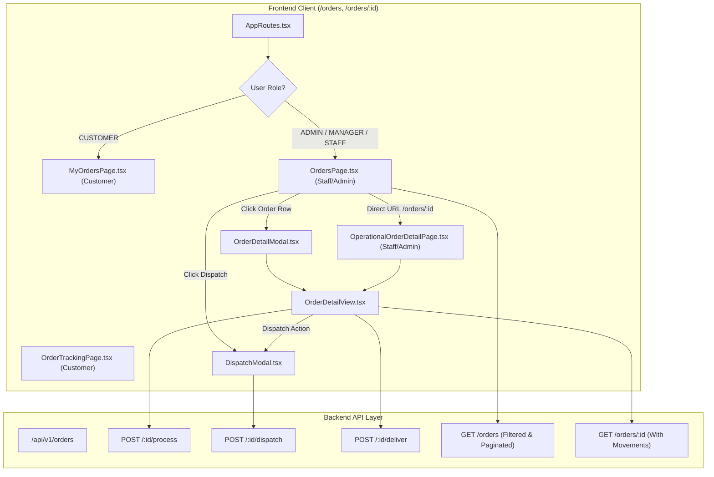

# StockFlow — Phase 2: Warehouse Operations & Order Management UI Report

**Date:** 2026-11-05  
**Author:** StockFlow Core Engineering  
**Scope:** Operational Orders Management Interface, Fulfilment State Transitions, Multi-Warehouse Allocation & Dispatch  
**Status:** Completed & Verified  

---

## 1. Executive Summary

Phase 2 builds a complete, production-grade operational Orders Management interface tailored for **Administrators**, **Warehouse Managers**, and **Warehouse Staff**, while strictly preserving the customer-facing shopping, cart, and self-service order tracking workflows.

The interface directly integrates with the corrected Phase 1 backend fulfilment lifecycle:
$$\text{CONFIRMED} \longrightarrow \text{PROCESSING} \longrightarrow \text{SHIPPED} \longrightarrow \text{DELIVERED}$$

All fulfilment actions trigger atomic backend state transitions, deterministic row locking (`SELECT ... FOR UPDATE`), physical stock deductions (`quantityOnHand`), reservation commitments, and immutable `DISPATCH` inventory movement records without client-side state duplication.

---

## 2. Architecture & Components Created



### Components and Pages Overview

| File Path | Component | Responsibility |
| :--- | :--- | :--- |
| `frontend/src/pages/OrdersPage.tsx` | `OrdersPage` | Full operational orders management table at `/orders`. Supports live search, status filtering, warehouse filtering, date range filtering, allocation tags, and inline lifecycle triggers. |
| `frontend/src/components/orders/OrderDetailView.tsx` | `OrderDetailView` | Comprehensive order details component showing lifecycle progress stepper, customer details, line items, multi-warehouse breakdowns, stock reservations, payment history, physical movement ledger, and state transition modals. |
| `frontend/src/components/orders/OrderDetailModal.tsx` | `OrderDetailModal` | Modal wrapper for `OrderDetailView`, allowing operators to inspect and triage orders directly from the table without full-page navigation. |
| `frontend/src/components/orders/DispatchModal.tsx` | `DispatchModal` | Dedicated dispatch confirmation dialog. Displays allocation facilities, each SKU and quantity, an irreversible physical stock deduction warning, carrier selection, and tracking number inputs. |
| `frontend/src/pages/OperationalOrderDetailPage.tsx` | `OperationalOrderDetailPage` | Dedicated operational page at `/orders/:id` for operators accessing direct links or bookmarked orders. |
| `frontend/src/routes/AppRoutes.tsx` | `OrdersRoute`, `OrderDetailRoute` | Role-aware route splitters ensuring Customers view `MyOrdersPage` and `OrderTrackingPage`, while Operators view `OrdersPage` and `OperationalOrderDetailPage`. |
| `frontend/src/types/orders.ts` | Type definitions | Extended with customer details (`user`), `InventoryMovementRecord`, `ListOrdersQueryParams`, and fulfilment action payloads. |
| `frontend/src/api/orders.ts` | API client | Added `fetchOrders`, `processOrder`, `dispatchOrder`, `deliverOrder`. |

---

## 3. Backend Enhancements (Smallest Necessary Addition)

To satisfy the contract requirements for operational order management without breaking existing functionality or weakening security:

### 1. Enhanced `listOrdersQuerySchema` & `listOrders`
- **Schema (`src/modules/orders/order.schemas.ts`):**
  Added optional query parameters: `search` (string), `warehouseId` (UUID), `startDate` (ISO string), `endDate` (ISO string).
- **Service (`src/modules/orders/order.service.ts`):**
  - **Search:** Case-insensitive search across `orderNumber`, `user.email`, `user.fullName`, and line-item product `name` / `sku`, or exact UUID match.
  - **Warehouse Filter:** Scoped filtering by `warehouseId` (for Staff/Manager, strictly intersects with assigned facilities).
  - **Date Range:** Filters `createdAt` between `startDate` and `endDate`.
  - **Payload Enrichment:** Includes `user: { id, email, fullName }`, `orderItems.product`, `orderItems.warehouse`, and `inventoryReservations`.

### 2. Enhanced `getOrderById`
- Enriched response with `user: { id, email, fullName }`, `orderItems.product`, `orderItems.warehouse`, `payments`, and `inventoryReservations`.
- Automatically retrieves and attaches `inventoryMovements` (`where: { referenceId: orderId }`), exposing immutable `DISPATCH` physical audit logs to the UI.

### 3. Flexible `deliverOrderSchema`
- Accepts `notes`, `deliveryNotes`, and `deliveredAt` timestamp.

---

## 4. Role-Based Behaviour & Permissions

```
+--------------------+------------------------------------+------------------------------------+
| Role               | Order Visibility Scope             | Fulfilment Action Authority        |
+--------------------+------------------------------------+------------------------------------+
| ADMIN              | Organization-wide (All facilities) | All facilities & state transitions |
| WAREHOUSE_MANAGER  | Facilities assigned in UserAssign  | Actions within assigned facilities |
| WAREHOUSE_STAFF    | Facilities assigned in UserAssign  | Actions within assigned facilities |
| CUSTOMER           | Strictly own placed orders         | None (Customer self-service only)  |
+--------------------+------------------------------------+------------------------------------+
```

1. **ADMIN:**
   - Full organization-wide visibility across all facilities and orders.
   - Authorized to transition any order through `process`, `dispatch`, and `deliver`.
2. **WAREHOUSE_MANAGER & WAREHOUSE_STAFF:**
   - Visibility restricted to orders containing items allocated to their assigned warehouses (`UserWarehouseAssignment`).
   - The warehouse dropdown filter only displays their accessible facilities.
   - For multi-warehouse orders spanning unassigned facilities, unauthorized dispatch is blocked both in the UI (warning badge) and on the backend (HTTP `403 Forbidden`).
3. **CUSTOMER:**
   - Preserves `MyOrdersPage` (`/orders`) and `OrderTrackingPage` (`/orders/:id`).
   - Cannot access internal operational orders or warehouse dispatch tools.
   - Attempts to access operational endpoints return HTTP `403 Forbidden`.

---

## 5. Multi-Warehouse Order Handling

Orders in StockFlow can allocate line items across multiple distinct warehouse facilities:

1. **Multi-Warehouse Allocation Tags:**
   The `/orders` table clearly displays allocations per warehouse using distinct pills (e.g. `WH-OPS-A (2)`, `WH-OPS-B (3)`) and flags multi-facility orders with a purple `Multi-WH` badge.
2. **Warehouse Breakdown Cards in Detail View:**
   Aggregates total allocated units, SKU count, warehouse code, and authorization status for every facility involved.
3. **Dispatch Confirmation Modal:**
   - Groups SKUs by warehouse facility.
   - Displays clear indicators if any facility is outside the operator's assignment.
   - Allows selecting specific warehouse dispatch or full-order dispatch.
   - Features prominent warning:
     > **⚠️ Irreversible Physical Stock Deduction:** Confirming this dispatch indicates that goods have been packed and handed over to transportation. The system will atomically decrement physical stock (`quantityOnHand`) and transition reserved stock to **COMMITTED**.

---

## 6. Testing & Verification Results

### 1. Warehouse Operations Integration Suite ([`tests/warehouse-operations.test.ts`](file:///Users/sankalp/Desktop/SDE_PRO_1/tests/warehouse-operations.test.ts))
**8 / 8 test cases passed (100% green)**:
- `GET /api/v1/orders` supports pagination, customer info, item details, and status filters.
- Search filter matches by order number, customer email, customer full name, and product SKU.
- Warehouse filtering returns only orders fulfilling from specified facility.
- Warehouse Staff and Managers only see orders fulfilling from their assigned facilities.
- Customer role cannot list internal operational orders and only sees own orders.
- Full operational lifecycle: Process $\to$ Dispatch (Physical Stock Deduction) $\to$ Deliver $\to$ Inspect Movement Ledger.
- Multi-warehouse order shows both facility allocations and prevents unauthorized staff dispatch.
- Status validation guards reject invalid lifecycle transitions (422 / 409).

### 2. Full Regression Suite Execution
- `tests/warehouse-operations.test.ts`: **8 / 8 passed**
- `tests/fulfilment-lifecycle.test.ts`: **14 / 14 passed**
- `tests/orders.test.ts`: **12 / 12 passed**
- `tests/payments.test.ts`: **3 / 3 passed**
- **Total:** **37 / 37 backend tests passed with zero regressions.**

### 3. Frontend Production Build & Type Checking
- `npx tsc --noEmit` (Backend): **0 errors (Clean exit 0)**
- `npm --prefix frontend run build` (Frontend): **0 errors, built in 1.84s**

---

## 7. Known Limitations & Future Enhancements

1. **Carrier API Integration:** Currently, carrier selection and tracking numbers are recorded as operational metadata without direct webhook tracking from third-party carrier APIs (e.g. FedEx / EasyPost).
2. **Batch / Bulk Dispatch:** Operators dispatch orders individually. In high-volume operations, a bulk-picking and dispatch wave workflow could be added in a future phase.
3. **Printed Packing Slips:** A printable PDF packing slip and warehouse pick-list generator can be introduced in subsequent iterations.

---

## 8. Summary of Compliance

- ✅ Existing customer order pages preserved (`MyOrdersPage`, `OrderTrackingPage`).
- ✅ Operational Orders placeholder replaced with full-featured `OrdersPage.tsx`.
- ✅ Real backend data, pagination, search, status, warehouse, and date filters implemented.
- ✅ Detailed order view with customer info, requested/allocated quantities, reservations, timeline, and movement ledger.
- ✅ Phase 1 APIs integrated (`/process`, `/dispatch`, `/deliver`) with confirmation dialogs.
- ✅ Multi-warehouse allocations properly represented and scoped.
- ✅ Role-based boundaries strictly enforced.
- ✅ Frontend build and backend type checks pass cleanly.
- ✅ Zero modifications or migrations applied to Neon database.

