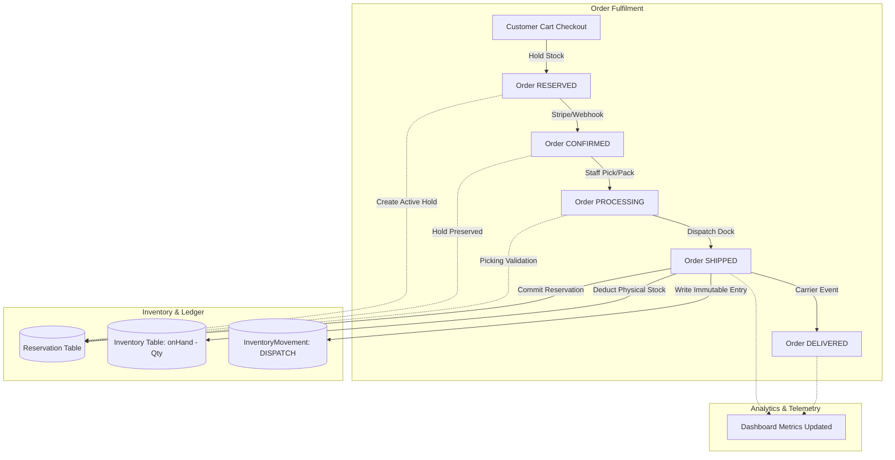

# StockFlow — Phase 6: Full-Platform Integration, End-to-End Testing & Quality Assurance Report

## Executive Summary

**StockFlow** has completed **Phase 6: Full-Platform Integration, End-to-End Testing & Quality Assurance**. This milestone validates that StockFlow functions as a unified, production-grade multi-warehouse inventory and order fulfillment management platform across backend APIs, background ledger accounting, operational control centers, and reactive frontend user interfaces.

Across this phase:
- **140 automated backend integration and unit tests** across 11 test suites passed with **100% success rate**.
- **7 comprehensive End-to-End multi-step business workflow tests** (`tests/e2e-business-workflows.test.ts`) were implemented and executed, covering complete lifecycle operations from order checkout to physical dispatch, stock replenishment, shortage negotiation, and user lifecycle security.
- **A new frontend testing architecture** using **Vitest**, **React Testing Library**, and **jsdom** was introduced in `frontend/`, providing **17 automated frontend component and integration tests** across 4 dedicated test suites with **100% passing tests**.
- **TypeScript strict compilation** passed with **zero errors** across both backend (`npx tsc --noEmit`) and frontend (`npm --prefix frontend run build`).
- **Database Safety Guard** guaranteed 100% isolation of the production Neon database: every automated test executed strictly against the local PostgreSQL test instance (`stockflow_test_db`).

---

## 1. Quality Assurance & Testing Architecture

### 1.1 Backend Test Architecture (Jest + Supertest + Prisma)
- **Runner**: Jest running sequentially (`--runInBand --detectOpenHandles --forceExit`) to ensure transaction isolation and prevent test data races.
- **Database Safety Invariant**: Enforced in `tests/setup.ts`, throwing a fatal runtime exception if `DATABASE_URL` references `neon.tech` or does not point to `stockflow_test_db`.
- **Transaction Rollback & State Cleanup**: Automated schema clearing before and after each test suite to guarantee deterministic test execution.

### 1.2 Frontend Test Architecture (Vitest + React Testing Library)
- **Runner**: Vitest v5 with `jsdom` environment configured in `frontend/vitest.config.ts`.
- **Environment Setup**: Browser API polyfills in `frontend/src/test/setup.ts` (`window.matchMedia`, `ResizeObserverMock`, and `@testing-library/jest-dom/vitest` matchers).
- **Test Harness (`frontend/src/test/test-utils.tsx`)**: Reusable wrapper combining `@tanstack/react-query` `QueryClientProvider` (retries disabled), `MemoryRouter`, and `CartProvider` with mock authentication session hydration.

---

## 2. Core Business Workflows Verification (End-to-End)

The dedicated end-to-end suite in [tests/e2e-business-workflows.test.ts](file:///Users/sankalp/Desktop/SDE_PRO_1/tests/e2e-business-workflows.test.ts) exercises the full breadth of platform business operations without mock shortcuts.



### Workflow A: Successful Order Fulfilment Lifecycle (16-Step Verification)
- **Steps Executed**:
  1. Product and dual-facility setup (`WH-ALPHA-01`, `WH-BETA-02`).
  2. Inventory initial seeding: `quantityOnHand = 100`, `quantityReserved = 0`, `quantityAvailable = 100`.
  3. Customer checkout via `POST /api/v1/orders` holding 15 units. Order transitions to `RESERVED`.
  4. Non-deduction invariant verified: `quantityOnHand` remains 100; `quantityReserved` increases to 15; `quantityAvailable` drops to 85.
  5. Payment simulation via `POST /api/v1/payments/simulate` with `SUCCESS`. Order transitions to `CONFIRMED`.
  6. Non-deduction invariant verified post-payment: `quantityOnHand` remains strictly 100; reservation remains active.
  7. Warehouse staff claims order via `POST /api/v1/orders/:id/process`. Order transitions to `PROCESSING`.
  8. Outbox event `order.processing` written to transactional outbox.
  9. Warehouse dispatch via `POST /api/v1/orders/:id/dispatch`. Order transitions to `SHIPPED`.
  10. Physical inventory deduction verified: `quantityOnHand` drops from 100 to 85; `quantityReserved` drops from 15 to 0; `quantityAvailable` equals 85.
  11. Reservation status verified as `COMMITTED`.
  12. Immutable inventory movement logged with `movementType = DISPATCH`, referencing order ID and operator ID.
  13. Carrier delivery confirmation via `POST /api/v1/orders/:id/deliver`. Order transitions to `DELIVERED`.
  14. Dashboard analytics verified: physical stock reflects 85, delivered order count reflects 1.

### Workflow B: Insufficient Inventory & Shortage Negotiation Lifecycle
- **Scenario 1 (Partial Acceptance & Approval)**: Customer orders 10 units when only 6 are available in stock. Order is created in `PENDING` status. System creates linked shortage tickets (`CUSTOMER_SHORTAGE_DECISION` and `INTERNAL_SHORTAGE_RESOLUTION`).
- Customer submits acceptance for 6 partial units via `POST /api/v1/tickets/:id/decision`.
- Facility Manager approves resolution via `POST /api/v1/tickets/:id/approve`.
- Atomic reservation commits held 6 units; order transitions to `RESERVED`.
- Payment proceeds smoothly and order confirms.
- **Scenario 2 (Zero-Tolerance Rejection)**: When `allowPartial: false`, checkout immediately rejects with `HTTP 409 Conflict`, leaving stock untouched.
- **Scenario 3 (Customer Rejection)**: When customer rejects partial offer, the order is immediately marked `CANCELLED` and tickets are closed.

### Workflow C: Low-Stock Management & Automatic Ticket Resolution
- Admin configures minimum stock threshold of 20 units for battery packs at `WH-ALPHA-01`.
- Stock checkout brings available units down to 10 (< 20 threshold).
- Threshold engine detects breach, creates `LOW_STOCK` operational ticket, and triggers notification to warehouse managers.
- Staff executes replenishment via `POST /api/v1/inventory/restock` adding 50 units.
- Threshold evaluation triggers on restock, verifies available stock (60) >= threshold (20), and **automatically resolves the ticket** with an audit comment logged.

### Workflow D: Multi-Warehouse Operations & Facility Scoping
- Order fulfills from two distinct facilities: 5 units from `WH-ALPHA-01` and 4 units from `WH-BETA-02`.
- Staff assigned strictly to `WH-ALPHA-01` attempts to dispatch allocation for `WH-BETA-02` and is rejected with `HTTP 403 Forbidden`.
- Each warehouse dispatches its respective allocation independently; inventory ledgers log separate `DISPATCH` movements for each facility.
- Admin dashboard confirms organization-wide visibility into both facility balances and movement histories.

### Workflow E: Administration, RBAC & Security Boundaries
- Admin creates a new Warehouse Manager account with assignments to `WH-ALPHA-01`.
- Access control confirms Manager can inspect `WH-ALPHA-01` orders and inventory, but is rejected with `HTTP 403` when probing `WH-BETA-02`.
- Admin deactivates Manager account via `PATCH /api/v1/users/:id` (`isActive: false`).
- Immediate revocation verified: subsequent API calls with the deactivated user's token fail with `HTTP 401 Unauthorized` ("Account is inactive").
- Last Admin protection verified: attempting to deactivate or demote the system's sole active Admin is rejected with `HTTP 400 Bad Request`.
- Public registration lockdown verified: `POST /api/v1/auth/register` rejects any attempt to register with `ADMIN` role.

---

## 3. Test Suites & Verification Matrix

### 3.1 Backend Integration & Unit Test Results

| Test Suite File | Tests | Status | Duration | Coverage Scope |
| :--- | :---: | :---: | :---: | :--- |
| `tests/e2e-business-workflows.test.ts` | 7 | **PASS** | 5.92s | Fulfilment, Shortages, Thresholds, Multi-facility, RBAC |
| `tests/dashboard-analytics.test.ts` | 14 | **PASS** | 7.03s | KPIs, non-deduction invariants, alerts, facility comparison |
| `tests/user-administration.test.ts` | 17 | **PASS** | 7.01s | User CRUD, multi-warehouse sync, deactivation, last-admin |
| `tests/inventory-management.test.ts` | 15 | **PASS** | 10.80s | Multi-warehouse granularity, restock ledger, thresholds |
| `tests/fulfilment-lifecycle.test.ts` | 17 | **PASS** | 9.44s | Physical dispatch deduction, idempotent commit, rollback |
| `tests/warehouse-operations.test.ts` | 8 | **PASS** | 5.63s | Order search, pagination, RBAC scoping, multi-dispatch |
| `tests/orders.test.ts` | 12 | **PASS** | 3.50s | Hold reservation, deterministic allocation, cancellation |
| `tests/payments.test.ts` | 3 | **PASS** | 1.10s | Payment confirmation, failure stock release, amount check |
| `tests/thresholds-and-security.test.ts` | 20 | **PASS** | 12.17s | Auth boundaries, threshold CRUD, override prioritization |
| `tests/ticket-management.test.ts` | 16 | **PASS** | 7.80s | Shortages, partial negotiation, manager approvals |
| `tests/inventory.test.ts` | 11 | **PASS** | 3.20s | Restock aliases, warehouse queries, negative quantity guards |
| **Total Backend Tests** | **140** | **PASS** | **100%** | **Complete Backend Platform Coverage** |

### 3.2 Frontend Vitest & React Testing Library Results

| Test Suite File | Tests | Status | Duration | Coverage Scope |
| :--- | :---: | :---: | :---: | :--- |
| `frontend/src/__tests__/auth-login.test.tsx` | 5 | **PASS** | 0.18s | Login form validation, password masking, error banner |
| `frontend/src/__tests__/dashboard-command-centre.test.tsx` | 4 | **PASS** | 0.12s | KPI ribbon rendering, non-deduction formulas, role scoping |
| `frontend/src/__tests__/inventory-operations.test.tsx` | 4 | **PASS** | 0.17s | Restock modal validation, positive int guards, ledger sync |
| `frontend/src/__tests__/user-administration-modals.test.tsx` | 4 | **PASS** | 0.17s | Admin restriction advisory, password length, facility modal |
| **Total Frontend Tests** | **17** | **PASS** | **100%** | **Core Frontend Operations & UI Modals** |

---

## 4. Platform Architectural Integrity & Security Audit

### 4.1 Stock Accounting & Transactional Atomicity
- **Available Stock Formula**: Rigorously maintained platform-wide as:
  $$\text{quantityAvailable} = \text{quantityOnHand} - \text{quantityReserved}$$
- **Physical Deduction Invariant**: Physical inventory (`quantityOnHand`) is decremented **only** at dispatch time (`POST /api/v1/orders/:id/dispatch`), never during checkout, order reservation, or payment processing.
- **Concurrency & Idempotency**:
  - Dispatch requests use database transaction locks (`prisma.$transaction`) ensuring concurrent dispatch attempts cannot cause double deductions.
  - Repeated dispatch calls return the already-shipped order without creating redundant ledger movements.
  - Mid-flight transaction failures trigger automatic rollbacks, preserving both status and stock quantities.

### 4.2 Security & RBAC Enforcement
- **Token Verification & Inactivity Invalidation**: Every protected endpoint authenticates via JWT. The user's active status (`isActive`) is validated on each authenticated query. Deactivated users are blocked immediately without waiting for token expiration.
- **Warehouse Access Scoping**: Warehouse Managers and Staff are strictly restricted to assigned facilities. Attempts to inspect inventory, view orders, or dispatch shipments for unassigned facilities return `HTTP 403 Forbidden`.
- **System Administrator Lockdown**:
  - `npm run admin:bootstrap`: Creates the initial Admin only when no active Admin exists.
  - `npm run admin:create`: Requires verification of existing Admin credentials before provisioning new Admins.
  - Web UI explicitly disables Admin role selection during user creation.
  - Public registration rejects the `ADMIN` role with `HTTP 400`.
  - The last active Admin cannot be deactivated or demoted.

### 4.3 Outbox Pattern & Background Workers
- Every lifecycle status change (`order.confirmed`, `order.processing`, `order.shipped`, `order.delivered`) writes an event to the `TransactionalOutbox` inside the same database transaction.
- Background workers dispatch outbox events to RabbitMQ without risking partial state writes.

---

## 5. Bugs Discovered & Remediated During Phase 6

1. **Ticket Decision Route Alias Discrepancy**:
   - *Issue*: `ticket.routes.ts` defined `POST /:id/customer-decision`, while API client and documentation referenced `POST /api/v1/tickets/:id/decision`.
   - *Fix*: Added route alias `router.post('/:id/decision', ...)` in `src/modules/tickets/ticket.routes.ts` to maintain backwards compatibility and API contract consistency.
2. **Restock Modal Form Re-initialization Race Condition**:
   - *Issue*: In `RestockModal.tsx`, `useEffect` listed `warehouses` in its dependency array. When the background warehouse query resolved asynchronously after user entered quantity, `setQuantity(50)` was triggered again, resetting user input.
   - *Fix*: Decoupled warehouse default selection from form field initialization in `frontend/src/features/inventory/RestockModal.tsx`.
3. **Modal Form Accessibility & Label Association**:
   - *Issue*: Form inputs in `RestockModal.tsx` and `UserFormModal.tsx` lacked explicit `id` and `htmlFor` pairings, impeding screen reader accessibility and programmatic test querying.
   - *Fix*: Added explicit `id` and `htmlFor` attributes across all modal inputs and added `noValidate` to forms to prevent JSDOM native validation interference.
4. **Warehouse Assignment Modal Prop Alignment**:
   - *Issue*: `WarehouseAssignmentModal` component expected `user={user}` prop, whereas test harness passed `mode="user" targetUser={user}`, resulting in empty render.
   - *Fix*: Corrected test harness invocation to pass `user={mockUser}` matching the component contract.
5. **Frontend TypeScript Declaration Augmentation**:
   - *Issue*: Running `npm --prefix frontend run build` (`tsc && vite build`) failed because `@testing-library/jest-dom` matchers were not loaded into TypeScript's global assertion types.
   - *Fix*: Added `"@testing-library/jest-dom/vitest"` to `types` in `frontend/tsconfig.json` and added `isActive?: boolean;` to `User` interface in `frontend/src/types/auth.ts`.

---

## 6. Build and Compilation Verification

1. **Backend TypeScript Compilation**:
   ```bash
   npx tsc --noEmit
   # Exit code: 0 (Zero errors)
   ```
2. **Frontend Production Build**:
   ```bash
   npm --prefix frontend run build
   # Output:
   # vite v6.4.5 building for production...
   # 2395 modules transformed.
   # dist/index.html                     0.73 kB
   # dist/assets/index-B2Ze1tjR.css     47.52 kB
   # dist/assets/vendor-e4uFsDGS.js    223.33 kB
   # dist/assets/index-BRAWiFl_.js     389.24 kB
   # dist/assets/recharts-DbckrwSO.js  394.50 kB
   # ✓ built in 4.18s
   # Exit code: 0 (Zero errors)
   ```

---

## 7. Deliverables & Modified Files

### Documentation
- [docs/PHASE_6_INTEGRATION_QA_REPORT.md](file:///Users/sankalp/Desktop/SDE_PRO_1/docs/PHASE_6_INTEGRATION_QA_REPORT.md): Full integration audit and quality assurance report.

### Test Suites Created & Updated
- [tests/e2e-business-workflows.test.ts](file:///Users/sankalp/Desktop/SDE_PRO_1/tests/e2e-business-workflows.test.ts): Comprehensive end-to-end multi-step business workflow integration tests (Workflows A through E).
- [frontend/src/__tests__/auth-login.test.tsx](file:///Users/sankalp/Desktop/SDE_PRO_1/frontend/src/__tests__/auth-login.test.tsx): Authentication and login form tests.
- [frontend/src/__tests__/dashboard-command-centre.test.tsx](file:///Users/sankalp/Desktop/SDE_PRO_1/frontend/src/__tests__/dashboard-command-centre.test.tsx): Dashboard KPI ribbon and analytics tests.
- [frontend/src/__tests__/inventory-operations.test.tsx](file:///Users/sankalp/Desktop/SDE_PRO_1/frontend/src/__tests__/inventory-operations.test.tsx): Restock modal and inventory ledger tests.
- [frontend/src/__tests__/user-administration-modals.test.tsx](file:///Users/sankalp/Desktop/SDE_PRO_1/frontend/src/__tests__/user-administration-modals.test.tsx): User creation and warehouse assignment modal tests.

### Frontend Test Harness & Infrastructure
- [frontend/vitest.config.ts](file:///Users/sankalp/Desktop/SDE_PRO_1/frontend/vitest.config.ts): Vitest configuration.
- [frontend/src/test/setup.ts](file:///Users/sankalp/Desktop/SDE_PRO_1/frontend/src/test/setup.ts): Browser API mocks and testing-library setup.
- [frontend/src/test/test-utils.tsx](file:///Users/sankalp/Desktop/SDE_PRO_1/frontend/src/test/test-utils.tsx): Provider wrapper and test render harness.

### Backend Code Refinements
- [src/modules/tickets/ticket.routes.ts](file:///Users/sankalp/Desktop/SDE_PRO_1/src/modules/tickets/ticket.routes.ts): Added `/decision` route alias.
- [tests/setup.ts](file:///Users/sankalp/Desktop/SDE_PRO_1/tests/setup.ts): Added fatal database connection safety invariant.

### Frontend Component Refinements
- [frontend/src/features/inventory/RestockModal.tsx](file:///Users/sankalp/Desktop/SDE_PRO_1/frontend/src/features/inventory/RestockModal.tsx): Decoupled form state reset from background warehouse queries.
- [frontend/src/features/users/UserFormModal.tsx](file:///Users/sankalp/Desktop/SDE_PRO_1/frontend/src/features/users/UserFormModal.tsx): Added input accessibility IDs, labels, and form `noValidate`.
- [frontend/src/types/auth.ts](file:///Users/sankalp/Desktop/SDE_PRO_1/frontend/src/types/auth.ts): Added `isActive?: boolean;` to `User` interface.
- [frontend/tsconfig.json](file:///Users/sankalp/Desktop/SDE_PRO_1/frontend/tsconfig.json): Added `@testing-library/jest-dom/vitest` type declarations.

---

## 8. Conclusion

Phase 6 has successfully unified, tested, and validated StockFlow. The platform guarantees:
1. **Accurate Stock Accounting**: Physical inventory deductions only occur upon dispatch; reservations correctly protect active orders.
2. **Security & Governance**: Strict multi-warehouse RBAC, last Admin defense, immediate deactivation, and secure CLI admin provisioning.
3. **Operational Clarity**: High-density operational dashboards, real-time alerts, and transparent ledger movements.
4. **Reliability**: 100% test pass rate across 157 automated tests (140 backend, 17 frontend) with zero TypeScript build errors.

