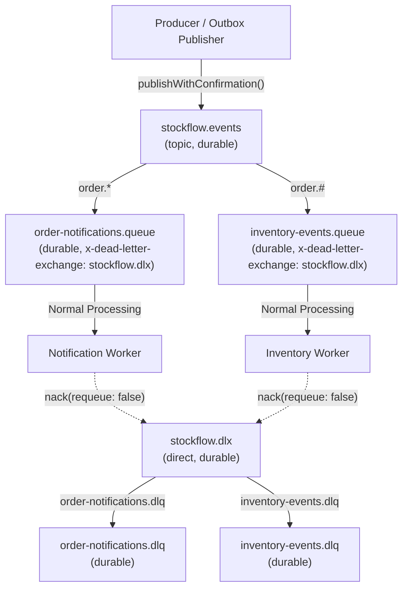

# StockFlow — RabbitMQ Configuration & Topology Specification

## 1. Broker Topology Design

StockFlow configures a production-grade RabbitMQ topology utilizing durable topic exchanges, dedicated persistent queues, and a Dead-Letter Exchange (DLX) architecture.



---

## 2. Exchanges & Queues Specification

### Exchanges

| Name | Type | Durable | Purpose |
|---|---|---|---|
| `stockflow.events` | `topic` | `true` | Main message exchange for all business domain events. |
| `stockflow.dlx` | `direct` | `true` | Dead-Letter Exchange for routing permanently failed or unprocessable messages. |

### Queues

| Queue Name | Durable | Routing Key Binding | Dead-Letter Arguments | Purpose |
|---|---|---|---|---|
| `order-notifications.queue` | `true` | `order.*` | `x-dead-letter-exchange: 'stockflow.dlx'`<br>`x-dead-letter-routing-key: 'order-notifications.dlq'` | Consumed by NotificationWorker for asynchronous email/SMS notifications. |
| `inventory-events.queue` | `true` | `order.#` | `x-dead-letter-exchange: 'stockflow.dlx'`<br>`x-dead-letter-routing-key: 'inventory-events.dlq'` | Consumed by InventoryWorker for ledger reconciliation and downstream metrics. |
| `order-notifications.dlq` | `true` | `order-notifications.dlq` (bound to `stockflow.dlx`) | None | Stores poisoned notification messages for engineering triage. |
| `inventory-events.dlq` | `true` | `inventory-events.dlq` (bound to `stockflow.dlx`) | None | Stores poisoned inventory messages for engineering triage. |

---

## 3. Local Development with Docker Compose

RabbitMQ with the Web Management Console is containerized via `docker-compose.yml`:

```bash
# Start RabbitMQ in the background
docker compose up -d

# Check container health and status
docker compose ps

# Stop RabbitMQ container
docker compose down
```

### Accessing the Web Management Console:
- **URL**: `http://localhost:15672`
- **Username**: `guest` (or `${RABBITMQ_USER}`)
- **Password**: `guest` (or `${RABBITMQ_PASSWORD}`)
- **AMQP Protocol Port**: `5672`

---

## 4. Connection Lifecycle & Reconnection Logic

The RabbitMQ client (`src/infra/rabbitmq/rabbitmq.client.ts`) implements enterprise lifecycle controls:

1. **Automatic Topology Initialization**: On initial connection, exchanges, queues, DLQs, and topic bindings are declared idempotently.
2. **Channel Model & Confirm Channels**: Maintains a standard `Channel` for consumption and a `ConfirmChannel` for reliable publishing.
3. **Exponential Backoff Reconnection**:
   - Initial retry delay: 2,000 ms.
   - Doubles on subsequent failures up to a cap of 30,000 ms.
   - Re-asserts topology upon re-establishing broker connection.
4. **Graceful Shutdown**:
   - Listens to `SIGINT` and `SIGTERM`.
   - Halts worker consumers via `channel.cancel()`.
   - Closes open channels and connection cleanly before terminating the Node.js process.

---

## 5. Message Persistence Guarantees

Every message published by StockFlow enforces:
- `persistent: true` (`deliveryMode: 2`): Written to disk on the broker before confirmation.
- `contentType: 'application/json'`.
- `timestamp`: Millisecond Unix timestamp of publishing.
- Headers carrying tracing metadata: `x-event-id`, `x-aggregate-type`, `x-aggregate-id`, `x-retry-count`.

