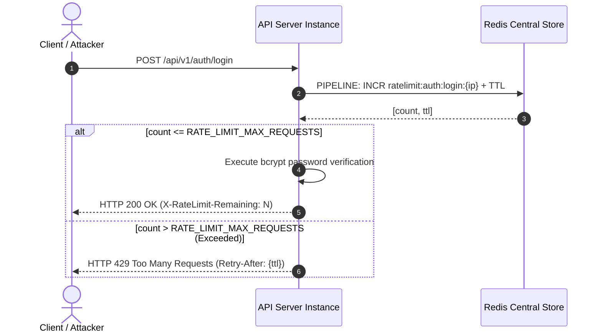

# StockFlow — Redis-Backed Distributed Rate Limiting

## 1. Overview & Threat Model

Authentication endpoints (`/api/v1/auth/login` and `/api/v1/auth/register`) are prime vectors for distributed brute-force, credential stuffing, and volumetric denial-of-service (DoS) attacks. Because password verification relies on computational hashing (`bcrypt` with 10 salt rounds), unprotected authentication endpoints easily exhaust CPU capacity.

To mitigate this without constraining horizontally scaled instances, StockFlow implements **Distributed Sliding-Window Rate Limiting** using **Redis**:
1. All API instances share the exact same rate-limiting counters in Redis.
2. In-memory counters are evaluated atomically via Redis pipelines.
3. Limits are strictly scoped to sensitive authentication routes (`/login` and `/register`), avoiding unnecessary latency overhead on general read endpoints.

---

## 2. Distributed Rate Limiting Mechanism



---

## 3. Configuration & Environment Variables

| Variable | Default Value | Description |
|---|---|---|
| `RATE_LIMIT_WINDOW_MS` | `60000` (60 seconds) | Duration of the rate-limit evaluation window in milliseconds. |
| `RATE_LIMIT_MAX_REQUESTS` | `10` | Maximum number of allowed requests per IP address within the window. |

---

## 4. Standard HTTP 429 Response & Headers

When an IP address exceeds the threshold, the middleware halts processing before any database or hashing operations execute, returning:

### HTTP Response Headers
- `X-RateLimit-Limit`: Maximum requests permitted per window.
- `X-RateLimit-Remaining`: Remaining requests allowed in the current window.
- `X-RateLimit-Reset`: Unix timestamp (seconds) when the quota resets.
- `Retry-After`: Seconds the client must wait before making another request.

### Response Body
```json
{
  "success": false,
  "error": {
    "code": "TOO_MANY_REQUESTS",
    "message": "Too many login attempts from this IP. Please try again after 45 seconds.",
    "details": {
      "limit": 10,
      "windowMs": 60000,
      "retryAfterSeconds": 45
    }
  },
  "meta": {
    "timestamp": "2026-11-01T17:40:00.000Z"
  }
}
```

---

## 5. Resilience & Fail-Open Fallback

If Redis experiences a network partition, restart, or fatal outage:
- The rate limiter logs a non-fatal warning: `[RateLimiter] Error evaluating rate limit for {ip}. Failing open.`
- The middleware calls `next()`, allowing legitimate user authentication to continue unimpeded.
- The core business availability of the application is never compromised by secondary security tooling failures.

