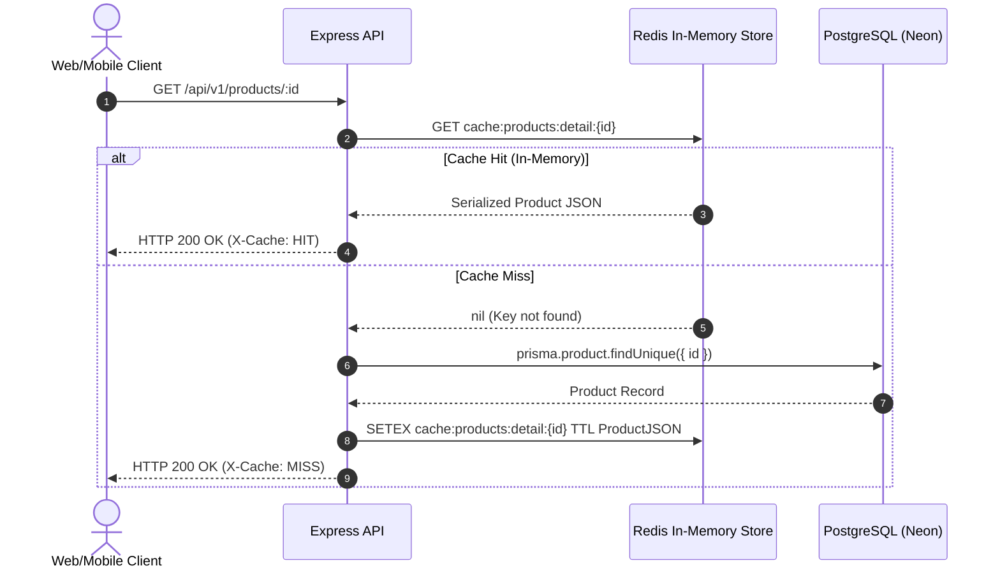

# StockFlow — Redis In-Memory Caching Architecture

## 1. Overview & Strategy

In high-throughput e-commerce systems, database read bottlenecks degrade checkout performance. Frequently queried resources—specifically catalog listings and product details—exhibit high read-to-write ratios ($> 100:1$). 

StockFlow implements a distributed **Cache-Aside (Lazy-Loading)** architecture backed by **Redis 7**:
1. **Cache Read First**: On incoming product queries, the application checks Redis using deterministic cache keys.
2. **Database Fallback on Miss**: If the item is missing, the application queries PostgreSQL via Prisma, caches the serialized result in Redis with an expiration TTL, and returns the response.
3. **Proactive Invalidation on Mutation**: When an administrator creates, updates, or deletes a product, all associated cache entries are invalidated immediately to guarantee data freshness and eliminate stale reads.

> [!IMPORTANT]
> **Strict Consistency Exclusions**: Consistent with financial integrity principles, **inventory availability balances** (`on_hand - reserved`) and **order reservation states** are strictly excluded from Redis caching. Real-time inventory allocation relies on row-level database locking (`SELECT ... FOR UPDATE`) in PostgreSQL to guarantee zero overselling.

---

## 2. Cache-Aside Lifecycle Flow



---

## 3. Cache Key Taxonomy

All cache keys use strict, namespaced identifiers to prevent collision:

| Resource | Key Format | Example | TTL |
|---|---|---|---|
| **Product Detail** | `cache:products:detail:{id}` | `cache:products:detail:f47ac10b-58cc-4372-a567-0e02b2c3d479` | `CACHE_TTL` (Default: 60s) |
| **Product Listing** | `cache:products:list:page={p}:limit={l}:search={s}:active={a}` | `cache:products:list:page=1:limit=20:search=:active=true` | `CACHE_TTL` (Default: 60s) |

---

## 4. Cache Invalidation Matrix

To prevent serving stale data to consumers, cache entries are invalidated immediately across all mutation operations:

| Mutation Operation | Trigger Method | Invalidated Keys | Mechanism |
|---|---|---|---|
| **Create Product** | `POST /api/v1/products` | All list queries (`cache:products:list:*`) | Non-blocking `SCAN` + `DEL` pipeline |
| **Update Product** | `PUT / PATCH /api/v1/products/:id` | Specific detail (`cache:products:detail:{id}`) & all lists | `DEL detail` + `SCAN/DEL lists` |
| **Delete Product** | `DELETE /api/v1/products/:id` | Specific detail (`cache:products:detail:{id}`) & all lists | `DEL detail` + `SCAN/DEL lists` |

```mermaid
flowchart TD
    Admin["Admin User"] -->|"PUT /api/v1/products/:id"| API["Product Service"]
    API -->|"1. Commit Update"| DB[("PostgreSQL")]
    API -->|"2. DEL detail key"| R1[("Redis: cache:products:detail:{id}")]
    API -->|"3. SCAN & DEL list keys"| R2[("Redis: cache:products:list:*")]
    API -->>|"4. HTTP 200"| Admin
    
    Customer["Customer Request"] -->|"GET /api/v1/products/:id"| API2["Product Service"]
    API2 -->|"Cache Miss"| R1
    API2 -->|"Fetch Fresh Data"| DB
```

### Non-Blocking Cache Eviction (`SCAN` vs `KEYS *`)
StockFlow's `delByPattern` utility strictly avoids the Redis `KEYS *` command, which blocks the single-threaded Redis event loop during pattern matching. Instead, it utilizes cursor-based `SCAN` iterating 100 keys per chunk:
```ts
let cursor = '0';
do {
  const [nextCursor, keys] = await client.scan(cursor, 'MATCH', pattern, 'COUNT', 100);
  cursor = nextCursor;
  if (keys.length > 0) {
    await client.del(...keys);
  }
} while (cursor !== '0');
```

---

## 5. Fail-Open Fault Tolerance & High Availability

In distributed production architectures, transient cache outages must never bring down the primary application:
1. **Lazy Initialization**: If Redis is offline at boot time, the API starts normally and logs a warning.
2. **Fail-Open Strategy**: If a Redis command (`GET`, `SET`, `DEL`) fails or times out, the error is caught and logged as a warning; the application transparently falls back to querying PostgreSQL.
3. **No Request Buffering**: `enableOfflineQueue: false` ensures that requests do not hang in memory waiting for a disconnected Redis instance to recover.
4. **Fast Timeout**: `maxRetriesPerRequest: 1` prevents thread pool starvation.

